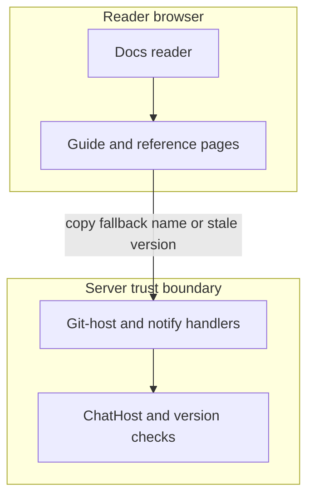

## Context

October review items 1 to 7 are doc gaps in git-host, notification, and step-up docs. Main already has ChatHost validation and the registration version handling; only the docs state them wrongly or not at all.

## Decisions

1. **Docs-only fix boundary.** Edit only the guides, reference pages, and RFC clarifications listed in what_changes. Do not change handlers, ports, limits, or any accepted ADR. Verify each stated behavior on main before writing.

## Structure

No code structure changes. No new type or constructor. Docs state what handlers and ChatHost already do.

## Risks

- Doc states behavior main does not have; each task checks the claim against main first.

## Layers (defense in depth)

| Layer | Guard | Hostile test |
| --- | --- | --- |
| boundary check | Reference states the exact 404 absent, 412 mismatch, and success cases so callers retry with the current version. | Read the reference and attempt PUT with a stale version; the text must predict 412 and not 404. |
| fail closed | Reference states chat URLs must pass send-time ChatHost validation and a rejected URL gets no delivery. | Configure a chat sink with a rejected host and check the test route; the text must predict no delivery. |

## Quality attributes

| Attribute | Target | Unit | Scope |
| --- | --- | --- | --- |
| none affected | Docs-only change with no runtime path |  |  |

## Threat model

Data flow and trust boundaries:

| Boundary | STRIDE | Threat | Layer | Guard | Hostile test |
| --- | --- | --- | --- | --- | --- |
| Reader browser to Server | I | A reader trusts a stale doc and pastes a fallback name with hidden spaces, retries a stale registration version, or expects chat delivery to a rejected host. | boundary check | Reference states 404 for absent registration and 412 for version mismatch so stale clients re-read before retry. | Submit PUT with stale If-Match and confirm the docs predict 412, not silent overwrite. |
| Reader browser to Server | I | A reader trusts a stale doc and pastes a fallback name with hidden spaces, retries a stale registration version, or expects chat delivery to a rejected host. | encode or contain | Reference warns fallback names may hold zero-width spaces and must not be pasted as clean names. | Copy fallback text and show the hidden spaces fail a strict name match as documented. |
| Reader browser to Server | I | A reader trusts a stale doc and pastes a fallback name with hidden spaces, retries a stale registration version, or expects chat delivery to a rejected host. | limit | JWT budget gap note names the refusal effect and who sees it so callers back off instead of retrying without bound. | Exceed the per-installation budget in a test and confirm the documented refusal appears. |
| Reader browser to Server | I | A reader trusts a stale doc and pastes a fallback name with hidden spaces, retries a stale registration version, or expects chat delivery to a rejected host. | authorize at point of use | Chat delivery note requires send-time ChatHost validation at the point of use regardless of hostNeedsUpdate. | Configure a rejected chat host with hostNeedsUpdate set and confirm the test route refuses delivery. |
| Reader browser to Server | I | A reader trusts a stale doc and pastes a fallback name with hidden spaces, retries a stale registration version, or expects chat delivery to a rejected host. | fail closed | On any unknown version or host value the docs direct the reader to re-read and re-check; no delivery or overwrite proceeds. | Send an unknown registration version and confirm the documented 404 or 412 path with no state change. |
