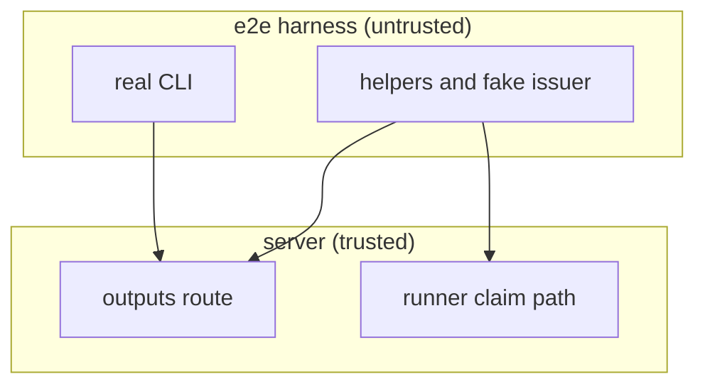

## Context

October review issue 2709 items 1-5 add missing e2e coverage only. No server change. Item 1 covers reduced deployments with and without features. Items 2 and 3 are one paging scenario. Item 4 covers real runner-phase job tokens on both stores. Item 5 covers empty-secret guards.

## Decisions

1. **E2e-only fix boundary.** Add assertions only in e2e files. Keep server, API description and store unchanged. Paging uses 5 stacks in the current project plus 2 stacks in another project, with the existing harness paging config forcing more than one page. The run freezes stack create and delete.
2. **Job token and empty-secret method.** Job-token scenarios use the existing e2e runner harness claim path with its runner credential to get a job token, then read with an access token. The e2e runner holds a stored grant for ActionRunnerClaim on the pool, following runner-protocol-renew-fence-namespace. The empty-secret regression injects a fake token-issuer function into the helper that returns success with an empty or missing secret, and the helper returns an error before any request.

## Structure

No new type. E2e helpers fail closed on an empty token secret before any request, by early return with an error.

## Risks

- Job-token matrix is slow and depends on the tool version.
- A failed run fails without retry so flakiness stays visible.
- A hung runner claim or leftover claim and token after a failed run blocks later runs; the harness claim timeout and cleanup remove them.

## Layers (defense in depth)

| Layer | Guard | Hostile test |
| --- | --- | --- |
| boundary check | Helper checks secret is non-empty before any request and returns an error naming the helper. | Inject issuer returning empty secret and assert no request leaves the helper. |
| encode or contain | Secret travels only as an access-token credential on the outputs route, never in logs. | Run helper with empty secret and assert no wire request and no log line holds a secret. |
| limit | Runner claim uses the harness claim timeout so a hung claim ends and cleans up. | Block claim answer and assert the harness times out and releases the claim. |
| authorize at point of use | Outputs route checks the access token grant at point of use for allow, deny, and operator positive control. | Read cross-unit outputs with reader, denied reader, and operator tokens and assert allow and deny match the rule. |
| fail closed | Empty or missing secret fails closed before use; intentional administrator calls with valid secrets still send their credential. | Return success with missing secret and assert the helper errors before use. |

## Quality attributes

| Attribute | Target | Unit | Scope |
| --- | --- | --- | --- |
| none affected | e2e-only assertions; no latency, storage, rate-limit, or timeout target changes |  |  |

## Threat model

Data flow and trust boundaries:

| Boundary | STRIDE | Threat | Layer | Guard | Hostile test |
| --- | --- | --- | --- | --- | --- |
| e2e helper to server outputs route | I | Helper uses an empty or attacker-shaped token secret to call cross-unit outputs. | boundary check | Helper rejects empty or missing token secret before any request. | Inject empty secret and assert no request leaves the helper. |
| e2e helper to server outputs route | I | Helper uses an empty or attacker-shaped token secret to call cross-unit outputs. | encode or contain | Secret travels only as an access-token credential and never in logs. | Run with valid and empty secrets and assert logs hold no secret. |
| e2e helper to server outputs route | I | Helper uses an empty or attacker-shaped token secret to call cross-unit outputs. | limit | Harness claim timeout bounds token issue and request size limits bound outputs reads. | Hang the claim and assert the timeout ends it; send an oversize read and assert refusal. |
| e2e helper to server outputs route | I | Helper uses an empty or attacker-shaped token secret to call cross-unit outputs. | authorize at point of use | Outputs route checks the access-token grant at point of use for reader, denied reader, and operator. | Read with allow, deny, and operator tokens and assert the allow and deny match the rule. |
| e2e helper to server outputs route | I | Helper uses an empty or attacker-shaped token secret to call cross-unit outputs. | fail closed | Empty secret fails closed before use with an error naming the helper. | Return success with missing secret and assert the helper errors before use. |
| runner claim path to job token use | E | Runner claim mints a job token outside its phase and reads outputs it must not read. | boundary check | Claim path checks the runner credential before issuing a job token. | Claim with a bad runner credential and assert refusal with no token. |
| runner claim path to job token use | E | Runner claim mints a job token outside its phase and reads outputs it must not read. | encode or contain | Job token travels only as an access-token credential scoped to the claimed phase. | Replay the token on another unit and assert denial. |
| runner claim path to job token use | E | Runner claim mints a job token outside its phase and reads outputs it must not read. | limit | Claim timeout and single-use token bound replay and hang time. | Hang the claim and assert timeout; reuse a consumed token and assert refusal. |
| runner claim path to job token use | E | Runner claim mints a job token outside its phase and reads outputs it must not read. | authorize at point of use | Outputs route rechecks the job token grant at point of use for allow, deny, and operator control. | Read allowed, denied, and operator outputs with the job token and assert the rule result. |
| runner claim path to job token use | E | Runner claim mints a job token outside its phase and reads outputs it must not read. | fail closed | Bad proof or expired claim fails closed with no token and cleanup revokes leftovers. | Send a bad proof and assert refusal and no usable token remains. |

## Failure modes

| Step | Failure | Retry | State after |
| --- | --- | --- | --- |
| Obtain job token through runner-harness claim | Runner claim hangs with no answer | Harness claim timeout fires once, releases the claim, and fails the scenario with no retry in the run | Claim released, no job token kept, scenario marked failed for a rerun from a clean state. |
| Run reduced-document and allow and deny matrix for one tool version | Job phase fails after the claim | No retry in the run; cleanup revokes the job token and removes the claim | Token revoked, claim removed, reduced-document and allow and deny assertions absent for that version. |
