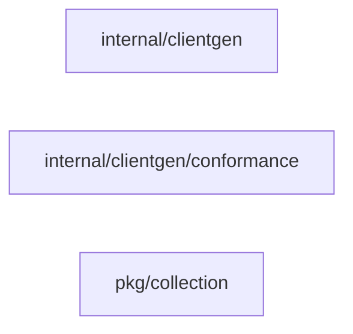

## Context

Follow-up hardening of the generated API clients and the client generator conformance harness. No wire change. No new route.

## Decisions

1. **Fix in place, no new tool.** Fix each review item in place inside internal/clientgen and internal/clientgen/conformance. Close terminates descendants by process-group signal: SIGTERM then SIGKILL after 5 seconds per group, with PGID reuse check after reaping. Linux harness-death cleanup uses Pdeathsig with LockOSThread on the spawning thread, and is a no-op on macOS and Windows. Seed reuse allows conflict only when stored content matches byte for byte and ETag re-read succeeds. The shared TypeScript name registry claims decode identifiers through its existing claim path and returns its own invalid-name error before rendering.

## Structure

Unexported helpers in internal/clientgen/conformance for connection header filtering, process cleanup, and seed reuse, each built by a small constructor that checks its invariants. The shared TypeScript name registry claims decode identifiers through its existing claim path.

## Risks

- Scope creep into tool-neutral API behavior. Guard by keeping no wire change and no route change.
- Flaky subprocess tests on hosted runners. Guard by deterministic shutdown and Linux-only cleanup.

## Diagrams

Modules that the change touches, and their imports on main:

## Quality attributes

| Attribute | Target | Unit | Scope |
| --- | --- | --- | --- |
| none affected | No user request path changes; harness and generator only |  |  |
