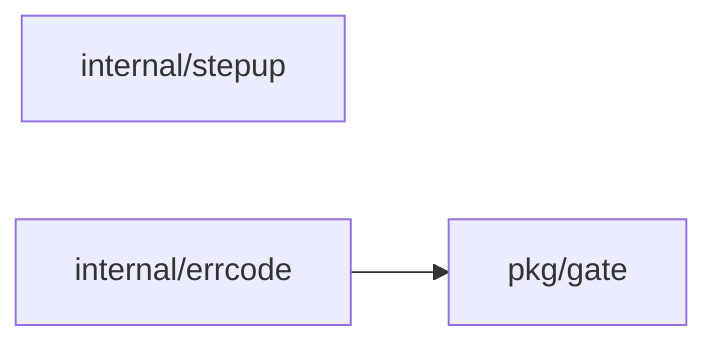
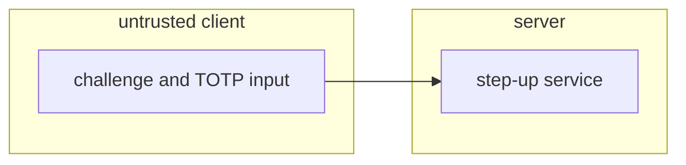

## Context

Contract and test follow-ups in internal/stepup, internal/errcode, and pkg/gate. No route, schema, or error-code change.

## Decisions

1. **One audit writer per refusal.** The service audits ErrNotFound, ErrExpired, and ErrUsed. The store audits ErrMismatch and ErrFactorRefused. No refusal is audited twice. RecordFailure itself appends no entry; the service layer appends the single entry for the three lookup-state errors.
2. **Reservation lifetime.** BeginTOTPAttempt stores a reservation that lives 300 seconds. AcceptStep validates and consumes it in the same transaction as the factor change. Expiry and crash before consume fail closed with no factor change.

## Structure

Only the constructor of the step-up service in internal/stepup makes a reservation value, and the store consumes it in the same transaction as the factor change.

## Risks

- Duplicate audit entries for one refusal.
- A partial reset on a transaction failure.

## Layers (defense in depth)

| Layer | Guard | Hostile test |
| --- | --- | --- |
| boundary check | Allowlist of holder kinds session and access-token in CreateChallenge. | CreateChallenge with empty and unknown kinds stores nothing. |
| fail closed | The store consumes a TOTP reservation and a key-add challenge atomically with the factor change. | Replay a reservation and reuse a key-add challenge after revocation. |

## Diagrams

Modules that the change touches, and their imports on main:

States on main in the touched packages:

## Quality attributes

| Attribute | Target | Unit | Scope |
| --- | --- | --- | --- |
| none affected | Contract and test follow-ups; no latency or storage change. |  |  |

## Threat model

Data flow and trust boundaries:

| Boundary | STRIDE | Threat | Layer | Guard | Hostile test |
| --- | --- | --- | --- | --- | --- |
| untrusted client to server | S | A replayed or made-up reservation or challenge gains a fresh authentication. | boundary check | Allowlist of holder kinds session and access-token. | CreateChallenge with an empty and an unknown kind. |
| untrusted client to server | S | A replayed or made-up reservation or challenge gains a fresh authentication. | encode or contain | The store validates the reservation and the challenge owner. | AcceptStep with a made-up reservation and AddKey with the challenge of another person. |
| untrusted client to server | S | A replayed or made-up reservation or challenge gains a fresh authentication. | limit | The reservation lives 300 seconds. | AcceptStep after expiry. |
| untrusted client to server | S | A replayed or made-up reservation or challenge gains a fresh authentication. | authorize at point of use | The challenge belongs to the person at the point of use. | AddKey with the challenge of another person. |
| untrusted client to server | S | A replayed or made-up reservation or challenge gains a fresh authentication. | fail closed | An unknown or consumed state refuses with no factor change. | Reuse a consumed challenge and a consumed reservation. |

## Contracts

**step-up challenge**

- Invariant: One challenge is answered at most once.
- Invariant: One refusal appends exactly one audit entry.
- `CreateChallenge`: pre: A holder kind is given.. Post: An empty or unsupported holder kind returns ErrInvalid and stores no challenge..
- `RecordFailure`: pre: A challenge identifier is given.. Post: A missing challenge returns ErrNotFound, an expired challenge returns ErrExpired, and a non-open challenge returns ErrUsed, with no count change and no audit append by RecordFailure itself..
- `AddKey`: pre: A key-add challenge is open for the person.. Post: The key-add challenge is marked answered in the same transaction as the key insert..
- `AcceptStep`: pre: A store-recorded TOTP reservation exists.. Post: A fabricated, reused, or expired reservation is refused with no factor change..
