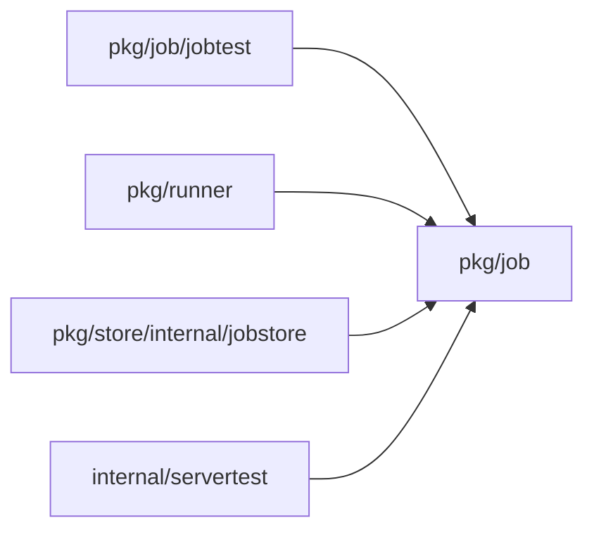
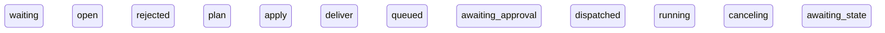

## Context

Seven non-blocking review items at named sites in pkg/job, pkg/runner, pkg/store/internal/jobstore and pkg/durable/durabletest/durabletest.go. This change does not touch internal/servertest/roundtrips_test.go, internal/servertest/roundtrips_model_test.go or internal/servertest/roundtrips_conflict_test.go.

## Decisions

1. **Local fixes with confirmation read.** Fix each item at the site named in the issue with no shared helper and no new package. Confirm a missing namespace with a second read before ending the operation. Keep transient failures retryable. Enforce the plan-part rule on the job and jobstore write and restore paths. Scope drift steps by unit tool. Reuse the namespace ID only within one claim. Keep the shared expiryWait timeout unchanged.

## Structure

No new unexported type. The fix boundary is the named functions in pkg/job/claimer.go, pkg/job/service_start.go, pkg/job/recorder.go, pkg/job/record.go, pkg/store/internal/jobstore/record.go, pkg/job/driftsteps.go, pkg/runner/executor.go and the test help file pkg/durable/durabletest/durabletest.go. Constructors stay unchanged.

## Risks

- A claimer change can mistake a transient fence failure for a permanent one and drop work.
- A plan validation change can reject the restore of an old body.

## Diagrams

Modules that the change touches, and their imports on main:

States on main in the touched packages:

## Quality attributes

| Attribute | Target | Unit | Scope |
| --- | --- | --- | --- |
| none affected | Review follow-ups only; no latency, storage or rate target changes |  |  |

## Contracts

**Job**

- Invariant: A claim belongs to one namespace and never mixes namespace IDs across chunk stores in that claim.
- Invariant: A stored plan part with Kind OutputPlanApply holds Secret true and any other part holds Secret false.
- `PutPlan`: pre: A plan body is given to PutPlan.. Post: PutPlan refuses a body where an apply part holds Secret false or a display part holds Secret true..
- `CheckPlanBody`: pre: A stored body or a reservation is given to CheckPlanBody.. Post: CheckPlanBody refuses a body that breaks the Secret rule and accepts a valid reservation without parts.; CheckPlanBody refuses an old stored body that breaks the Secret rule; recovery is a new plan..

**DriftSteps**

- Invariant: Drift validation selects the allowlist from the unit tool of the validated spec.
- `ValidateDriftSteps`: pre: A unit tool string and a drift step list are given to ValidateDriftSteps.. Post: ValidateDriftSteps accepts only plan-only steps of the given unit tool and rejects empty, mixed-tool, other-tool and unsupported-tool inputs..

## Failure modes

| Step | Failure | Retry | State after |
| --- | --- | --- | --- |
| Claim reads namespace fence | Namespace read fails transiently | Keep the operation queued and retry on the next poll | Operation stays pending |
| Claim confirms a missing report | One read reports missing during replica lag or restore | Second read before any terminal step; a disagreement is transient | Operation stays pending |
| Claim ends a confirmed missing-namespace operation | Namespace is confirmed missing | No retry; end once and write the disposition record | Operation ended; valid work stays claimable; a later namespace create does not revive the ended operation |
| Cancel during expiry | Extend races cancel after a resource-changing step began | No retry of the canceled operation | Durable operation ends canceled and the job fails |
