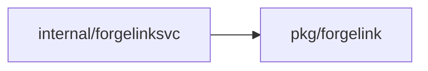

## Context

Docs and file rows of the review follow-ups. Each row is checked on main and skipped when present.

## Decisions

1. **Verify first.** Run the named rg command for each row. Edit only when the line is missing. Record added or skipped rows in the pull request.
2. **Prose and one guard.** Guide rows are prose only. The bench script gets one check that exits non-zero on an empty version. No new tool.

## Structure

No type is added. The change edits prose, one shell script and one test table.

## Risks

- A row may already be fixed on main, so verify-first skips it.

## Diagrams

Modules that the change touches, and their imports on main:

## Quality attributes

| Attribute | Target | Unit | Scope |
| --- | --- | --- | --- |
| none affected | Docs, one script check and one test case; no runtime change |  |  |
