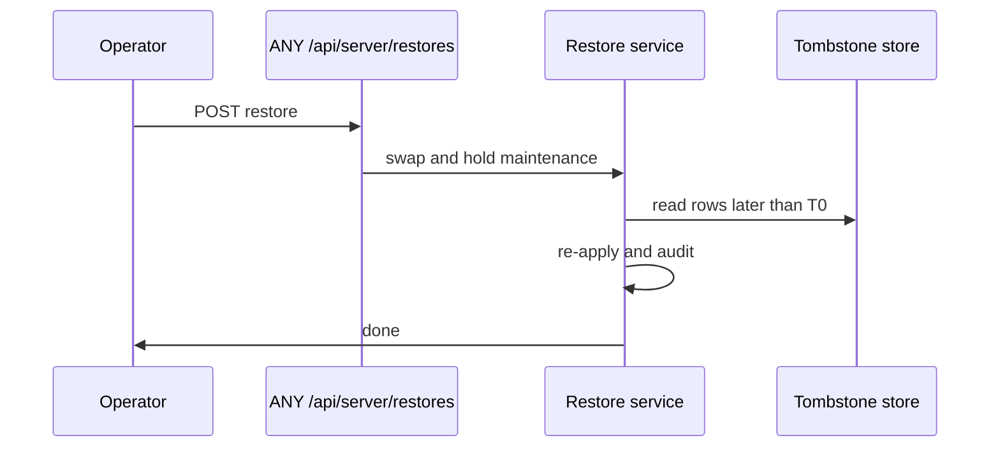
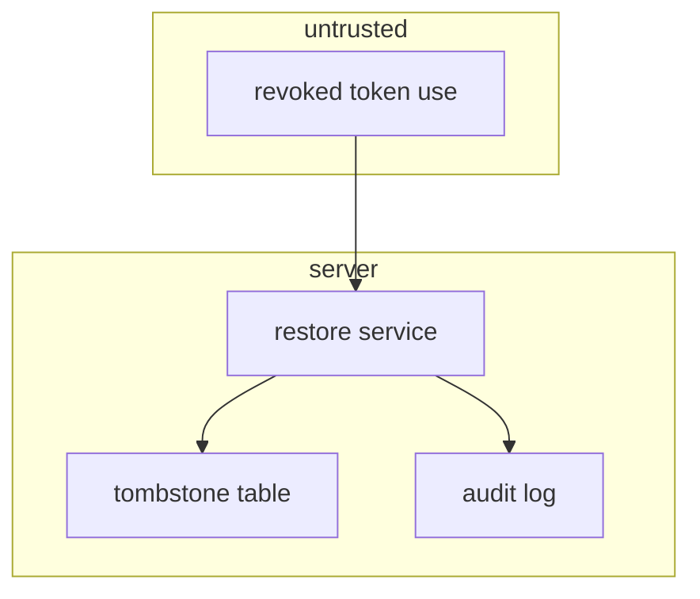

## Context

Revocations after the backup time return after a restore because the maintenance journal resets on each enter.

## Decisions

1. **Durable revocation tombstones as a control table.** One row per revocation with kind, target stable ID, and at_ms on the database clock. Kind allowlist: session, access-token, service-token, grant, join-token, principal-disable, provider-disable. Each live revocation path writes its row in the same transaction as the revocation. Replay is a fenced step of the durable restore after the swap while maintenance stays on. It reads stored integers, skips rows with at_ms at or before manifest T0, skips all rows when the manifest installation ID is missing or differs from the local installation ID, applies each later row one time in batches of 100, records applied IDs per restore ID, writes one audit entry per applied target, writes one audit entry for a foreign skip, and stays denied with one audit entry for a missing target or an unknown kind without creating a row from a tombstone alone.
2. **Retention by schedule.** A schedule row deletes only tombstones with at_ms at or before the oldest taken-at time in the backups control table. A restore past the oldest kept tombstone completes with one audit gap entry that names the missing range.

## Structure

The NEW unexported type revocationTombstone with the NEW constructor checkTombstone checks the kind allowlist and the at_ms range before any write.

## Risks

- A missed kind lets a revoked credential work after restore.
- Tombstones grow without retention.

## Layers (defense in depth)

| Layer | Guard | Hostile test |
| --- | --- | --- |
| boundary check | Kind allowlist in checkTombstone. | A tombstone with an unknown kind is refused and access stays denied. |
| encode or contain | SQL placeholders and stable IDs only. | SQL characters in a target ID affect no other row. |
| limit | 100 rows per replay transaction. | 1000 tombstones replay in bounded batches. |
| authorize at point of use | Replay runs under the restore authority and re-applies only a past deny. | A grant revocation replay grants nothing. |
| fail closed | Missing target or unknown kind stays denied with an audit entry. | A tombstone for a missing target leaves access denied. |

## Diagrams

After this change:

## Quality attributes

| Attribute | Target | Unit | Scope |
| --- | --- | --- | --- |
| latency | 1000 tombstones replay in under 30 | seconds | ReplayRevocations step of one restore |

## Threat model

Data flow and trust boundaries:

| Boundary | STRIDE | Threat | Layer | Guard | Hostile test |
| --- | --- | --- | --- | --- | --- |
| A revoked credential is reused after a restore. | E | Elevation by reuse of a revoked credential. | boundary check | Kind allowlist in checkTombstone. | A tombstone with an unknown kind is refused. |
| A revoked credential is reused after a restore. | E | Elevation by reuse of a revoked credential. | encode or contain | SQL placeholders and stable IDs only. | SQL characters in a target ID affect no other row. |
| A revoked credential is reused after a restore. | E | Elevation by reuse of a revoked credential. | limit | 100 rows per replay transaction. | 1000 tombstones replay in bounded batches. |
| A revoked credential is reused after a restore. | E | Elevation by reuse of a revoked credential. | authorize at point of use | Replay runs under restore authority and re-applies only a past deny. | A grant revocation replay grants nothing. |
| A revoked credential is reused after a restore. | E | Elevation by reuse of a revoked credential. | fail closed | Missing target or unknown kind stays denied with an audit entry. | A tombstone for a missing target leaves access denied. |

## Contracts

**Restore**

- Invariant: A revoked credential stays refused after the swap.
- `ReplayRevocations`: pre: The manifest taken-at time T0 is known.; Maintenance mode is on.. Post: Each tombstone later than T0 is applied one time.; One audit entry exists per applied target..

## Failure modes

| Step | Failure | Retry | State after |
| --- | --- | --- | --- |
| Replay after swap | The instance crashes mid-replay. | The next claimant reruns ReplayRevocations and skips applied IDs of the same restore ID. | Maintenance stays on until ReplayRevocations completes one time per target. |
