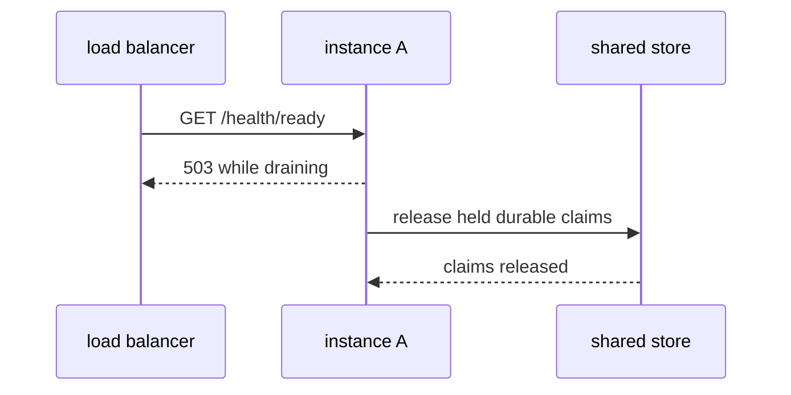
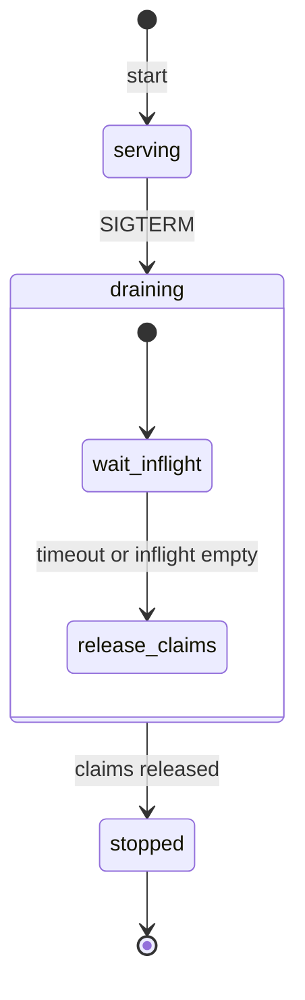

## Context

Rolling deploy replaces one instance at a time while tool work runs. The leaving instance must stop taking work, let in-flight requests drain, then release background claims so another worker takes over.

## Decisions

1. **Drain then release, with main's path (PM decision, 14 Nov 2026).** On SIGTERM the server drains through WithDrainPeriod (DefaultDrainPeriod 10 s): GET /health/ready answers the 503 of main (pkg/dustpan/health.go:338) with a NEW `Retry-After` header, then the existing shutdown path runs with shutdownTimeout 30 s for in-flight requests, and the backup worker and the durable runners release their claims when Run returns (pkg/dustpan/dustpan.go:2094), so another instance takes them over. No new timer and no new constant.

## Structure

No new type. The drain state is the `draining` flag of the readiness probe in pkg/dustpan/health.go:54, set at the start of the drain; the claim release is the return of Run in the existing shutdown path.

## Risks

- A drain that waits without bound blocks deploys.
- A release that loses claim state causes duplicate work.

## Diagrams

After this change:

Modules that the change touches, and their imports on main:

States and transitions after this change:

## Quality attributes

| Attribute | Target | Unit | Scope |
| --- | --- | --- | --- |
| availability | readiness 503 within 1 s | s | per instance SIGTERM |
| recovery | claimable by another worker within 60 s | s | per released durable claim |

## Contracts

**instance**

- Invariant: One instance record names one server process.
- Invariant: A draining instance takes no new durable claims.
- The drain (pkg/dustpan/health.go, the `draining` flag): pre: the stop signal arrived. Post: readiness answers 503 with `Retry-After`; the shutdown path then releases the claims.
- `ReleaseClaims`: pre: Instance holds claims.. Post: Held durable claims become claimable by another worker..

**durable operation**

- Invariant: One claim holder owns one operation step at one time.
- Invariant: A released claim can run again on another worker.
- `ReleaseOnShutdown`: pre: Shutdown started after drain timeout or SIGTERM.. Post: Claim is released for takeover..

## Failure modes

| Step | Failure | Retry | State after |
| --- | --- | --- | --- |
| Release held claims | SIGKILL during drain, claims not released by holder | Claim lease expires and another worker claims the operation | Operation pending with one expiry |
| Wait for in-flight requests | In-flight request exceeds drain timeout | Client retries through proxy to a healthy instance | Draining instance stops with request aborted |
| Release held claims | Second SIGTERM or store outage during release | Release falls back to lease expiry and another worker claims within 60 s | Operation pending with one expiry |
