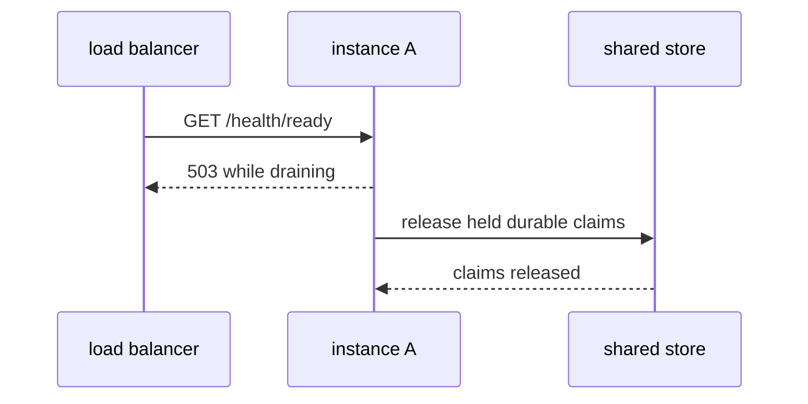
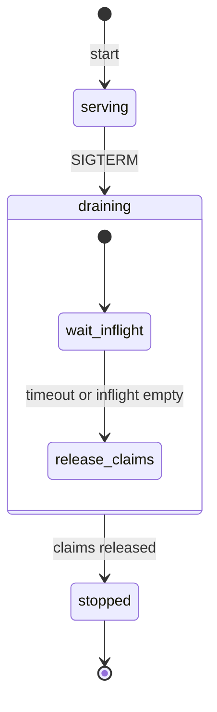

## Context

Rolling deploy replaces one instance at a time while tool work runs. The leaving instance must stop taking work, let in-flight requests drain, then release background claims so another worker takes over.

## Decisions

1. **Drain then release.** On SIGTERM the server enters draining, readiness answers 503, in-flight HTTP requests complete up to a bounded drain timeout, then held durable claims are released. New claims are refused while draining.

## Structure

Unexported draining gate in internal/instance built by NewDrainGate with a fixed timeout; only the gate can mark the instance draining and only its Close can release claims.

## Risks

- A drain that waits without bound blocks deploys.
- A release that loses claim state causes duplicate work.

## Diagrams

After this change:

Modules that the change touches, and their imports on main:

States and transitions after this change:

## Quality attributes

| Attribute | Target | Unit | Scope |
| --- | --- | --- | --- |
| availability | readiness 503 within 1 s | s | per instance SIGTERM |
| recovery | claimable by another worker within 60 s | s | per released durable claim |

## Contracts

**instance**

- Invariant: One instance record names one server process.
- Invariant: A draining instance takes no new durable claims.
- `BeginDrain`: pre: Instance record exists.. Post: Instance state becomes draining.; Readiness reports not ready..
- `ReleaseClaims`: pre: Instance holds claims.. Post: Held durable claims become claimable by another worker..

**durable operation**

- Invariant: One claim holder owns one operation step at one time.
- Invariant: A released claim can run again on another worker.
- `ReleaseOnShutdown`: pre: Shutdown started after drain timeout or SIGTERM.. Post: Claim is released for takeover..

## Failure modes

| Step | Failure | Retry | State after |
| --- | --- | --- | --- |
| Release held claims | SIGKILL during drain, claims not released by holder | Claim lease expires and another worker claims the operation | Operation pending with one expiry |
| Wait for in-flight requests | In-flight request exceeds drain timeout | Client retries through proxy to a healthy instance | Draining instance stops with request aborted |
| Release held claims | Second SIGTERM or store outage during release | Release falls back to lease expiry and another worker claims within 60 s | Operation pending with one expiry |
