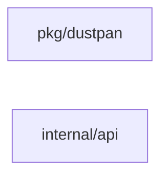

## Context

The cross-adapter route probe in pkg/dustpan/route_actions_test.go checks unauthenticated answers. It misses unlisted paths, passes 400 or 404 as safe, and its comment overstates coverage.

## Decisions

1. **Unlisted path probe.** Add the NEW Server.UngatedHandler constructor in pkg/dustpan/dustpan.go next to Server.Handler as test-support that returns the same mux without the credential gate, then probe the NEW fixed allowlist of unlisted probe paths through Handler and UngatedHandler and require identical non-2xx status plus identical error code. The NEW allowlist holds only test probe strings with no redirect and no public 2xx: /__probe_unlisted, /__probe_unlisted/ with trailing slash, /__probe_unlisted/./x with dot segment, /__probe_unlisted%2Fy with encoded slash, /__PROBE_UNLISTED with uppercase, //__probe_unlisted with double slash, /api/dustpan/v1/__probe_unlisted under a tool prefix, and POST to /__probe_unlisted with an unknown method for that path.
2. **Exact unauthenticated answer.** Exact-answer table: one table in the probe helper maps each route family to its exact unauthenticated answer, 401 with code auth.unauthenticated for tool-neutral routes and each tool adapter error shape for Pulumi and TFE routes. A 400 or 404 that is not the table value is a wrong answer and the probe fails, not safe. Pin the table values on the code after the route-guard change moves the address check into route.Enforce.
3. **Single public list.** Single public list: the public-route table next to TestNoRouteAnswersWithoutACredential is the one place. Per-adapter publicPatterns lists are deleted only after the tightened probe passes and the coverage-proof mutation fails on the same tree.

## Structure

No production behavior change. Add one test-support constructor, the NEW Server.UngatedHandler next to Server.Handler, that returns the ungated mux. All route checks stay in the probe helper and its tables.

## Risks

- Tool error shapes differ, so the exact-answer table groups them by adapter in one helper.
- The unlisted allowlist excludes redirects and public 2xx paths, so 3xx handling needs no new rule.

## Diagrams

Modules that the change touches, and their imports on main:

## Quality attributes

| Attribute | Target | Unit | Scope |
| --- | --- | --- | --- |
| none affected | Test-only change with doc comment fix, no runtime path changes |  |  |
