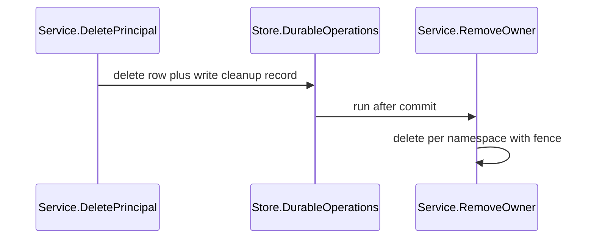
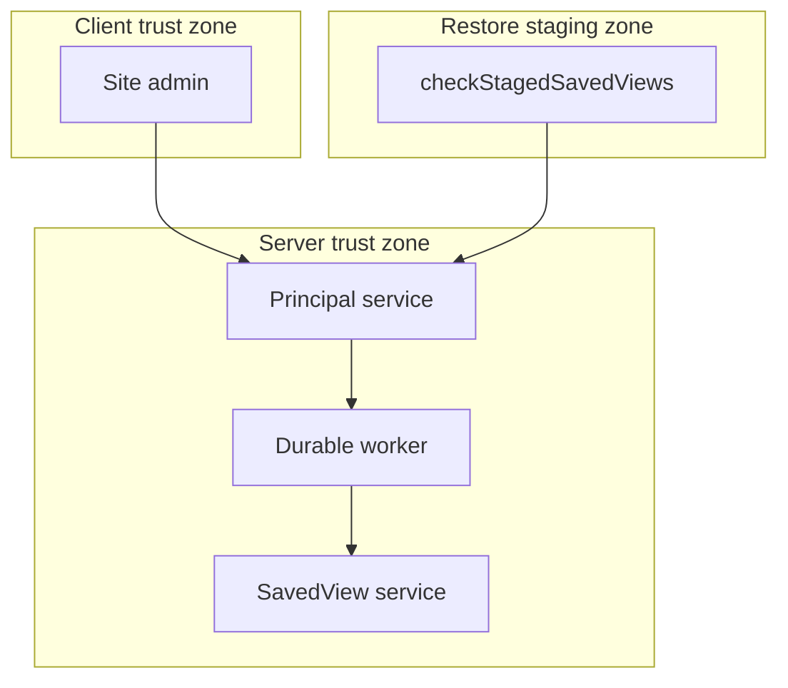

## Context

Principal delete on main has no follow-up path. Backup restore on main checks staged row shape and misses cap counts, so an over-cap backup restores.

## Decisions

1. **Cleanup as durable operation after commit.** Reuse the existing durable-operations store and its existing worker: write one cleanup record in the same transaction that deletes the principal, then run savedview.Service.RemoveOwner once per deleted principal ID after commit with retry 30s then 5min then 60min up to 50 attempts. Each namespace runs in its own transaction with its own fence. After 50 failures the record stays failed with an audit entry and the durable status shows it. No new table and no new migration.
2. **Restore fails closed on cap breach.** Extend checkStagedSavedViews in sqlite and postgres to count staged rows grouped by owner plus namespace and grouped by namespace, and return backup.ErrCorrupt when any count is above MaxPerOwner or above MaxPerNamespace. A refused ApplyStaging applies zero staged saved-view rows. Repair is a new filtered backup file, there is no staged-edit command on main. Document the fail-closed rule in the NEW guide docs/guides/backup-restore.

## Structure

No new tool and no new table. Cleanup reuses savedview.Service.RemoveOwner with its constructor checks plus the existing durable-operations store. Restore check extends checkStagedSavedViews in both dialects with no schema change and no new migration.

## Risks

- A refused restore during an emergency costs time. The guide states the refusal rule and the repair by a new filtered backup file.

## Diagrams

After this change:

## Quality attributes

| Attribute | Target | Unit | Scope |
| --- | --- | --- | --- |
| none affected | No latency, storage, or rate target changes; cleanup is async and caps are existing constants |  |  |

## Threat model

Data flow and trust boundaries:

| Boundary | STRIDE | Threat | Layer | Guard | Hostile test |
| --- | --- | --- | --- | --- | --- |
| Principal delete and cleanup boundary | E | Cleanup runs in the wrong transaction or deletes the views of the wrong principal. | boundary check | Cleanup record written in the delete transaction runs only after commit, never inside it. | Kill the process between commit and run and assert the worker still runs RemoveOwner. |
| Principal delete and cleanup boundary | E | Cleanup runs in the wrong transaction or deletes the views of the wrong principal. | encode or contain | Owner matched by stable principal ID, never by subject or name. | Create a new principal with the same subject and assert it sees zero old views. |
| Principal delete and cleanup boundary | E | Cleanup runs in the wrong transaction or deletes the views of the wrong principal. | limit | Each namespace cleanup runs in its own transaction with its own fence. | Run cleanup with a stale fence and assert the namespace write is refused. |
| Principal delete and cleanup boundary | E | Cleanup runs in the wrong transaction or deletes the views of the wrong principal. | authorize at point of use | Cleanup deletes by stable owner principal ID with per-namespace fence while orphan views match no reader. | Delete owner then list views as another principal and assert no view of the deleted owner is readable. |
| Principal delete and cleanup boundary | E | Cleanup runs in the wrong transaction or deletes the views of the wrong principal. | fail closed | Orphan views fail closed and match no reader; exhausted retries leave a failed record plus audit entry. | Fail cleanup 50 times and assert views stay unreadable and the record shows failed. |
| Restore staging boundary | T | Hostile backup brings more saved views than the caps allow. | boundary check | checkStagedSavedViews counts staged saved views by owner and namespace in the same staged query in both dialects. | Stage hostile backup with MaxPerOwner+1 views for one owner and assert backup.ErrCorrupt. |
| Restore staging boundary | T | Hostile backup brings more saved views than the caps allow. | encode or contain | Row shape stays checked with viewstore.View for each staged row. | Stage row with bad shape and assert backup.ErrCorrupt. |
| Restore staging boundary | T | Hostile backup brings more saved views than the caps allow. | limit | Caps stay constants MaxPerOwner 100 and MaxPerNamespace 10000 per namespace scope. | Assert create over cap returns savedview.ErrLimit. |
| Restore staging boundary | T | Hostile backup brings more saved views than the caps allow. | authorize at point of use | Staged cap check applies to the staged owner and namespace before any row is applied. | Stage over-cap rows and assert zero staged saved-view rows are applied. |
| Restore staging boundary | T | Hostile backup brings more saved views than the caps allow. | fail closed | Over-cap staging fails closed with backup.ErrCorrupt and applies zero staged saved-view rows. | Assert stored view count unchanged after refused ApplyStaging. |

## Contracts

**savedview.View**

- Invariant: Owner is a stable principal ID that is never reused.
- Invariant: At most 100 views for one owner in one namespace.
- Invariant: At most 10000 views in one namespace.
- `RemoveOwner`: pre: Caller runs outside the principal-delete transaction.. Post: All views with the given owner ID are deleted.; One view:delete audit entry per deleted view holds the view ID and no name..
- `checkStagedSavedViews`: pre: Staged saved-view rows are present in the staging area.. Post: Staged rows over any cap return backup.ErrCorrupt.; Staged rows at cap pass unchanged..

## Failure modes

| Step | Failure | Retry | State after |
| --- | --- | --- | --- |
| Enqueue cleanup record | Crash after principal-delete commit before cleanup runs. | Durable record persisted in delete transaction restarts on next worker poll with backoff 30s, 5min, then 60min, up to 50 attempts. | Principal stays deleted, views stay until retry deletes them. |
| Run RemoveOwner per namespace | RemoveOwner fails on one namespace after deleting views in another namespace. | Retry calls RemoveOwner again with the same owner ID; namespaces with zero views return 0 with no audit entry. | Cleaned namespaces stay clean, failed namespace retries alone. |
| Exhaust retries | Cleanup fails 50 times. | No further retry. Record stays failed, one audit entry names the owner ID, durable status shows failed. | Views stay orphaned and match no reader until an operator reruns the cleanup. |
