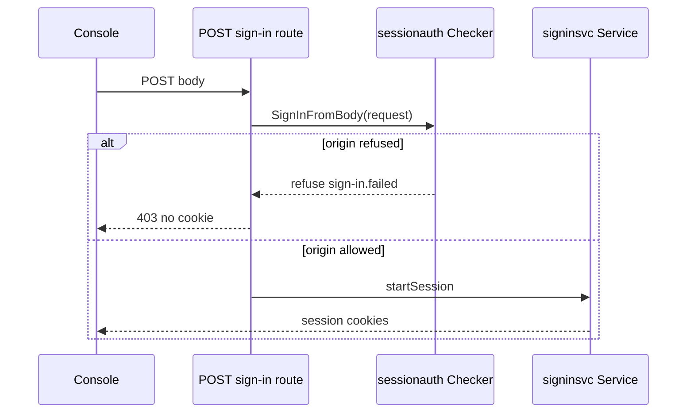
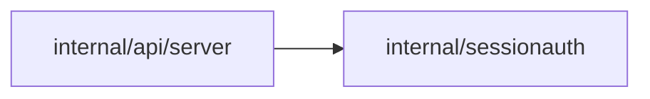
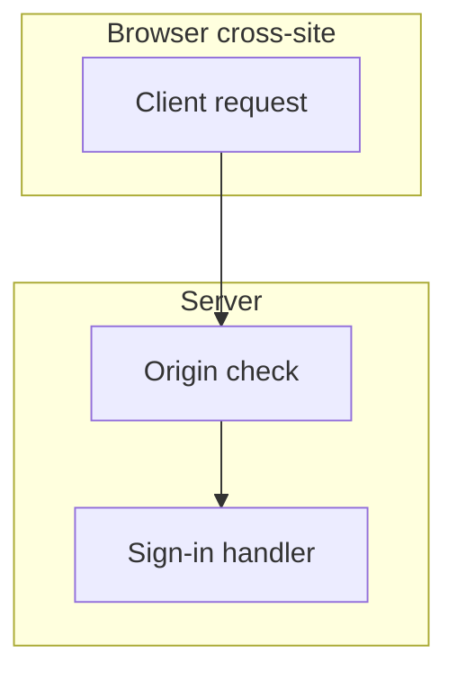

## Context

The local password route runs sessionauth.Checker.SignInFromBody. The dev-code, passkey begin and passkey finish routes start a session from a body without that check. The change runs the same check first on each of them, in the handlers of internal/api/server.

## Decisions

1. **One boundary for sign-in bodies.** Call Checker.SignInFromBody at the start of the dev-code, passkey begin and passkey finish handlers in internal/api/server, before any body decode, code spend, challenge issue, challenge consume or cookie write. A refused request answers 403 with code sign-in.failed, sets no cookie, spends no code and consumes no challenge. A refused request leaves the sealed passkey challenge and its cookie intact.
2. **Fix the dev-code client content type.** The dev-code e2e client sends Content-Type application/json. The password route, the origin rules, the dev-only mount of dev-code and existing rate limits stay unchanged.

## Structure

No new type and no constructor. The check already exists as Checker.SignInFromBody. No structure removes the need for the call, so a route test for each route guards the order and a cross-site text/plain test fails when the call is removed.

## Risks

- A later edit to one handler can place work before the check, because the guard is a call and not a type-level boundary.

## Layers (defense in depth)

| Layer | Guard | Hostile test |
| --- | --- | --- |
| boundary check | Route handler calls Checker.SignInFromBody before decode, spend, or cookie write. | Remove the call on one route and check the per-route origin test fails. |
| fail closed | Refused request sets no cookie, spends no code, and consumes no challenge. | Send cross-site text/plain then retry with the same code or challenge and check the retry still works once. |

## Diagrams

After this change:

Modules that the change touches, and their imports on main:

New imports of this change (each one allowed by the module rules):

- `internal/api/server` imports `internal/sessionauth`

## Quality attributes

| Attribute | Target | Unit | Scope |
| --- | --- | --- | --- |
| none affected | the origin check is an in-memory header check with no store or network work |  |  |

## Threat model

Data flow and trust boundaries:

| Boundary | STRIDE | Threat | Layer | Guard | Hostile test |
| --- | --- | --- | --- | --- | --- |
| Browser cross-site to server sign-in handler | S | Cross-site request forgery starts a session from a victim browser. | boundary check | Refuse a request whose content type or origin is not allowed before any state change. | Send cross-site text/plain to each route and check for 403 with no cookie. |
| Browser cross-site to server sign-in handler | S | Cross-site request forgery starts a session from a victim browser. | encode or contain | Decode the body with the strict JSON reader only after the origin check passes. | Send malformed JSON with a valid origin and check for a decode refusal. |
| Browser cross-site to server sign-in handler | S | Cross-site request forgery starts a session from a victim browser. | limit | Spend no one-time code and issue no challenge on a refused request. | Reuse the dev-code after a refused request and check that it still works once. |
| Browser cross-site to server sign-in handler | S | Cross-site request forgery starts a session from a victim browser. | authorize at point of use | Start no session unless the origin check passed on the same request. | Call passkey finish with a valid challenge cookie and a disallowed origin and check for no session. |
| Browser cross-site to server sign-in handler | S | Cross-site request forgery starts a session from a victim browser. | fail closed | Deny a missing content type or origin with sign-in.failed and no cookie. | Omit Content-Type on each route and check for 403 with no cookie. |
