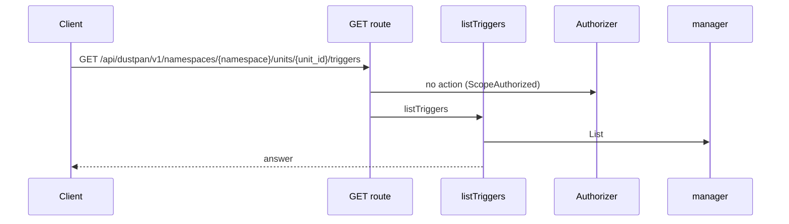
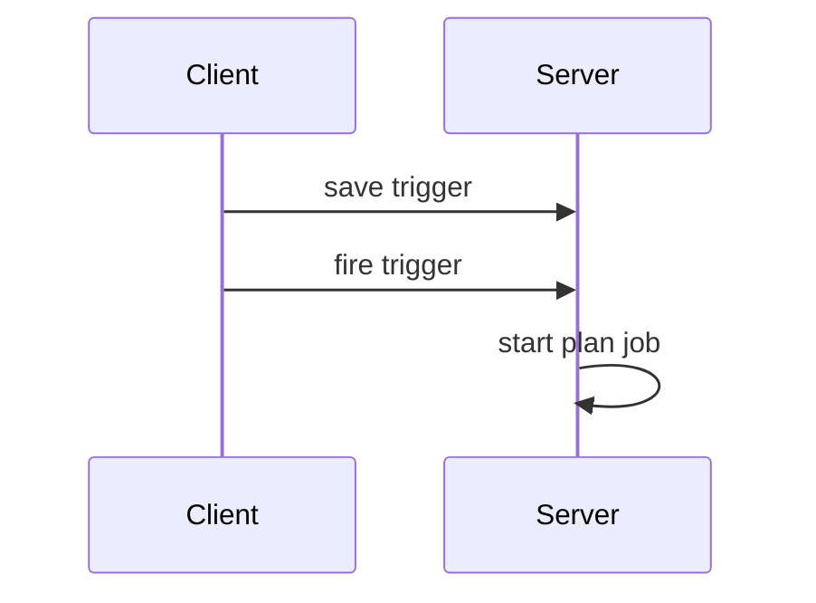
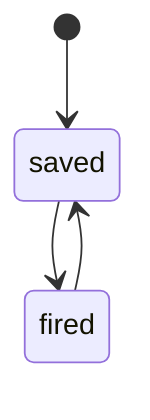
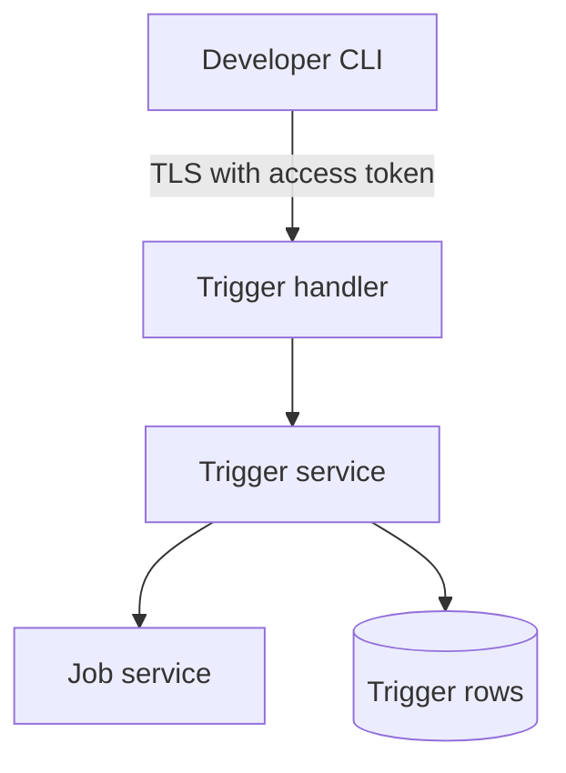

## Context

Main already stores trigger rows, serves the trigger routes, has the trigger error codes, the guide and the e2e file. This change adds declared actions, audit entries, plan-only start, save-time cycle refusal and limit refusals.

## Decisions

1. **Service checks before write.** Validate kind, cron shape, same-namespace source and limits in the service before the write. Serialize follows saves per namespace.
2. **Plan-only start port.** The start path calls a plan-only port of the job service. The port has no apply operation.
3. **No seeding in this change.** When the grant is absent, an automatic start is refused and audited.

## Structure

An unexported trigger service type is built only by its constructor, which takes a plan-only Starter interface and a fenced store.

## Risks

- A caller bypasses the plan-only port.
- A trigger names a source in another namespace.
- Two saves at the same time skip the cycle check.

## Diagrams

Today: `GET /api/dustpan/v1/namespaces/{namespace}/units/{unit_id}/triggers` on main (from the route table and the handler body, route row internal/api/triggers/routes.go:93, handler internal/api/triggers/serve.go:123).

After this change:

New imports of this change (each one allowed by the module rules):

- `internal/api/triggers` imports `pkg/trigger`

States and transitions after this change:

## Quality attributes

| Attribute | Target | Unit | Scope |
| --- | --- | --- | --- |
| reliability | 100 | % of retried keys return one job | manual fire with Idempotency-Key |

## Threat model

Data flow and trust boundaries:

| Boundary | STRIDE | Threat | Layer | Guard | Hostile test |
| --- | --- | --- | --- | --- | --- |
| TLS then server | S | A forged trigger save or fire starts a job in another namespace. | boundary check | The handler checks the token, the action and the body shape. | Send a forged token; the server returns 401. |
| TLS then server | S | A forged trigger save or fire starts a job in another namespace. | limit | The starter allows the plan operation only. | Request an apply through the starter; it refuses. |

## Contracts

**trigger**

- Invariant: One trigger belongs to one unit and has one kind.
- Invariant: A trigger start requests the plan operation only.
- `Save`: pre: The caller holds the manage action on the unit.. Post: The trigger row is stored with its last saver..
- `Fire`: pre: The trigger row exists and is enabled.. Post: A plan job starts through the job service..

## Failure modes

| Step | Failure | Retry | State after |
| --- | --- | --- | --- |
| Fire trigger | Job service refuses the plan start | Return the refusal to the caller. | trigger saved, no job started |
