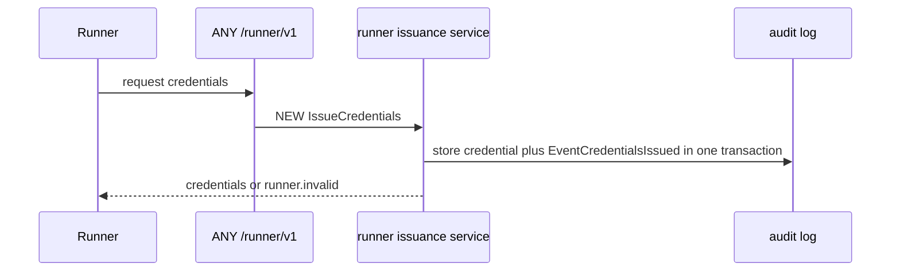
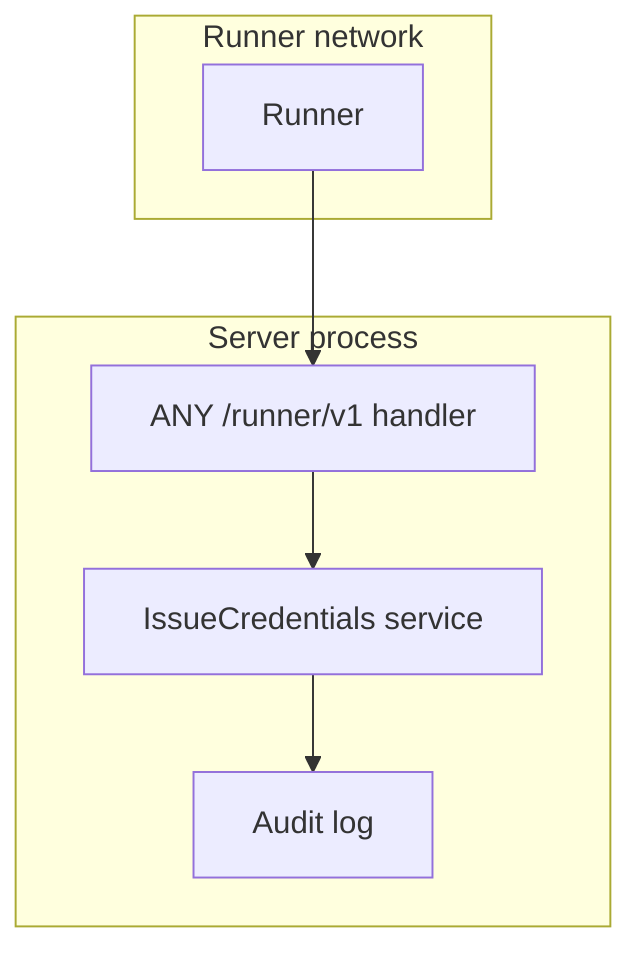

## Context

The runner audit catalog defines EventCredentialsIssued and its rule, but no issuance path writes it, so the producer test keeps it in an unproduced set.

## Decisions

1. **Write at issuance in one transaction, fail closed.** Write the entry at credential issuance in the same store transaction as the credential, before credentials are returned, through ANY /runner/v1. On audit write error roll back the credential and refuse with runner.invalid. Remove EventCredentialsIssued from the unproduced set. The entry carries the requesting runner as actor, the pool as object, plus credential ID, expiry and reason, and never the secret value.

## Structure

Unexported issuance result built only by the NEW IssueCredentials constructor, which requires the stored audit entry ID in the same transaction before it returns credentials.

## Risks

- A second issuance path exists and stays unwritten.

## Layers (defense in depth)

| Layer | Guard | Hostile test |
| --- | --- | --- |
| fail closed | Transaction requires the audit entry ID before credentials are returned. | Remove the audit write and check that issuance fails with runner.invalid. |

## Diagrams

After this change:

Modules that the change touches, and their imports on main:

## Quality attributes

| Attribute | Target | Unit | Scope |
| --- | --- | --- | --- |
| none affected | Audit-only fix at the existing issuance path with no latency or storage target change |  |  |

## Threat model

Data flow and trust boundaries:

| Boundary | STRIDE | Threat | Layer | Guard | Hostile test |
| --- | --- | --- | --- | --- | --- |
| Runner network to server process | S | A forged runner spoofs credential issuance. | boundary check | Handler checks the runner credential at ANY /runner/v1 and refuses unknown callers with runner.invalid. | Send a forged credential and check for refusal with no audit entry. |
| Runner network to server process | S | A forged runner spoofs credential issuance. | encode or contain | Audit entry stores IDs, expiry, actor and reason as data and never the secret value. | Issue credentials then scan the stored entry for secret bytes. |
| Runner network to server process | S | A forged runner spoofs credential issuance. | limit | One entry per successful issuance; refused requests write nothing. | Send a refused request and check that the entry count stays the same. |
| Runner network to server process | S | A forged runner spoofs credential issuance. | authorize at point of use | AuditRules check the actor and object of the entry. | Submit an entry with a wrong actor and check that the rule check refuses it. |
| Runner network to server process | S | A forged runner spoofs credential issuance. | fail closed | On audit write error the transaction rolls back with runner.invalid and no credentials. | Break the audit store, request credentials, and check for runner.invalid with no credentials. |

## Contracts

**runner credentials issuance**

- Invariant: Each successful issuance stores exactly one EventCredentialsIssued entry in the same store transaction as the credential.
- Invariant: An EventCredentialsIssued entry never contains a secret credential value.
- `IssueCredentials`: pre: The caller passed the runner credential gate on ANY /runner/v1.. Post: The credential and one EventCredentialsIssued entry are both stored, or neither is stored.; No secret credential value is stored in the entry..
