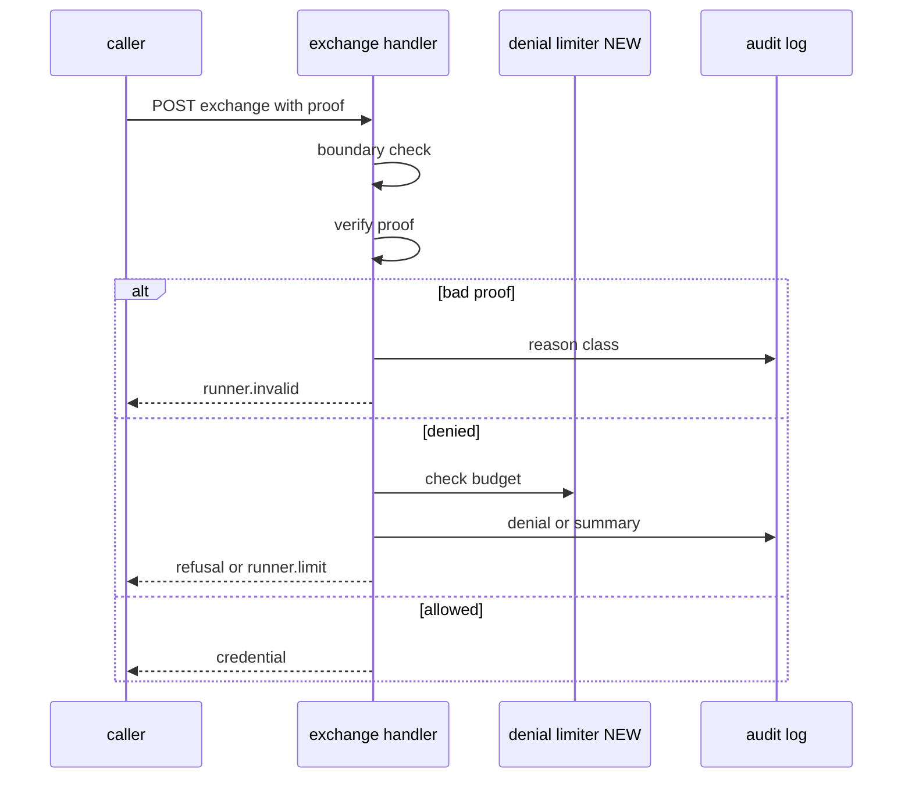
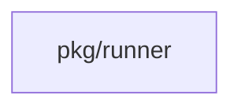
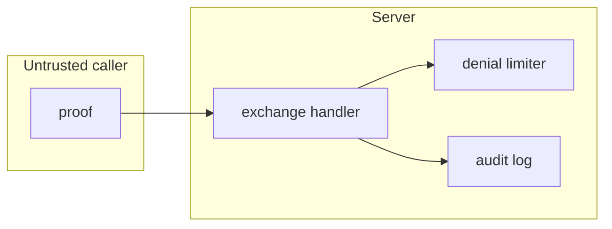

## Context

Each denial that passes the proof check writes one audit entry, so a forged flood fills the audit log. A bad-proof refusal writes none.

## Decisions

1. **Limit passing-proof denials and audit bad proofs.** The limiter counts only denials after proof verification, keyed by client address, namespace and rule: 30 per 60 seconds, 10000 keys per server process, oldest evicted. A malformed proof at the boundary writes no audit and counts nothing. A bad proof writes one entry with a reason class from a fixed allowlist, and no proof bytes. The caller sees only the existing code runner.invalid. Suppressed denials write one summary entry per source per 60 seconds and increment the NEW counter runner_exchange_suppressed_denials_total with no per-proof labels. If the limiter or the audit write fails, the server denies with no credential.

## Structure

An unexported limiter type with a constructor that checks window, budget and key cap. Only the constructor builds a value.

## Risks

- A source behind a shared address shares one key. The client address rule of the installation applies.

## Diagrams

After this change:

Modules that the change touches, and their imports on main:

## Quality attributes

| Attribute | Target | Unit | Scope |
| --- | --- | --- | --- |
| refusal latency | 200 | ms p95 | exchange refusal |
| storage growth | 1 summary entry per source per window | entries per 60 seconds | each source key above its limit |

## Threat model

Data flow and trust boundaries:

| Boundary | STRIDE | Threat | Layer | Guard | Hostile test |
| --- | --- | --- | --- | --- | --- |
| caller to exchange handler | D | A forged flood fills the audit log. | boundary check | Allowlist the proof shape and size. | An oversized proof gets runner.invalid. |
| caller to exchange handler | D | A forged flood fills the audit log. | encode or contain | The audit entry holds a fixed reason class only. | A hostile proof text never shows in the entry. |
| caller to exchange handler | D | A forged flood fills the audit log. | limit | 30 denials per 60 seconds for each key, 10000 keys. | A flood of 100 denials writes at most 30 entries and one summary. |
| caller to exchange handler | D | A forged flood fills the audit log. | authorize at point of use | The stored rule of the namespace is read at the exchange. | A rule of another namespace is refused. |
| caller to exchange handler | D | A forged flood fills the audit log. | fail closed | An error of the limiter or the audit write denies. | A failing audit store gives no credential. |

## Contracts

**Trust exchange**

- Invariant: A bad proof never yields a credential.
- Invariant: An audit entry never holds proof bytes.
- Invariant: A valid success never counts as a denial.
- `Exchange`: pre: The proof shape is valid and names a trust rule.. Post: An over-limit denial gives runner.limit.; A bad proof gives runner.invalid and one audit entry.; A valid proof gives a credential..
