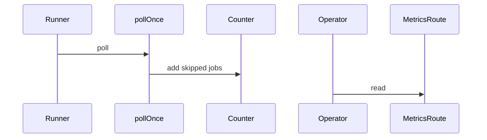

## Context

pollOnce reads at most 64 candidate jobs. Jobs after the bound are not offered to the runner.

## Decisions

1. **One counter, no labels.** Add the number of skipped jobs to one counter at the end of each poll. The provisional name is dustpan_runner_poll_skipped_jobs_total: it names the thing counted and uses the _total suffix of a counter. Before the first tag the name can change with no shim.

## Structure

NEW: an unexported field of the runner API handler holds the counter. Its constructor takes the metrics registry, so pollOnce cannot run with a missing counter.

## Risks

- A hot poll adds a small cost for one atomic add.

## Diagrams

After this change:

## Quality attributes

| Attribute | Target | Unit | Scope |
| --- | --- | --- | --- |
| cost of the count | 1 atomic add for each poll | operations | runner poll |

## Failure modes

| Step | Failure | Retry | State after |
| --- | --- | --- | --- |
| Count at the end of a poll | The poll fails before the count | The runner polls again | The counter has no value for the failed poll |
