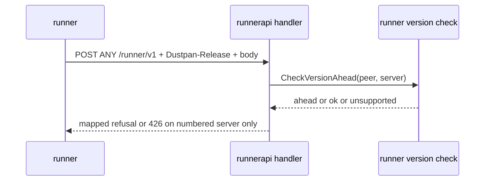
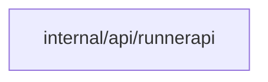
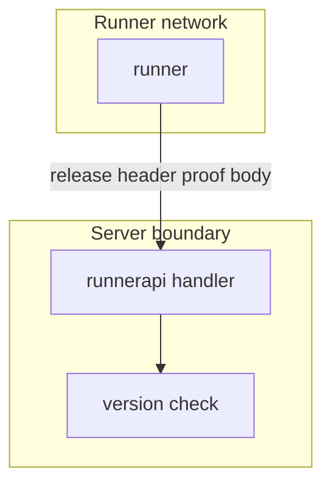

## Context

Join, poll, and session refusals on ANY /runner/v1 share one bare answer. A dev build refuses its own release value. A large body returns 400 and not 413.

## Decisions

1. **Distinct refusal classes and check order.** Add a small refusal mapper in internal/api/runnerapi that maps parse, proof, body, size, and version states to distinct error codes and status codes before it writes the answer. The proof answer names the class only. Check order is release presence, release shape, body size, body shape, version ordering, then proof. The body limit uses a bounded read so unauthenticated callers cannot force a large read.
2. **Dev release self-accept.** Accept the exact server release string as identical before the semver parse, including the literal dev on a dev build. Version ordering applies only on a numbered server. On a dev server any other release value gets the bad-release refusal, never a 426 answer, because a dev server has no version number.

## Structure

Unexported refusal class type in internal/api/runnerapi with a constructor that takes the parse result and returns status plus error code; only the constructor builds a refusal answer.

## Risks

- A distinct answer helps a probe tell cases apart; proof refusals stay generic with no proof detail.

## Diagrams

After this change:

Modules that the change touches, and their imports on main:

## Quality attributes

| Attribute | Target | Unit | Scope |
| --- | --- | --- | --- |
| refusal latency | 50 | ms | per POST to ANY /runner/v1 after the request body is received |
| request body limit | 1 | MiB | per runner protocol JSON request |

## Threat model

Data flow and trust boundaries:

| Boundary | STRIDE | Threat | Layer | Guard | Hostile test |
| --- | --- | --- | --- | --- | --- |
| Runner network to server boundary | S | Spoofed runner release or proof probes the version path | boundary check | Allowlist: release matches server string or major.minor.patch, proof matches v1 shape, body is JSON under 1 MiB | Send missing header, 1.2, bad proof, body `{`, and 30 MiB body; each gives its mapped code. |
| Runner network to server boundary | S | Spoofed runner release or proof probes the version path | encode or contain | Contain: bounded read, strict JSON decode, proof answer names the class only with no proof bytes | Send overlong header, cut JSON, and wrong signature; the reader stops at the limit and the answer leaks no proof bytes. |
| Runner network to server boundary | S | Spoofed runner release or proof probes the version path | limit | Limit: 1 MiB body cap, 64 character release cap; 426 answers occur on a numbered server only | Send 30 MiB body for 413; send 99.0.0 to a numbered server for 426 and to a dev server for 400 bad-release. |
| Runner network to server boundary | S | Spoofed runner release or proof probes the version path | authorize at point of use | Authorize at point of use on join, poll, and session with runner credential; missing or wrong credential maps to bad-proof | Call poll and session with no credential and with a bad proof; the server denies with bad-proof. |
| Runner network to server boundary | S | Spoofed runner release or proof probes the version path | fail closed | Fail closed: unknown release, unknown proof, decode error deny with mapped code | Send unknown release format and unknown proof version; the server denies and logs cause only server side. |
