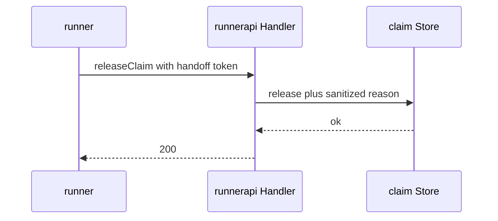
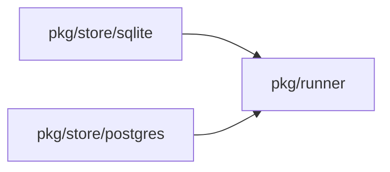
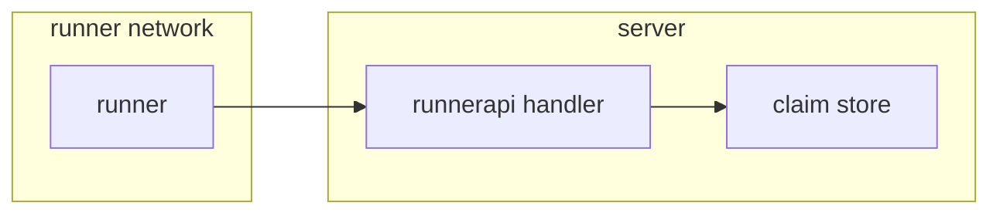

## Context

releaseClaim in internal/api/runnerapi/protocol.go decodes ReleaseRequest and drops the reason. This change keeps only the existing string field with a sanitizer.

## Decisions

1. **Sanitized reason type.** One unexported type releaseReason has one constructor newReleaseReason. It checks the 500-rune cap on the decoded string, replaces CR and LF with spaces, removes other C0 and C1 controls, U+2028 and U+2029, replaces invalid UTF-8 with U+FFFD, and trims the ends. The handler and the store take only the built value, so no path stores a raw reason.

## Structure

Unexported type releaseReason with constructor newReleaseReason; only the constructor makes a value.

## Risks

- Stored reason grows claim rows by at most 500 runes.
- Log forging through CR, LF, and escapes without the sanitizer.

## Layers (defense in depth)

| Layer | Guard | Hostile test |
| --- | --- | --- |
| boundary check | Handler refuses a reason above 500 runes with runner.invalid and stores nothing. | A 501-rune reason is refused with runner.invalid and the claim keeps its prior reason. |
| encode or contain | Constructor replaces CR and LF with spaces and removes NUL, ESC, other C0 and C1 controls, U+2028 and U+2029; invalid UTF-8 becomes U+FFFD. | A reason with CRLF, NUL, ESC, ANSI escapes, U+2028 and invalid bytes stores none of them. |
| limit | 500-rune cap per claim record plus the existing 8 KiB body limit. | An oversize reason and an oversize body are both refused. |
| authorize at point of use | Handoff check for the named claim runs before any write. | The handoff of another claim is denied with runner.not-found and stores nothing. |
| fail closed | Any store error fails the release and keeps the claim and its reason unchanged. | A forced store error leaves the prior claim state. |

## Diagrams

After this change:

Modules that the change touches, and their imports on main:

## Quality attributes

| Attribute | Target | Unit | Scope |
| --- | --- | --- | --- |
| storage growth | 500 | runes | per claim record |

## Threat model

Data flow and trust boundaries:

| Boundary | STRIDE | Threat | Layer | Guard | Hostile test |
| --- | --- | --- | --- | --- | --- |
| runner network to server | T | A runner sends an oversize reason or CR and LF to forge logs or grow rows. | boundary check | Refuse a reason above 500 runes with runner.invalid and store nothing. | A 501-rune reason is refused. |
| runner network to server | T | A runner sends an oversize reason or CR and LF to forge logs or grow rows. | encode or contain | Replace CR and LF with spaces and remove other controls; replace invalid UTF-8 with U+FFFD. | A CRLF and NUL reason stores with no CR, LF, or NUL. |
| runner network to server | T | A runner sends an oversize reason or CR and LF to forge logs or grow rows. | limit | 500-rune cap per claim plus the 8 KiB body limit. | An oversize reason and an oversize body are both refused. |
| runner network to server | T | A runner sends an oversize reason or CR and LF to forge logs or grow rows. | authorize at point of use | Check the handoff for the named claim before any write. | A wrong handoff is denied with runner.not-found. |
| runner network to server | T | A runner sends an oversize reason or CR and LF to forge logs or grow rows. | fail closed | Fail the release on any store error and keep the prior state. | A forced store error keeps the prior claim and reason. |

## Contracts

**runner claim**

- Invariant: A released claim keeps its last sanitized reason until a non-empty release replaces it.
- Invariant: A new claim from a takeover holds no reason.
- `releaseClaim`: pre: The handoff names the claim and the claim has no open session.. Post: The claim holds the sanitized reason, or the prior reason when the input is empty after trim..
