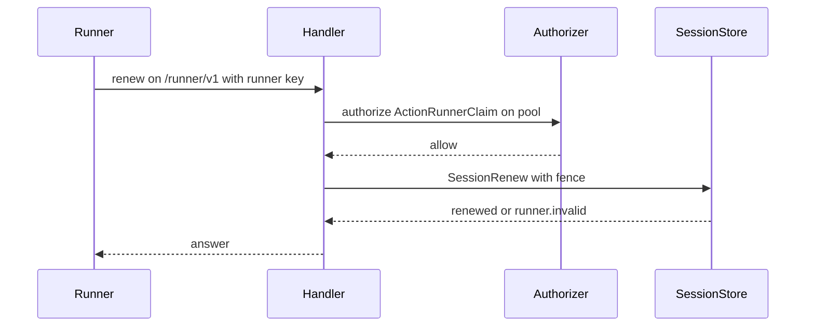
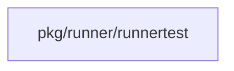
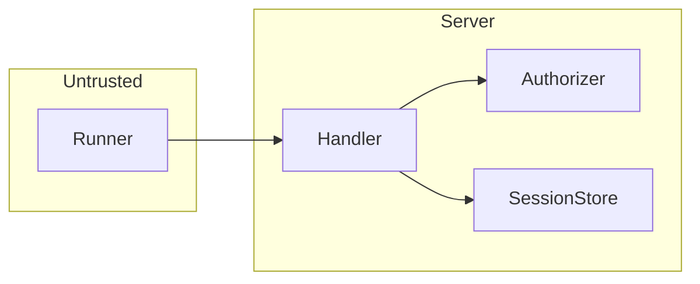

## Context

Renew paths trust the fence of the caller. Routes declare the claim action but never evaluate it.

## Decisions

1. **Store refuses a cross-namespace renew.** Each renew update in both dialects compares the namespace of the fence with the stored namespace in the same statement or transaction as the update. On a mismatch it returns runner.invalid and writes nothing.
2. **Claim is evaluated at the point of use.** Each session handler and each runner-key handler authorizes ActionRunnerClaim on the pool taken from the stored runner record, never from the request.

## Structure

No new unexported type. The check lives in the renew update so no new value can skip it.

## Risks

- A misconfigured runner that sends a wrong fence is now refused.

## Layers (defense in depth)

| Layer | Guard | Hostile test |
| --- | --- | --- |
| store | The renew update refuses a fence of another namespace in the same transaction. | The store test calls SessionRenew and RunnerRenew with a fence of another namespace. |
| handler | The handler authorizes ActionRunnerClaim on the pool of the runner. | The handler test calls a session route with a key of another pool and with a claim of another job. |

## Diagrams

After this change:

Modules that the change touches, and their imports on main:

## Quality attributes

| Attribute | Target | Unit | Scope |
| --- | --- | --- | --- |
| none affected | Security refusals only. No latency or storage target changes. |  |  |

## Threat model

Data flow and trust boundaries:

| Boundary | STRIDE | Threat | Layer | Guard | Hostile test |
| --- | --- | --- | --- | --- | --- |
| Runner to server | S | A runner renews a session of another namespace or pool. | boundary check | The handler checks the request shape at the boundary. | Send a renew with a malformed fence to the parser. |
| Runner to server | S | A runner renews a session of another namespace or pool. | encode or contain | The store uses placeholders and the error repeats no input. | Send a fence with a quote and check that the error repeats nothing. |
| Runner to server | S | A runner renews a session of another namespace or pool. | limit | A renew changes only its own record. | Renew with a bad fence and check that no other record changes. |
| Runner to server | S | A runner renews a session of another namespace or pool. | authorize at point of use | The handler authorizes ActionRunnerClaim on the pool of the stored runner. | Call with a key of another pool and expect runner.invalid. |
| Runner to server | S | A runner renews a session of another namespace or pool. | fail closed | The renew update refuses a mismatch of namespace. | Call SessionRenew with a fence of another namespace and expect runner.invalid. |

## Contracts

**runner session**

- Invariant: A session belongs to one namespace.
- Invariant: A renew never moves a session to another namespace.
- `SessionRenew`: pre: The fence names the namespace of the session.. Post: The claim time advances only when the fence matches..
- `RunnerRenew`: pre: The fence names the namespace of the runner.. Post: The renewal applies only when the fence matches..
