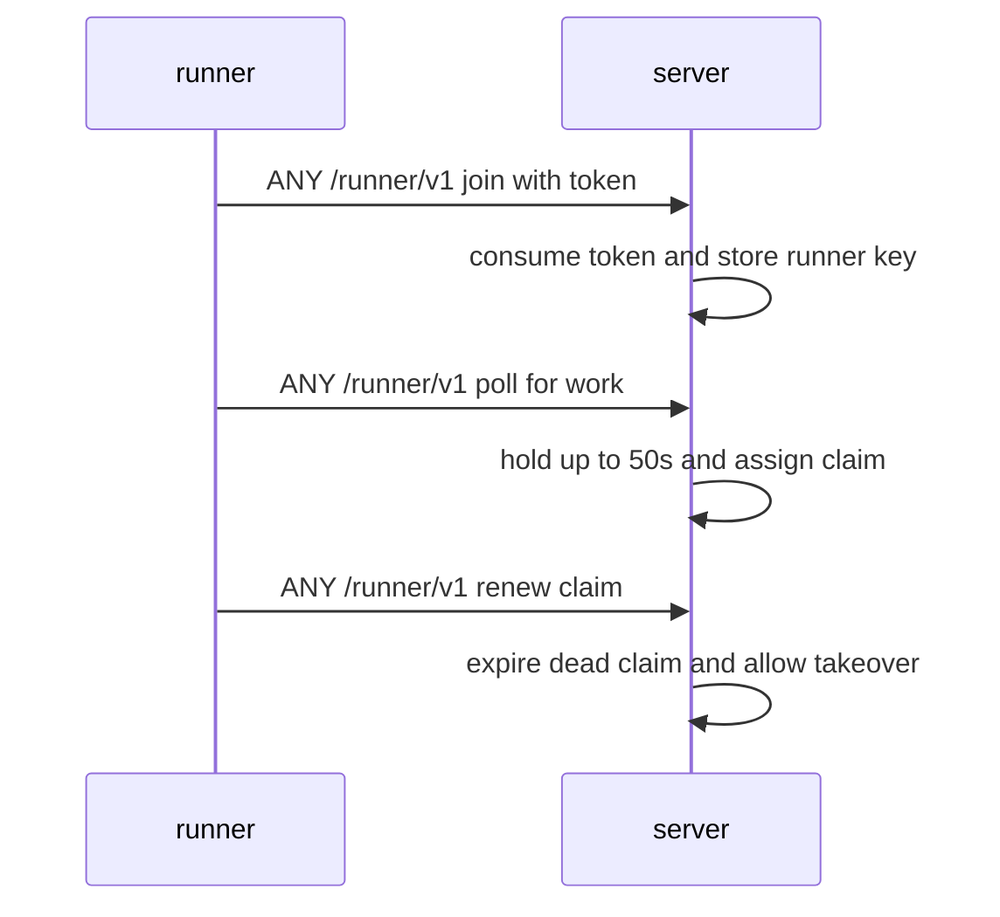
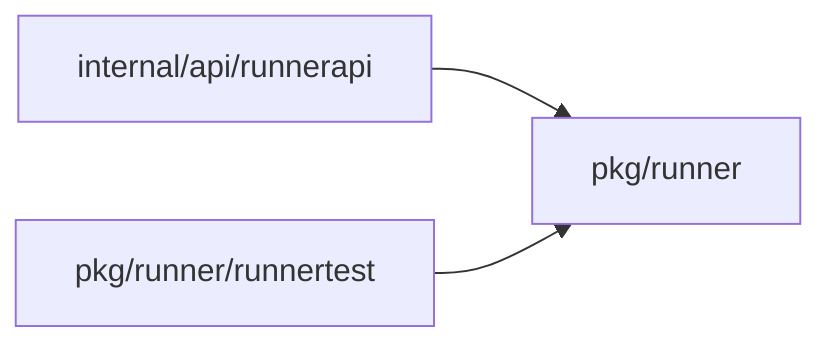
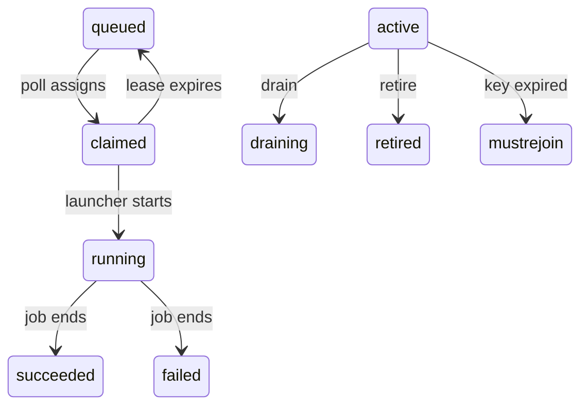
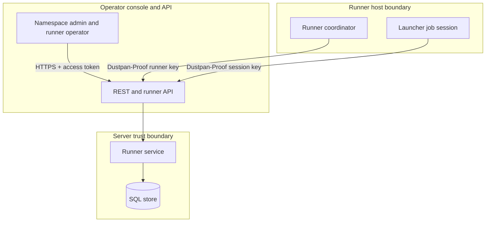

## Context

Server side of runner pools: join tokens, join, poll and claim for jobs of both tools, lease expiry with takeover, live log read stream. Runner binary lives in its own repository and is out of scope.

## Decisions

1. **One-use join in one transaction.** Join uses stored SHA-256 of token, one-use consume in the same transaction as runner insert, keyed by pool ID and runner name with stable runner ID after join. Lost join response is not retried with the same token; the operator retires the orphan record and creates a fresh token.
2. **Claim with lease and takeover.** Poll maps to job.Claimer.Claim for the pool with an immediate try at poll start, then recheck at least every 5 seconds inside the 50 second hold; unmatched labels return no work and the job stays queued; lease expiry returns the claim to the queue for another runner. Cross-instance wake is the wake-long-poll change. Provisional lease is 60 seconds with renew every 20 seconds and takeover after expiry plus 30 second grace.

## Structure

Unexported claimLease type with constructor newClaimLease that checks pool, owner, expiry and monotonic renew; only the constructor builds a live lease.

## Risks

- Token replay without nonce cache gives double join.
- Lease renewal without owner check lets one runner hold the claim of another runner.

## Layers (defense in depth)

| Layer | Guard | Hostile test |
| --- | --- | --- |
| HTTP adapter | Handler checks Dustpan-Proof signature, time window, nonce cache, and Dustpan-Release header before any state read. | Replay a poll proof and a stale proof; both get bad-proof and no claim. |
| service | Service checks join-token hash, expiry, prior use, and pool match; checks claim owner on renew; checks runner live on each claim use. | Join twice with one token; second join gets token-used. Renew a claim from another runner; request is refused. |
| port adapter | Store consumes token and inserts runner in one transaction; claim insert uses conditional write on lease owner and expiry. | Run two concurrent joins with one token; one wins and the other gets token-used. |

## Diagrams

After this change:

Modules that the change touches, and their imports on main:

New imports of this change (each one allowed by the module rules):

- `internal/api/runnerapi` imports `pkg/runner`
- `pkg/runner` imports `pkg/job`

States on main in the touched packages:

States and transitions after this change:

## Quality attributes

| Attribute | Target | Unit | Scope |
| --- | --- | --- | --- |
| availability | 90 | seconds | one pool with two live runners, one runner killed during a job |
| latency | 6 | seconds | runner poll with queued job on same instance |
| correctness | 1 | runner | concurrent joins with one join token |

## Threat model

Data flow and trust boundaries:

| Boundary | STRIDE | Threat | Layer | Guard | Hostile test |
| --- | --- | --- | --- | --- | --- |
| Server trust boundary | S | Forged runner poll claims the job of another pool | boundary check | Reject bad, replayed or stale Dustpan-Proof and bad Dustpan-Release before state read | Replay poll proof and mismatch release; server answers bad-proof and invalid with no claim |
| Server trust boundary | S | Forged runner poll claims the job of another pool | encode or contain | Sign proof over method, path, body hash, time and nonce; verify with stored public key | Forge proof with wrong key; server refuses with bad-proof |
| Server trust boundary | S | Forged runner poll claims the job of another pool | limit | Limit JSON to 4 MiB and poll wait to 50 seconds | Send oversize poll body; server answers invalid with no state change |
| Server trust boundary | S | Forged runner poll claims the job of another pool | authorize at point of use | Check namespace:manage-runners on join-token create and runner live on claim use | Poll with retired key; server answers retired |
| Server trust boundary | S | Forged runner poll claims the job of another pool | fail closed | Deny on unknown key, stale time or missing header with audit entry | Poll with unknown runner ID; server denies and writes audit entry |
| Server trust boundary | E | One join token joins two runners or one runner takes the claim of another runner | boundary check | Check token hash, expiry, prior use and pool match before runner insert | Join with token of another pool; server answers invalid |
| Server trust boundary | E | One join token joins two runners or one runner takes the claim of another runner | encode or contain | Store only SHA-256 of token and Ed25519 public key; never log secret | Read stored token row; only hash present, secret absent |
| Server trust boundary | E | One join token joins two runners or one runner takes the claim of another runner | limit | Enforce 1 hour default, 7 day maximum and per-namespace token cap | Create token beyond cap; server answers limit with no new token |
| Server trust boundary | E | One join token joins two runners or one runner takes the claim of another runner | authorize at point of use | Check claim owner on renew and handoff | Renew foreign claim; server refuses and keeps owner |
| Server trust boundary | E | One join token joins two runners or one runner takes the claim of another runner | fail closed | Consume join token and insert runner in one transaction keyed by token hash | Join twice at once with one token; one wins, other gets token-used |
| Runner host boundary | I | Key disclosure lets a host act as a live runner | boundary check | Check Dustpan-Proof time window and nonce cache on each request | Replay session proof after retire; server answers retired or bad-proof |
| Runner host boundary | I | Key disclosure lets a host act as a live runner | encode or contain | Runner key file mode 0600, session key in memory only | Read key from other user; OS denies read |
| Runner host boundary | I | Key disclosure lets a host act as a live runner | limit | Limit session life to claim life and step timeout plus grace | Use session after claim expiry; server refuses |
| Runner host boundary | I | Key disclosure lets a host act as a live runner | authorize at point of use | Check runner live and session claim live at point of use | Use session of retired runner; server answers retired |
| Runner host boundary | I | Key disclosure lets a host act as a live runner | fail closed | Deny session use after retire with retired | Send session request after retire; server answers retired |

## Contracts

**runner pool claim**

- Invariant: One live claim owner per operation at one time
- Invariant: One use per join token
- Invariant: Retired runner owns no live claim
- `join`: pre: Join token hash matches, unexpired, unused; pool matches. Post: Runner stored with Ed25519 public key; join token marked used.
- `claim`: pre: Runner live; pool has queued job whose labels the runner reports. Post: Live lease with owner runner, expiry and labels.
- `renew`: pre: Caller owns the live claim; runner live; session not open. Post: Lease expiry extended for same owner.

## Failure modes

| Step | Failure | Retry | State after |
| --- | --- | --- | --- |
| Claim live with renew | Runner process killed before renew | Lease expires; another runner claims same job | Claim returns to queued, then claimed by takeover runner |
| Join with one-use token | Join response lost after store insert | Operator retires orphan runner record and creates a fresh join token, then joins again | First runner record stays for audit with no live claim; second join with same token is refused with token-used |
| Long poll wait | Poller disconnects during 50s wait | Runner polls again at once | No claim made; job stays queued |
| Live log read | Log reader disconnects mid-stream | Reader resumes with last chunk number | Stream resumes in chunk order with no loss |

## Change impact (computed from main)

ADRs:

- `docs/adr/0131-the-runner-protocol.md` names `protocol.MaxPollWait`
