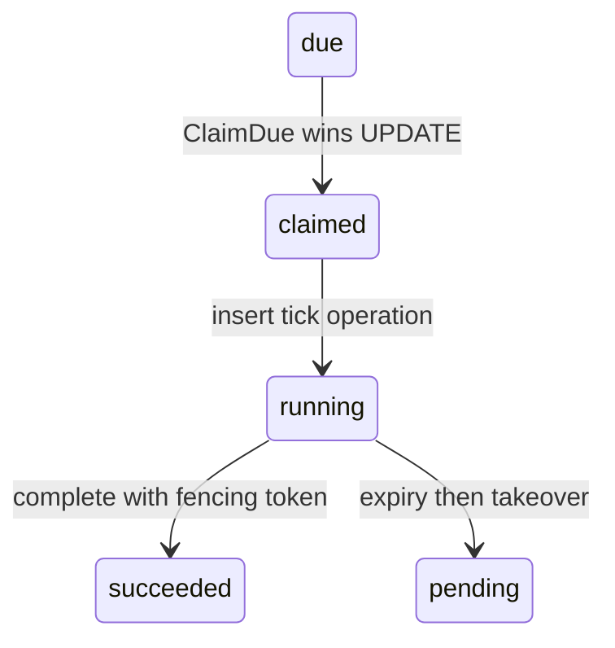

## Context

Three instances share one PostgreSQL database on one installation. Each job schedule present on main is a row with next_run_at. The test shortens each interval to 10 s with a test-only value and counts durable_operations start keys for 60 s.

## Decisions

1. **Keep the existing claim.** The conditional UPDATE of ADR 72 decision 3 stays the only schedule claim path. There is no leader election and no instance registry.
2. **Test-only interval.** A NEW test-only constructor sets the 10 s interval in test builds only. A production build refuses it and fails closed. No flag, no setting, and no environment variable carries it.
3. **Lease on the operation.** The 30 s lease and the fencing token sit on the tick durable operation per ADR 72 decision 2. The schedule row has no expiry. A holder death hands the operation over after expiry, and the next due tick collapses missed slots into one run.

## Structure

A NEW unexported test-only interval type with a constructor that checks the 10 s test value. A production build never links the constructor. No new tool and no new analyzer.

## Risks

- A crash between schedule claim and tick insert skips that slot. The step proves at-most-once, not zero loss.
- Clock skew between instances cannot cause a double claim because the claim uses the database clock in one conditional UPDATE.

## Diagrams

States and transitions after this change:

## Quality attributes

| Attribute | Target | Unit | Scope |
| --- | --- | --- | --- |
| none affected | Exit test only with no production latency change. |  |  |

## Contracts

**durable schedule**

- Invariant: At most one instance wins a due tick.
- Invariant: Start keys hold no instance ID.
- Invariant: The tick operation carries the expiry and the fencing token.
- `ClaimDue`: pre: The caller gives the database clock.. Post: next_run_at moves forward by one interval on the database clock.; The tick operation starts with one start key and a 30 s lease..

## Failure modes

| Step | Failure | Retry | State after |
| --- | --- | --- | --- |
| claim tick | Instance dies after the schedule claim and before the tick insert. | No retry of that slot. The next due tick runs once. | pending for the next interval |
| run tick | Holder of the tick operation dies mid-run. | Another instance claims after the 30 s expiry with a higher fencing token. A stale write with the old token fails. | running on the new holder |
| claim tick | Instance clocks differ. | No retry needed. The claim uses the database clock. | due once |
| renew lease | Database gap outlasts the 30 s lease. | Renewals fail, the operation expires, and another instance claims after the gap. | pending then running |
| claim tick | Database is down at the claim moment. | The claim fails with 503 and Retry-After. The tick stays due. | due |
