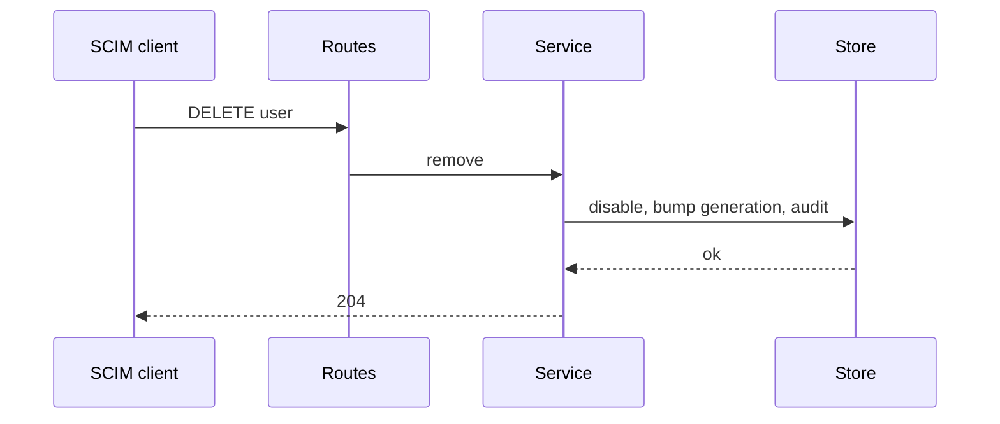
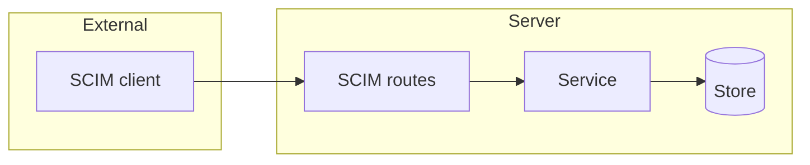

## Context

SCIM is a provisioning adapter behind a port. It writes persons, groups and memberships and never issues sessions or tokens.

## Decisions

1. **One service owns the writes.** The service creates persons by stable subject with source scim, maps group values through the same claim rule, and calls the one membership function in one transaction. The adapter maps wire fields only.
2. **Disable first.** A DELETE or active false disables the person, adds 1 to the session generation and disables tokens. With the setting on, it revokes them. The break-glass guard refuses the last enabled break-glass principal with 409.

## Structure

The unexported type scimRequest is made only by NewScimRequest, which checks the subject, the group ID and the size. The store never sees raw SCIM input.

## Risks

- A client mass-disables users: the rate limit and the audit bound it.
- Two creates race on one subject: a unique index lets one win.

## Layers (defense in depth)

| Layer | Guard | Hostile test |
| --- | --- | --- |
| HTTP handler | A SCIM-scoped bearer credential on each route. | Send create with no token, a wrong token and an admin token without SCIM scope. Each gives 401 and no row. |
| Service | Strict decode, field allowlist and size limit in the constructor. | Send extra fields, an oversize body and a bad subject. Each is refused. |
| Port adapter | The store checks the namespace fence in the same transaction. | Call the store with a fence of another namespace. The write is refused. |

## Diagrams

After this change:

## Quality attributes

| Attribute | Target | Unit | Scope |
| --- | --- | --- | --- |
| recoverability | 100 | percent of SCIM removals visible in the audit export on the next read | each SCIM disable and revocation |

## Threat model

Data flow and trust boundaries:

| Boundary | STRIDE | Threat | Layer | Guard | Hostile test |
| --- | --- | --- | --- | --- | --- |
| SCIM routes | S | A caller without the SCIM credential writes users or disables accounts. | boundary check | Strict decode and an allowlist of fields. | Send extra fields and an oversize body. Each is refused. |
| SCIM routes | S | A caller without the SCIM credential writes users or disables accounts. | authorize at point of use | SCIM-scoped bearer credential on each route. | Send an admin token without SCIM scope. The server answers 401. |
| SCIM routes | S | A caller without the SCIM credential writes users or disables accounts. | limit | A rate limit on DELETE for each credential. | Send a burst of DELETEs. The excess gets 429. |
| SCIM routes | S | A caller without the SCIM credential writes users or disables accounts. | fail closed | An unknown credential or value is denied and audited. | Send an unknown credential. The server answers 401 and writes an audit entry. |

## Failure modes

| Step | Failure | Retry | State after |
| --- | --- | --- | --- |
| DELETE user | A burst above the limit. | Retry after the window. | The excess users stay enabled. |
| POST user | Two creates race on one subject. | Read the user list and retry. | One row exists. |
