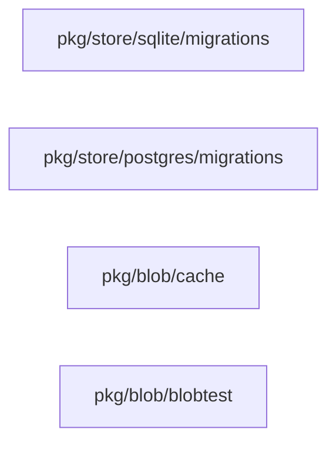

## Context

Small consistency follow-ups to scoped state blobs.

## Decisions

1. **Purge rows keep namespace ID.** Edit the one baseline per dialect in name order, regenerate sqlc. Rows without an ID are skipped by readers and each skip writes one audit refusal.
2. **Consistent errors, channels, contexts and examples.** Remove key from OpenStateBlob errors. Write sweep refusals with the background-work channel. Use cleanupContext in both refuse sites. Add an empty-workspace guard to list. Keep ListWorkspaces and WriteOncePrefixes and cover them with tests. Replace tofu/ examples with namespaces/<namespace ID>/ examples.

## Structure

No new type; the fix reuses the scoped blob view and cleanupContext in pkg/workspace/write_state.go.

## Risks

- Baseline edit changes SHA-256 and forces opendustpan dev reset.

## Diagrams

Modules that the change touches, and their imports on main:

## Quality attributes

| Attribute | Target | Unit | Scope |
| --- | --- | --- | --- |
| none affected | No latency, storage, or rate-limit change; small consistency follow-ups only. |  |  |

## Contracts

**stateBlobs**

- Invariant: Out-of-scope keys are refused before adapter access.
- `refuse`: pre: Key is checked against the namespace prefix.. Post: Refusal is recorded on the background channel for sweeps..

## Change impact (computed from main)

Tests:

- `internal/storecheck/storecheck_test.go` names `blob.ErrOutOfScope`
- `pkg/secret/itemkeyblob_test.go` names `blob.ErrOutOfScope`
- `pkg/registry/registry_test.go` names `blob.ErrOutOfScope`

ADRs:

- `docs/adr/0281-any-s3-compatible-store-the-database-decides-which-write-wins.md` names `blob.ErrOutOfScope`
- `docs/adr/0220-isolation-between-namespaces-on-shared-infrastructure.md` names `blob.ErrOutOfScope`
