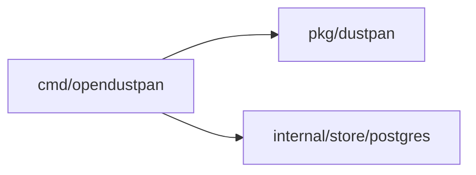

## Context

An embedder builds an own Go program around the public SDK. This change adds the NEW built-in constructors under pkg/dustpan and one guide page.

## Decisions

1. **One guide page plus NEW constructors.** One docs page holds the embed path. It names constructors, ports, and suites only, never adapter types or internal paths.
2. **Tested example without live database.** The example builds in CI, the capabilities probe runs against a test server with an access token, and the conformance commands run against SQLite and file blobs. The guide promises no fixed liveness or readiness path.

## Structure

No new exported type. Server fields stay unexported and are built only by NewServer; replaceable ports are set only through functional options.

## Risks

- Example drifts from SDK signatures
- Guide documents an internal package as stable

## Diagrams

Modules that the change touches, and their imports on main:

## Quality attributes

| Attribute | Target | Unit | Scope |
| --- | --- | --- | --- |
| none affected | Docs plus small SDK constructors, no request flow budget change |  |  |

## Contracts

**dustpan.Server**

- Invariant: Server exposes only ports and constructors from pkg, never types from internal
- `NewServer`: pre: Caller passes functional options from pkg/dustpan. Post: Server mounts the routes wired by the passed options.

## Change impact (computed from main)

Tests:

- `e2e/fetch_test.go` names `dustpan.NewServer`
- `internal/egress/egresshttp/egresshttp_test.go` names `dustpan.NewServer`
- `e2e/audit_sinks_test.go` names `dustpan.NewServer`

ADRs:

- `docs/adr/0243-the-source-port-its-adapters-and-conformance.md` names `dustpan.NewServer`
- `docs/adr/0154-history-gaps-found-before-the-implementation.md` names `dustpan.NewServer`
- `docs/adr/0272-the-public-sdk-surface.md` names `dustpan.NewServer`
