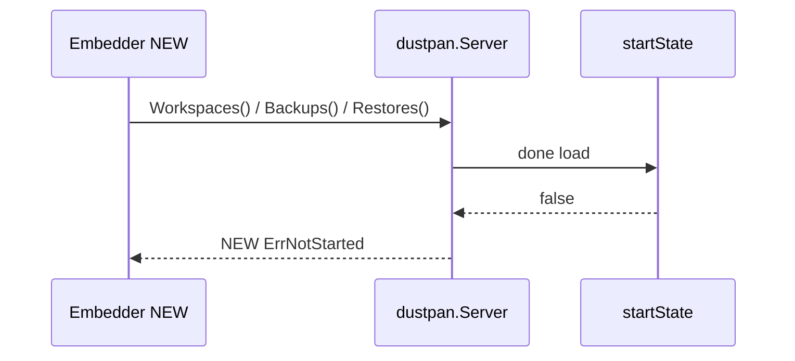
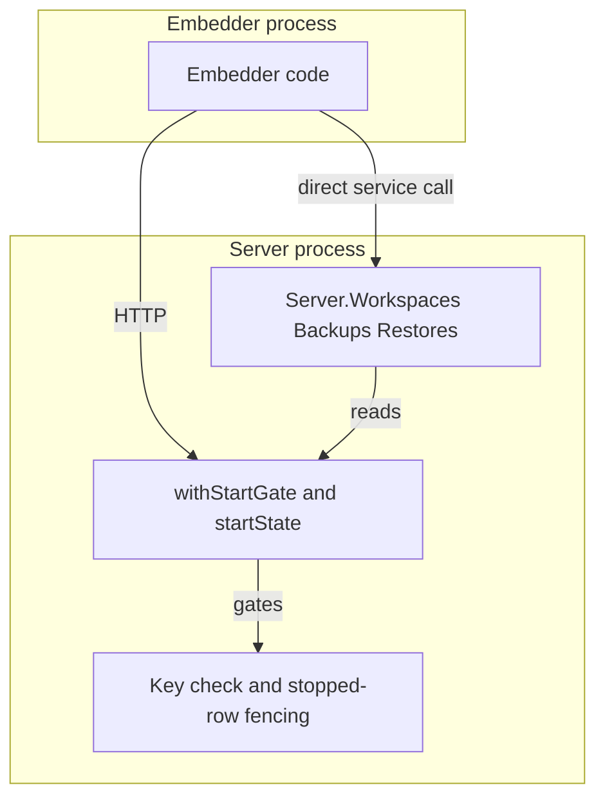

## Context

Server.Start runs the key check and fences stopped backup and restore rows. Server.Workspaces, Server.Backups and Server.Restores return services with no start check, so early use races Start.

## Decisions

1. **Gate accessors on atomic start state.** The three accessors read the unexported startState atomic done flag in pkg/dustpan/start.go and refuse with the NEW error ErrNotStarted until Start has set it last after success. The RFC fixes one of two shapes: accessors return (service, error), or services keep their shape and each method refuses. Internal Start and Run paths and Handler wiring use the ungated service fields, never the gated accessors. A handle obtained after Start keeps working across a later Start. Docs of each accessor state the Start-first rule.

## Structure

The unexported startState type holds an atomic done flag that only Server.Start sets, after success.

## Risks

- Embedder code that used services before Start must move service use after Start.

## Layers (defense in depth)

| Layer | Guard | Hostile test |
| --- | --- | --- |
| fail closed | A failed Start never sets the done flag. | Call each accessor after a Start that failed on a wrong key and expect the NEW error ErrNotStarted. |

## Diagrams

After this change:

## Quality attributes

| Attribute | Target | Unit | Scope |
| --- | --- | --- | --- |
| none affected | One atomic read for each accessor call; no storage or rate change |  |  |

## Threat model

Data flow and trust boundaries:

| Boundary | STRIDE | Threat | Layer | Guard | Hostile test |
| --- | --- | --- | --- | --- | --- |
| Embedder process | S | Embedder code calls a direct service accessor before Start and uses an unfenced service. | boundary check | Embedder calls only the fixed shapes Workspaces, Backups and Restores with valid inputs. | Call an accessor with a nil context and expect refusal without panic. |
| Embedder process | S | Embedder code calls a direct service accessor before Start and uses an unfenced service. | encode or contain | Embedder checks the NEW ErrNotStarted return and never uses a nil service. | Ignore the error return in a fixture and show the nil use is caught by nilaway. |
| Embedder process | S | Embedder code calls a direct service accessor before Start and uses an unfenced service. | limit | Embedder makes one accessor call at a time in tests with a timeout. | Run accessor calls against Start under -race with a timeout and check no hang. |
| Embedder process | S | Embedder code calls a direct service accessor before Start and uses an unfenced service. | authorize at point of use | Embedder requests the named service object only after Start. | Request Backups before Start and expect NEW ErrNotStarted. |
| Embedder process | S | Embedder code calls a direct service accessor before Start and uses an unfenced service. | fail closed | On refusal the embedder waits for Start success and retries; on failed Start it stops. | Fail Start on a wrong key and check the embedder does not retry service use. |
| Server process | T | Early direct service use races the fencing of stopped backup and restore rows and writes before the key check. | boundary check | Accessors allow only the fixed shapes Workspaces, Backups and Restores. | Call the accessor with a nil context and expect refusal without panic. |
| Server process | T | Early direct service use races the fencing of stopped backup and restore rows and writes before the key check. | encode or contain | Accessor returns service or NEW ErrNotStarted, never a half-made service. | Remove the error return and show the caller uses a nil service. |
| Server process | T | Early direct service use races the fencing of stopped backup and restore rows and writes before the key check. | limit | One atomic read of startState for each accessor call. | Run accessor calls against Start and check no data race under -race. |
| Server process | T | Early direct service use races the fencing of stopped backup and restore rows and writes before the key check. | authorize at point of use | Refusal happens at the accessor for the requested object. | Call Backups before Start and expect NEW ErrNotStarted even when Handler is gated separately. |
| Server process | T | Early direct service use races the fencing of stopped backup and restore rows and writes before the key check. | fail closed | Failed Start never sets done; accessors keep refusing. | Fail Start on a wrong key, then call each accessor and expect refusal. |

## Failure modes

| Step | Failure | Retry | State after |
| --- | --- | --- | --- |
| Start runs key check. | Key check fails. | Fix the key and call Start again. | Done flag stays false; accessors keep refusing. |
| Start fences stopped backups and restores. | Fencing of stopped rows fails. | Fix the store and call Start again. | Done flag stays false; accessors keep refusing. |
| Accessor reads done flag. | Accessor called while Start runs. | Wait for Start to succeed, then call again. | Refused until done flag is set. |

## Change impact (computed from main)

Tests:

- `pkg/backup/restore_service_dev_test.go` names `Server.Start`
- `e2e/dev_backup_test.go` names `Server.Start`
- `e2e/ha_kill_test.go` names `Server.Start`

Docs pages:

- `README.md:54` names `Server.Start`
- `README.md:475` names `Server.Start`
- `README.md:556` names `Server.Start`

ADRs:

- `docs/adr/0212-planner-role-smtp-settings-fresh-mfa-proxies-restore-audit-and-branding.md` names `Server.Start`
- `docs/adr/0116-request-states-jobs-approvals-and-freezes.md` names `Server.Start`
- `docs/adr/0164-cloud-sweeps-on-the-teams-runner.md` names `Server.Start`
