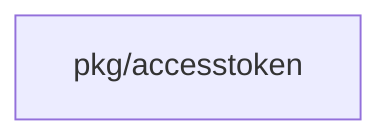

## Context

Main gates creation in requireManageTokens and resolves the target in resolveServiceTokenCreate. This change ends the token when the last maker path ends.

## Decisions

1. **Check at use.** Deny on each use when the NEW maker-path check finds no path, with no cache.

## Structure

The NEW unexported makerPathChecker in pkg/accesstoken holds only stable IDs; its constructor requires both IDs.

## Risks

- Automation that relies on a person-made token stops at grant removal.

## Layers (defense in depth)

| Layer | Guard | Hostile test |
| --- | --- | --- |
| authorize at point of use | Read the maker grants by stable ID and deny when no path remains. | Use a token after maker grant removal and show denial. |
| fail closed | Deny on store error and write an audit entry. | Fail the grant read and show the use is denied. |

## Diagrams

Modules that the change touches, and their imports on main:

## Quality attributes

| Attribute | Target | Unit | Scope |
| --- | --- | --- | --- |
| latency | 50 | ms | service token authentication with one grant read |
