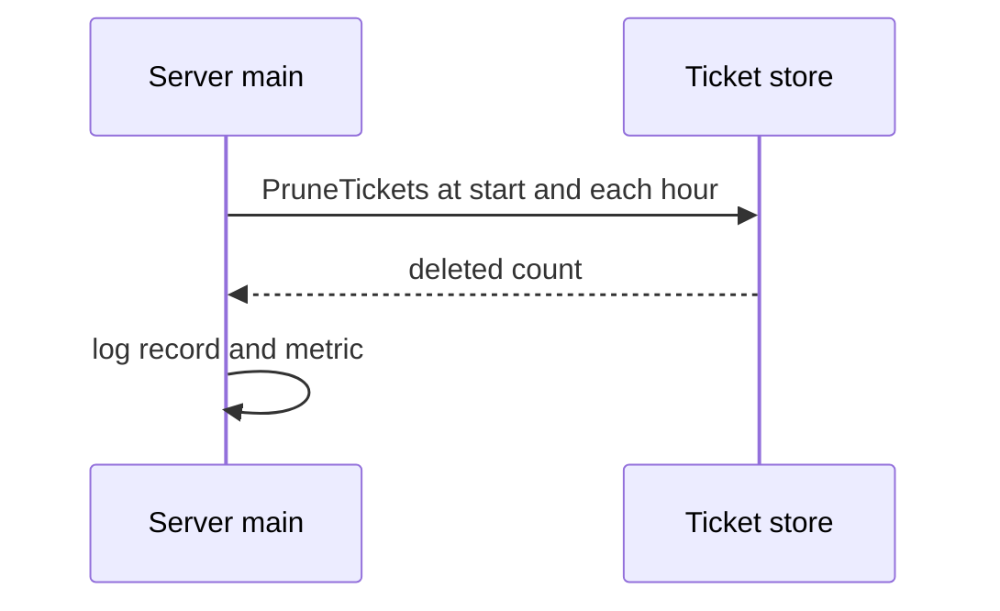
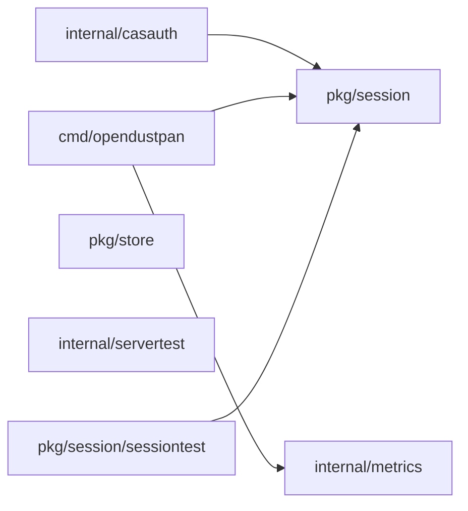
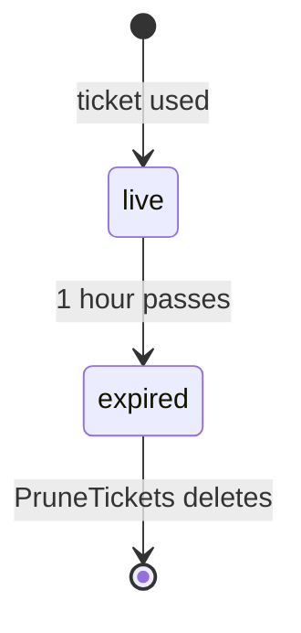
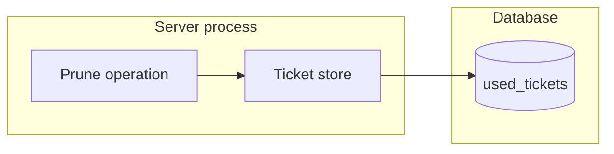

## Context

The ticket store, its SQL adapters in pkg/store and its conformance suite exist on main. No code calls the prune, and nothing wires the constructor.

## Decisions

1. **Recorded prune.** The NEW durable operation in cmd/opendustpan runs once at start and then every 1 hour, with a 30 second timeout for each run. It calls PruneTickets with the clock time, writes one log record at level info with the fields count and cutoff, and adds the count to the counter. The interval is fixed and is not a setting.
2. **Metric.** The counter `cas_used_tickets_pruned_total` has no labels and starts at 0 at each process start.
3. **Shutdown.** The operation stops when the server context ends. The next start runs the prune again.

## Structure

The type StoreTickets keeps its store and clock in unexported fields. Only NewStoreTickets makes a value and it refuses a nil store or clock.

## Risks

- A prune error leaves rows for one more hour. A live row is never deleted, because the delete reads expiry.

## Layers (defense in depth)

| Layer | Guard | Hostile test |
| --- | --- | --- |
| boundary check | NewStoreTickets refuses a nil store or clock. | TestNewStoreTicketsRefusesNil in pkg/session |
| encode or contain | The SQL uses placeholders for time. | RunTicketStore in pkg/session/sessiontest, the prune case |
| limit | The prune deletes only rows with expiry at or before the cutoff, with a 30 second timeout. | TestPruneKeepsLiveRows in pkg/session/sessiontest |
| authorize at point of use | UsedTickets refuses a live digest of the same provider. | RunUsedTickets in pkg/session/sessiontest, the replay case |
| fail closed | A prune error deletes nothing and is logged. | TestPruneRunLogsFailure in cmd/opendustpan |

## Diagrams

After this change:

Modules that the change touches, and their imports on main:

States on main in the touched packages:

States and transitions after this change:

## Quality attributes

| Attribute | Target | Unit | Scope |
| --- | --- | --- | --- |
| storage growth | 0 | expired rows older than 1 hour after each prune | used_tickets of one installation |

## Threat model

Data flow and trust boundaries:

| Boundary | STRIDE | Threat | Layer | Guard | Hostile test |
| --- | --- | --- | --- | --- | --- |
| Server process to database | T | A wrong cutoff deletes a live ticket row early and allows a replay. | boundary check | NewStoreTickets refuses a nil store or clock. | TestNewStoreTicketsRefusesNil |
| Server process to database | T | A wrong cutoff deletes a live ticket row early and allows a replay. | encode or contain | The delete uses placeholders and a time value. | RunTicketStore prune case |
| Server process to database | T | A wrong cutoff deletes a live ticket row early and allows a replay. | limit | The delete reads expiry at or before the cutoff, with a 30 second timeout. | TestPruneKeepsLiveRows |
| Server process to database | T | A wrong cutoff deletes a live ticket row early and allows a replay. | authorize at point of use | UsedTickets refuses a live digest of the same provider. | RunUsedTickets replay case |
| Server process to database | T | A wrong cutoff deletes a live ticket row early and allows a replay. | fail closed | A store error deletes nothing and is logged. | TestPruneRunLogsFailure |
| Server process to database | R | The prune deletes rows with no record. | boundary check | The prune runs only from the one wired operation. | TestPruneRunLogsCount |
| Server process to database | R | The prune deletes rows with no record. | encode or contain | The log record has fixed fields count and cutoff. | TestPruneRunLogsCount |
| Server process to database | R | The prune deletes rows with no record. | limit | One run each hour, one record each run. | TestPruneCounterSumsCounts |
| Server process to database | R | The prune deletes rows with no record. | authorize at point of use | Only the server operation calls PruneTickets, with no route. | TestPruneRunLogsCount |
| Server process to database | R | The prune deletes rows with no record. | fail closed | A failed run logs at level error and leaves the counter unchanged. | TestPruneRunLogsFailure |
| Server process to database | D | A slow delete blocks the server or the database. | boundary check | The interval is fixed and no input sets it. | TestPruneRunLogsCount |
| Server process to database | D | A slow delete blocks the server or the database. | encode or contain | The run uses its own context. | TestPruneRunLogsFailure |
| Server process to database | D | A slow delete blocks the server or the database. | limit | A 30 second timeout for each run. | TestPruneRunLogsFailure |
| Server process to database | D | A slow delete blocks the server or the database. | authorize at point of use | No caller outside the operation reaches the prune. | TestPruneRunLogsCount |
| Server process to database | D | A slow delete blocks the server or the database. | fail closed | A timeout deletes nothing more and the next hour retries. | TestPruneRunLogsFailure |

## Contracts

**UsedTickets**

- Invariant: The prune deletes only rows with expiry at or before the cutoff.
- `NewStoreTickets`: pre: The store and the clock are not nil.. Post: The value records through the store..
- `PruneTickets`: pre: The cutoff is the clock time.. Post: Expired rows are deleted and the count is returned..

## Failure modes

| Step | Failure | Retry | State after |
| --- | --- | --- | --- |
| Prune delete | The process stops, the 30 second timeout ends or the store fails. | The next run, at the next start or the next hour, deletes the remaining rows. | Expired rows remain, and they refuse nothing. |

## Change impact (computed from main)

Tests:

- `internal/casauth/hostile_test.go` names `ErrReplay`
- `internal/casauth/replay_test.go` names `ErrReplay`
- `internal/signinsvc/service_test.go` names `ErrReplay`

ADRs:

- `docs/adr/0133-runner-identities-and-tokens.md` names `ErrReplay`
- `docs/adr/0320-one-sign-in-path-for-every-sign-in-method.md` names `ErrReplay`
- `docs/adr/0321-ldap-saml-cas-oauth-groups-and-trusted-header-sign-in.md` names `ErrReplay`
