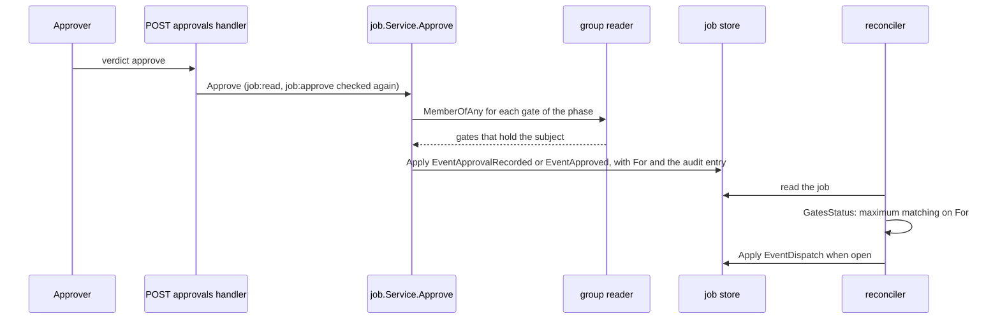

## Context

Status: Part A (decisions 1 to 10) is on main. The decisions 1 to 10 below stay as the record of what was built, and the open work is decisions 11 to 15 (Part B).

A job holds one gate for each phase kind, and a gate is one requirement: one count and one list of groups (`pkg/job/gate.go:89`). The decider refuses a unit with more than one requirement (`pkg/gate/jobgate/jobgate.go:168`). This change lets a phase hold up to 3 gates, one for each requirement, and counts approvals with a maximum matching, so that one person fills one slot.

Part A (groups only) is decided by ADR 225 decision 6 and ADR 192 decision 6. Part B (users, unit owners, fresh windows, the refusal of `unless`) follows the owner decisions of 2026-11-20 that the proposal lists. In Part A the decider keeps its refusal for each Part B shape, and Part B removes the refusals one task at a time. The kind of the approver is not part of this change: the owner decided it on 2026-11-20 (owner decision 7), and the change `machine-approvals` holds it. This design keeps what main does for the kind of the approver (an agent is refused, no other kind is).

The flow on main, which this change keeps:

1. `POST .../jobs` runs the decider, builds the gates (`PolicyGates`, `pkg/job/service_start.go:439`) and stores the job in `awaiting-approval`.
2. `POST .../jobs/{job_id}/approvals` calls `Approve` (`pkg/job/service_approve.go:38`). It reads the waiting gates, checks the approver and records the verdict.
3. `record` (`:347`) picks the event from `GatesStatus`. The last needed approval gives `EventApproved`.
4. The reconciler calls `dispatchJob` (`pkg/job/reconcile.go:363`). It dispatches when `GatesStatus` is open. The store checks the plan binding, the lock, the busy unit and the destroy proof in the same transaction as the dispatch.

## Decisions

1. **Several gates in one phase, one name each.** `Gate` gets the NEW field `Name string`, the name of its requirement (`default`, `default/<scope key>`). The name is unique in a phase. The field Gates of `Decision` becomes `map[PhaseKind][]Gate`. `PolicyGates` copies every gate of the kind, sets the type `GateApproval`, and keeps the order that `DefaultRequirements` gives (`pkg/gate/requirements.go:30`). The phase stores `[]Gate` already (`internal/store/jobstore/body.go:164`).
2. **Eligibility is recorded when the person signs.** The matching needs to know, for each approver, the gates whose groups hold the approver. `GatesStatus` is pure and runs in the reconciler with no group reader. So `Approve` computes the gates that hold the approver and stores their names in `Approval.For`. The matching reads `For` only. This is the same moment as the group check on main, so the behavior for one gate does not change. The owner decided that an approval counts as of the approval time (2026-11-20), so nothing checks the approver again at dispatch. A recheck at dispatch is a separate, later change.
3. **Maximum matching with augmenting paths.** A new file `pkg/job/match.go` holds `matchGates(gates []Gate, approvals []Approval, startedBy string, policy gate.ApproverPolicy) (filled map[string]int, ok bool)`. Each gate has `Approvals` slots. An approval is a candidate for gate `g` when `g.counts` is true for it (`pkg/job/gate.go:266`) and `g.Name` is in `For`. Two approvals of one subject make one candidate. The search runs from each distinct subject with an augmenting path. The result is independent of the order of the approvals (ADR 225 decision 6). The size is at most 3 gates times 10 slots, so the cost is bounded.
4. **`Gate.Status` stays for one gate.** `GatesStatus` (`:295`) calls `matchGates` for the approval gates, returns `GateRejected` when any verdict rejects (as main does), `GateOpen` when every slot is filled, and `GateWaiting` otherwise. A confirmation gate keeps its own rule and is counted apart from the matching (`pkg/job/gate.go:266`, `WithConfirmations`).
5. **The approver check goes by gate.** `checkApprover` (`:208`) keeps the agent, policy, self-approval and repeat checks. The self-approval check changes from "no gate allows the starter" to "the starter fills only the gates that allow it": the starter's `For` holds only the gates with AllowSelf, and an empty `For` is refused. `checkGroups` (`:253`) returns the list of gates that hold the subject, and refuses with `identity.ErrDenied` when the list is empty. The refusal text names the requirements of the phase that the subject cannot fill. A gate with no groups holds every approver who passes the other checks (main: "any holder of the approve action").
6. **Approvals bind to the plan, as on main.** BindPlan is set on every gate of a changing phase after a plan phase (`pkg/gate/jobgate/jobgate.go:100-104`). `checkPlan` stays.
7. **Part B shapes stay refused in Part A.** `gatesOf` keeps the three `gate.ErrUnavailable` cases of `gateOf` (users or unit owners, `freshAuthSeconds`, groups with no IDs), per requirement, with the same message. So Part A opens no new path for a shape that Part B has not built yet. Decisions 11 to 14 describe Part B. `DefaultRequirements` keeps its refusal of an `unless` body (`pkg/gate/requirements.go:44`) for good (decision 14).
8. **The count is bound by structure.** `UnitChain` gives at most 3 scopes (`pkg/gate/scope.go:459`) and a scope holds one default (`pkg/gate/rules.go:298`), so `DefaultRequirements` gives at most 3 requirements. The cap of 10 requirements and the 429 refusal of the first draft are dropped: nothing counts requirements today, and a refusal that no input can reach is dead code. A defense-in-depth check stays in the start: a decision with more than `MaxApprovalGates` (3) gates for one phase fails with `ErrInvalid`.
9. **No SQL change.** The job state is the JSON column body of the jobs table (`internal/store/jobstore/body.go`), shared by `internal/store/sqlite` and `internal/store/postgres`. `gateBody` gets `name`, `approvalBody` gets `for`. A job row that holds no `name` is a job of an older shape that no tag shipped, so no conversion code is written. The baselines in `internal/store/sqlite/migrations/` and `internal/store/postgres/migrations/` do not change, and no migration is added.
10. **The audit entry names the requirements.** `approvalEntry` (`:391`) adds the change `requirements` with the names in `For`, and `event` as on main. A refusal writes an audit entry through `approvalRefusalReason` (`internal/api/jobs/approve.go:247`), with a new reason for "no requirement of the phase holds the subject".
11. **Users by stable ID (owner, 2026-11-20).** `Approvers` gets the NEW field `UserIDs`, parallel to `Users`, as GroupIDs is parallel to `Groups` (`pkg/gate/rules.go:147`). The config service sets both at save, so a caller cannot choose the IDs, and `Users` is for display. `Gate` gets `UserIDs` and `Users`. A user entry with no ID counts no one, and `gatesOf` refuses the requirement with `gate.ErrUnavailable` (fail closed). `Approve` maps the subject of the approver to the stable principal ID with a small reader port in `pkg/job` (`PrincipalIDs`), and a gate holds the approver when the ID is in `UserIDs`. The `users` field changes meaning, and no tag shipped the old one, so no conversion code is written. Any holder of `job:approve` may reject, whatever the approvers say (owner, 2026-11-20): the rejection path of `Approve` still skips the group and the user check.
12. **Unit owners resolve at each approval (owner, 2026-11-20).** A gate with UnitOwners set makes `Approve` read the owners of the unit from the context at the scope of the rule or wider, through a reader port in `pkg/job` (UnitOwners). `objectcontext.ParseOwner` gives the kind. Only `group:<name>` (the group by name now, then its stable ID, then the same membership check as a group gate) and `principal:<ID>` count. An owner of the kind text counts no one. A read error, no reader or an owner that does not parse refuses the approval with a `*DeniedError` on `job:approve` (fail closed). The result goes into `For`, so the matching never reads the context.
13. **Each requirement keeps its own fresh window (owner, 2026-11-20).** A requirement with `freshAuthSeconds` becomes a gate with the NEW field `FreshAuthSeconds` (the pair `Set` and `Seconds` of `gate.FreshAuth`, `pkg/gate/rules.go:83`). `Approve` adds a gate to `For` only when the fresh step of the approver meets the window of that gate. The approval already records the time of the fresh step (Approval.AuthAt). An approval that fills no gate because of the windows is refused with `mfa.fresh-step-required`. The window of a gate is never longer than the one window of the installation (ADR 227 decision 4). `freshAuthEnabled` is read at the one place that ADR 385 names, and when it is off no window is enforced and the job response shows the stored value with `"enforced": false`. A person with no fresh step fills only the gates with no window.
14. **No `unless` on a job (owner, 2026-11-20).** `DefaultRequirements` keeps its refusal. The error text names the requirement and says to remove the `unless` body. The test of the decider fixes it, also when the `unless` default is the second requirement. No evaluation of `unless` is added, so ADR 353 decision 6 has no fact to read.
15. **The kind of the approver is not changed here.** `checkApprover` refuses an agent and nothing else by kind, as main does. The rule for a service principal, a job token and an access token is in the change `machine-approvals`, which starts after this change and after the ADR that follows RFC 134. This design adds no code path that a token approval needs, and the matcher reads no credential. A machine approval is not part of any task here, and nothing here counts it.
16. **The ports and the wiring of Part B.** This decision names the readers that decisions 11 and 12 need. It does not change their rules.
    - The struct-field preflight of task 5.0 adds the NEW fields of `Approvers` and `Gate` first, with zero values. The literals of these types are in more than 10 files.
    - At save, the config service resolves each user name through the NEW port `gate.UserResolver`. The port is the NEW optional field `Users` of `ConfigServiceConfig`. The NEW type `userDirectory` in `pkg/dustpan/gateconfig.go` is its adapter over the principal store. With a nil port, a save that names a user fails with `gate.ErrUnavailable`. An unknown user fails the save with the NEW reason `ApproversUserMissing`. The API hides that reason from a caller without `server:read-principals`, as it hides a missing group. So a role of a namespace cannot learn which users exist.
    - At approval, `Approve` reads the ID of the subject through the NEW port `job.PrincipalIDs` (decision 11). The port is the NEW optional field `Principals` of `ServiceConfig`, and `jobGroups` in `pkg/dustpan/jobgroups.go` is its adapter. With a nil port, a gate with users holds no one.
    - A gate with unit owners holds the NEW field `Scope`. `gatesOf` sets it from the chain: a requirement that names approvers is `default/<scope key>`, so it has exactly one scope (ADR 225 decision 4). `UnitOwnerReader` reads at that scope and the wider scopes. The NEW type `jobOwners` in the NEW file `pkg/dustpan/jobowners.go` is its adapter over the context store. A zero `Scope` on a gate with unit owners refuses the approval.
    - A `group:<name>` owner goes through the NEW port `job.GroupNames`, then through `GroupReader` by ID. `jobGroups` is its adapter. A missing group counts no one. A read error or a nil port refuses the approval. The name is read once, at the approval. The approval stores only the names of the gates in `For`, and no group name.
    - The job store keeps `users`, `userIds`, `unitOwners` and `scope` in `gateBody`. A scope key that does not parse fails the decode, so a gate never loses its scope in silence.
    - The jobs API shows `users` and `unitOwners` on each gate. `userIds` stays in the store only, as `groupIds` does.

## Contract

Signatures of the new and changed names. A sentinel that is not listed is the one of main.

```go
// pkg/job/gate.go (NEW fields and constant)
type Gate struct {
    // ... fields of main ...
    // Name is the name of the requirement of the gate: "default" or
    // "default/<scope key>". It is unique in a phase.
    Name string
    // Part B: UserIDs holds the stable principal IDs of the approvers that
    // the requirement names, Users holds their names for display, UnitOwners
    // is true when the requirement names the owners of the unit, and
    // FreshAuth is the window of the requirement.
    // Scope is the scope of the default that gave the requirement. It is set
    // for a requirement that names approvers, and it is zero for "default".
    Users      []string
    UserIDs    []string
    UnitOwners bool
    Scope      gate.Scope // NEW
    FreshAuth  gate.FreshAuth
}

type Approval struct {
    // ... fields of main ...
    // For holds the names of the gates whose groups held the approver when
    // the approver signed. An empty For fills no slot.
    For []string
}

// MaxApprovalGates is the most gates that one phase may hold.
const MaxApprovalGates = 3

// Decision.Gates changes from map[PhaseKind]Gate.
type Decision struct {
    Allow         bool
    Reason        string
    Gates         map[PhaseKind][]Gate
    PolicyVersion string
}

// pkg/job/match.go (NEW, unexported)
func matchGates(gates []Gate, approvals []Approval, startedBy string, policy gate.ApproverPolicy) (filled map[string]int, open bool)

// pkg/job (Part B, NEW). Each port is optional; with a gate that needs it and
// no port, the approval is refused (fail closed).
type PrincipalIDs interface {
    // IDOf returns the stable principal ID of subject.
    IDOf(ctx context.Context, subject string) (string, error)
}

type UnitOwnerReader interface {
    // UnitOwners returns the owners of the unit from the context at the scope
    // of the rule or wider.
    UnitOwners(ctx context.Context, unit identity.Object, scope gate.Scope) ([]objectcontext.Owner, error)
}

// GroupNames is NEW (Part B). It resolves the group of a "group:<name>"
// owner. ErrNotFound means that no group has the name: the owner counts no
// one. Any other error refuses the approval.
type GroupNames interface {
    // GroupIDOf returns the stable ID of the group that is called name now.
    GroupIDOf(ctx context.Context, name string) (string, error)
}

// pkg/gate/config.go (Part B, NEW). With a nil port in ConfigServiceConfig,
// a save that names a user fails with ErrUnavailable.
type UserRef struct {
    ID   string // the stable principal ID
    Name string // the current name, for display
}

type UserResolver interface {
    // ResolveUser returns the principal that has the subject name. It
    // returns ErrNotFound when no principal has it.
    ResolveUser(ctx context.Context, name string) (UserRef, error)
}

// pkg/gate/approvers_error.go (Part B): the NEW reason ApproversUserMissing,
// a user that does not exist, after ApproversCountAbove.

// pkg/job/service_start.go (NEW, unexported). Errors: ErrInvalid.
func checkGates(gates []Gate) error
```

Sentinels: `ErrInvalid` for a bad gate set at the start; `identity.ErrDenied` (as `*DeniedError` on `job:approve`) for an approver that no gate holds; `ErrSelfApproval`, `ErrAlreadyApproved` and `ErrAgentDenied` as on main; `gate.ErrUnavailable` for a requirement with a Part B shape.

Endpoints: no new route. The response of `GET /api/dustpan/v1/namespaces/{namespace}/jobs/{job_id}` gets `gates[].name` (string), `gates[].filled` (integer, the slots that the matching fills) and `approvals[].for` (array of strings). The request of `POST .../approvals` does not change.

Stored shape: `jobs.body` JSON of both dialects gets `gates[].name` and `approvals[].for`. No table, column or migration changes.

Stored shape of Part B: `gates[].userIds`, `gates[].users`, `gates[].unitOwners`, `gates[].scope` and `gates[].freshAuth` in the same JSON body. The response of the jobs API gets `gates[].users` and `gates[].unitOwners` (tasks 5.1 and 5.2), and `gates[].freshAuthSeconds` and `gates[].freshAuthEnforced` (task 5.4).

Audit entry of an approval: the changes `job`, `verdict`, `phase`, `operation`, `event` and `plan` as on main, plus `requirements` (comma-separated names from `For`).

## Structure

- `Gate.Name` and `Approval.For` are set only in the job package and the jobgate decider. A constructor `NewGate` is not added, because `Gate` is a plain value that tests build (ADR 364: no new tool). The start validates the set of gates of a phase in one function, `checkGates`, which refuses an empty name when the phase has more than one gate, a repeated name, and more than `MaxApprovalGates` gates.
- `matchGates` is unexported. `GatesStatus` is its only caller, so a caller cannot count a gate with another rule.

## Layers (defense in depth)

Authorization per route is unchanged and stays:

| Route | Reads | Actions | Object |
| --- | --- | --- | --- |
| `POST /api/dustpan/v1/namespaces/{namespace}/jobs` | - | writes `unit:run-plan` | the unit (`internal/api/jobs/routes.go:151`) |
| `POST .../jobs/{job_id}/approvals` | `job:read` | `job:approve` | the unit of the job (`:157`) |
| `GET .../jobs/{job_id}` | `job:read` | - | the unit of the job |

The service checks `job:read` and `job:approve` again on the unit (`authorizedJob`). Each layer below stops the attack alone.

| Layer | Guard | Hostile test (fails when the guard is removed) |
| --- | --- | --- |
| Decider (`pkg/gate/jobgate`) | `gatesOf` refuses a requirement with users, unit owners, `freshAuthSeconds`, or groups with no IDs, and names the requirement. `DefaultRequirements` refuses an `unless` body. | A table of defaults with one Part B shape in the second scope. Each row wants `gate.ErrUnavailable`. Remove the guard and the row fails. |
| Gate set (`pkg/job`, `checkGates`) | Refuses a phase with more than 3 gates, a repeated name, or an empty name with several gates. | A decision with 4 gates, 2 gates with one name, 2 gates with an empty name. Each wants `ErrInvalid`. |
| Matcher (`pkg/job/match.go`) | One subject fills one slot. An approval with an empty `For`, an agent, a reject verdict, a subject that the policy does not count, or the starter on a gate with no AllowSelf fills no slot. | A table in `pkg/job/match_test.go`: one person who holds both gates fills one slot; two approvals of one subject fill one; a greedy order that fails and a maximum matching that succeeds; the reverse order of the same approvals gives the same result. |
| Service (`pkg/job`, `Approve`) | `checkApprover` and `checkGroups` check each gate by group ID with the reader. A failed read, no reader, a gate with no IDs, or an empty `For` is a `*DeniedError` on `job:approve`. | Extend `pkg/job/service_approve_groups_test.go`: a member of group A only fills gate A; a member of neither group is refused; an inactive member is refused; a read error is refused; the refusal names the gates. |
| Decider, Part B | `gatesOf` refuses a user entry with no ID, and `DefaultRequirements` refuses an `unless` body, also in the second scope. | A table with a user with no ID and an `unless` default in the second scope. Each row wants `gate.ErrUnavailable`. |
| Config, Part B (`pkg/gate`, `checkApprovers`) | A save resolves each user name to its ID. An unknown user, a nil `UserResolver` or a read error fails the save. The ID that a caller gives is dropped. The API hides `ApproversUserMissing` from a caller without `server:read-principals`. | The NEW file `pkg/gate/config_users_test.go` and `internal/api/server/gate_config_test.go`: an unknown user, a nil port, a caller-given ID, and a caller without `server:read-principals`. Each row fails when the guard is removed. |
| Service, Part B (`Approve`) | The owner read, the principal ID read and the window check each fail closed: a read error, no reader, a text owner, a user with no ID, or a stale fresh step fills no gate and refuses the approval. | Extend `pkg/job/service_approve_groups_test.go`: a read error of the context is refused; a text owner counts no one; a stale step with a gate that has a window fills only the gates with none; with `freshAuthEnabled` off no window applies. Each row fails when the guard is removed. |
| Reconciler (`pkg/job/reconcile.go`) | `dispatchJob` dispatches only when `GatesStatus` is open, computed from the stored `For`. | A job with 2 gates, 3 approvals from 2 people: stays queued until the third distinct person. |
| Store (`internal/store/jobstore`) | The store keeps the codec round trip of `name` and `for`, and `Store.Apply` for `EventDispatch` keeps its checks. | The job store conformance suite (`pkg/job/jobtest`): a job with 2 named gates and approvals with `for` round-trips on both dialects. |
| HTTP (`internal/api/jobs`) | The route keeps `job:read` and `job:approve`. The refusal maps to 403 with the audit reason. | `internal/servertest/jobs_api_test.go`: a caller without `job:approve` gets 403 and no approval is stored; a caller who is in no group gets 403 with the requirement names. |
| Fail closed | An unknown gate type, an unknown status or a missing reader means deny or wait. | `GatesStatus` with an unknown status keeps the job waiting (`pkg/job/service_approve.go:363` keeps `EventApprovalRecorded`). |

Hostile cases for the matcher and the service (each is a row in the table tests):

| Case | Expected |
| --- | --- |
| Ann holds groups A and B; gate A needs 1, gate B needs 1; only Ann approves | waiting: Ann fills one slot |
| Ann holds A and B; Bo holds A only; gate A needs 1, gate B needs 1 | open: Bo fills A, Ann fills B (a greedy order that gives Ann to A fails) |
| Ann approves twice | one slot; the second call is `job.already-approved` |
| The starter holds group A; gate A has AllowSelf false | refused with `job.self-approval` |
| An agent records an approval | refused, never a slot |
| `For` is empty on a stored approval | fills no slot |
| A rejection by one holder of `job:approve` | the job is rejected |
| A subject that the approver policy does not count (a dev subject on production) | refused and fills no slot |
| 4 gates in a decision | the start fails with `ErrInvalid` |
| Group read fails | the approval is refused, and an audit entry is written |
| A user is removed and made again with the same name | the new user fills no slot: the gate holds the old principal ID |
| The context read fails at an approval of a unit-owner gate | the approval is refused with 403, and an audit entry is written |
| The context names an owner as plain text | that owner fills no slot |
| A gate with unit owners has a zero scope, or no group resolver is set | the approval is refused with 403 |
| A save names a user that does not exist, and the caller lacks `server:read-principals` | the answer does not say that the user is missing |
| The owners change after Bo approved | the approval of Bo still fills its slot |
| A fresh step of 10 minutes, gate A window 300 s, gate B no window | `For` holds gate B only |
| A default with an `unless` body in the second scope | the start fails with `gate.ErrUnavailable` |
| A holder of `job:approve` who is in no approver list rejects | the job is rejected |

## Failure modes

- A person leaves a group after signing: the approval counts (owner decision, 2026-11-20: an approval counts as of the approval time). The audit entry shows `requirements`. A recheck at dispatch is a separate, later change.
- A group is made again with the same name: the gate holds the old ID, so the new group does not match (GroupIDs, ADR 362).
- Two approvals arrive at the same time: the store checks the job version in `Store.Apply`, so the second call gets a conflict (409) and may be sent again.
- A job of a unit with no default: no gate, no matching, no change.
- The reconciler runs on a job with 2 gates and an old approval with no `For`: the approval fills no slot, and the job waits. This is the closed choice.

## Risks

- A service principal, a job token or an access token that holds `job:approve` may approve, as on main. The change `machine-approvals` narrows it. This design does not widen or narrow it.
- One approver counted for two requirements lets a change run with too few people. The matcher test and the removal test cover it.
- A first-fit count refuses a valid set. The matching test with a second approver covers it.
- A change of the `Decision` type breaks the callers in `pkg/job/jobtest/rules.go:271` and `pkg/store/storetest/devdata_jobs.go:109`. The tasks list each caller.

## Diagram


