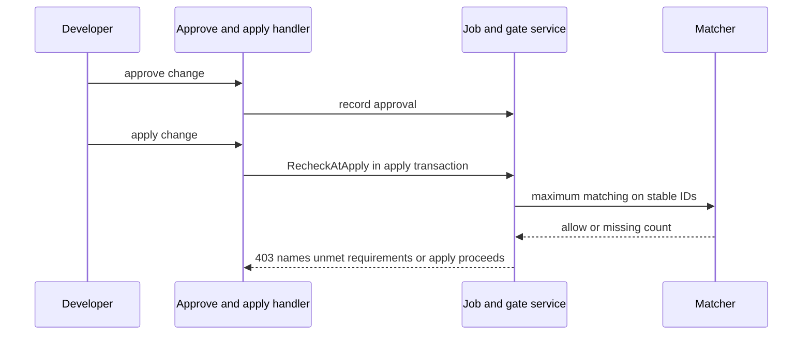
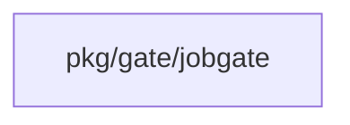
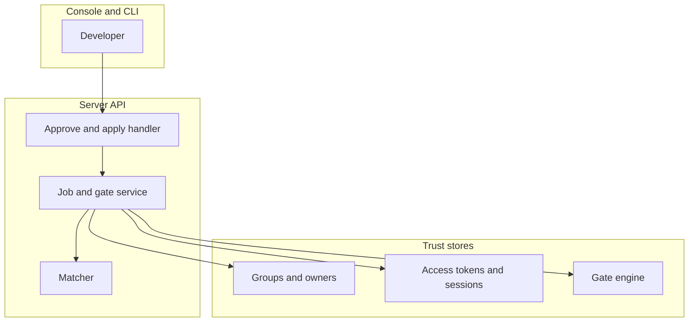

## Context

Slice 1 decider supports one group requirement and returns gate.ErrUnavailable for the rest. This change replaces that unavailable path with evaluation of all stored requirements in the same decider and record shape. It reuses the fresh authentication window of fresh-authentication-window-0-turns and the dev-data approver rules of gate-evaluation-must-apply-dev.

## Decisions

1. **Maximum matching over distinct approvers.** Evaluate up to 10 requirements per change in one pure matcher in pkg/gate/jobgate with maximum bipartite matching by augmenting-path search over eligible approvers, so a greedy order never refuses a valid set and never counts one approver twice. The unless body is stored on the approval rule by the namespace administrator or collection owner through the existing gate set routes. The unless input is the change fact document of the decision point. The unless bound is 5 seconds and 64 KB; error, timeout, or oversize means not exempt. Scope is one change evaluation.
2. **Atomic recheck at apply time with stable IDs.** Recheck every approval inside the same store transaction that moves the job or change order to apply: stable principal IDs, current group and owner membership, fresh authentication window at approval and apply time per the window model of fresh-authentication-window-0-turns, session revocation, plan revision binding, withdrawal, self-approval exclusion, dedupe by stable ID with a unique approval key per change and revision, and unless exemption through the existing gate engine. Write the unless audit entry once inside the same apply transaction, not on each read. Server time is the clock. An approver pairs only with a requirement whose window the approver meets.

## Structure

Unexported requirementSet built only by newRequirementSet which checks at least one stored requirement, at most 10 stored requirements, valid approver kinds, and non-negative freshAuthSeconds.

## Risks

- One approver counted twice lets a change apply with too few people.
- Stale fresh-authentication check lets an old sign-in approve a destroy.
- Membership change between approval and apply lets an ineligible approver persist.
- Greedy matching refuses a valid approver set or accepts too few people.
- Concurrent duplicate approvals count one person twice.

## Layers (defense in depth)

| Layer | Guard | Hostile test |
| --- | --- | --- |
| port adapter | Matcher allows only distinct eligible approvers per requirement by maximum bipartite matching on stable IDs. | Submit one approver covering two requirements plus a second approver covering one, and check the matcher still finds the valid assignment. |
| service | Service rechecks eligibility, fresh window at approval and apply time, revocation, plan binding, withdrawal, self-approval, and dedupes concurrent duplicate approvals inside the apply transaction. | Change group membership between approval and apply, replay an old approval past the window, post duplicate approvals at once, and check refusal or single count. |
| HTTP handler | Handler returns 403 that names each unmet requirement and the count of missing distinct approvers. | Post an apply with one requirement unmet and check the error body names the requirement and the missing count. |

## Diagrams

After this change:

Modules that the change touches, and their imports on main:

New imports of this change (each one allowed by the module rules):

- `internal/api/server` imports `pkg/gate/jobgate`
- `pkg/gate/jobgate` imports `pkg/gate`

## Quality attributes

| Attribute | Target | Unit | Scope |
| --- | --- | --- | --- |
| correctness | 100 percent of valid distinct-approver sets accepted | percent | approval evaluation for one change with up to 10 requirements |
| latency | 500 milliseconds maximum | milliseconds | decider evaluation per apply check |

## Threat model

Data flow and trust boundaries:

| Boundary | STRIDE | Threat | Layer | Guard | Hostile test |
| --- | --- | --- | --- | --- | --- |
| Console and CLI | S | A caller forges another principal and submits an approval in that name. | boundary check | Handler validates requirement IDs and approval bodies with an allowlist and refuses unknown values with 400. | Send a malformed approval body and check 400 with no state change. |
| Console and CLI | S | A caller forges another principal and submits an approval in that name. | encode or contain | Approval records hold stable IDs only; handler encodes output and strips control characters from names. | Send a name with CR LF and check stored output holds no header split. |
| Console and CLI | S | A caller forges another principal and submits an approval in that name. | limit | Handler rate limits approval posts per change and caps approvals at 10 requirements per change. | Flood approvals for one change and check the limit holds with 429. |
| Console and CLI | S | A caller forges another principal and submits an approval in that name. | authorize at point of use | Handler checks access token and authorization actions at the approve and apply routes. | Send an approval with a forged principal name and check refusal. |
| Console and CLI | S | A caller forges another principal and submits an approval in that name. | fail closed | Unknown principal or store error fails closed with refusal and audit entry. | Force a group lookup error and check the approval is refused, not counted. |
| Server API | T | One approver is counted twice or a stale approval passes the apply check. | boundary check | Service validates requirement shape at set time and refuses an 11th requirement with 400. | Store 11 requirements and check the set is refused. |
| Server API | T | One approver is counted twice or a stale approval passes the apply check. | encode or contain | Matcher output encodes only IDs and counts; no secret value enters records or logs. | Inspect approval records after a fresh-window refusal and check no secret value is present. |
| Server API | T | One approver is counted twice or a stale approval passes the apply check. | limit | Matcher counts only distinct stable IDs by maximum matching with a cap of 10 requirements per change. | Submit one approver for two requirements and check the apply still waits. |
| Server API | T | One approver is counted twice or a stale approval passes the apply check. | authorize at point of use | Service rechecks eligibility, revocation, window, plan binding, and withdrawal inside the apply transaction. | Revoke the session between approval and apply and check refusal. |
| Server API | T | One approver is counted twice or a stale approval passes the apply check. | fail closed | Unless evaluation failure closes to not exempt with no partial allow. | Force an unless engine error and check the requirement stays unmet. |
| Trust stores | I | An exemption or approval leaves no record, so the allow cannot be explained. | boundary check | Service validates group and owner references before count and refuses unknown IDs. | Send an approval with an unknown group ID and check 400 with no count. |
| Trust stores | I | An exemption or approval leaves no record, so the allow cannot be explained. | encode or contain | Group and session reads use placeholders and contained paths only. | Send an approval with path characters in the group name and check no escape from the store query. |
| Trust stores | I | An exemption or approval leaves no record, so the allow cannot be explained. | limit | Group expansion pages with a bound and unless evaluation carries time and size bounds. | Expand a large group and check the bound holds without timeout of the apply path. |
| Trust stores | I | An exemption or approval leaves no record, so the allow cannot be explained. | authorize at point of use | Eligibility reread at apply time uses current membership, not the approval-time copy. | Remove a member after approval and check RecheckAtApply refuses. |
| Trust stores | I | An exemption or approval leaves no record, so the allow cannot be explained. | fail closed | Unless exemption and every approval write an audit entry with requirement, setter, reason, and time. | Trigger an exemption and check the audit entry holds all four fields. |

## Contracts

**jobgate requirement set**

- Invariant: Every counted approver holds a distinct stable principal ID.
- Invariant: Every counted approval is eligible at apply time and bound to the current plan revision.
- Invariant: An exempt requirement carries a matched reason and an audit entry.
- `Evaluate`: pre: Caller passes stored requirements and recorded approvals for one change.. Post: Returns allow only when each non-exempt requirement holds with distinct approvers..
- `RecheckAtApply`: pre: Runs inside the same store transaction that moves the job to apply.. Post: Refuses when any approval lost eligibility, left the fresh window, was withdrawn, or bound to an older revision..

## Failure modes

| Step | Failure | Retry | State after |
| --- | --- | --- | --- |
| Evaluate unless exemption | Gate engine timeout on unless body | No retry; treat as not exempt and keep waiting for approvals. | awaiting-approval |
| Record approval | Concurrent duplicate approvals for one change | No retry; dedupe by stable ID inside the apply transaction. | awaiting-approval with one counted approval |
| Recheck at apply time | Group membership changes between approval and apply | Request a new eligible approval; no automatic retry. | awaiting-approval |
| Set approval rule | More than 10 requirements stored for one change | No retry; the set route refuses the 11th requirement and the evaluation fails closed. | awaiting-approval |
