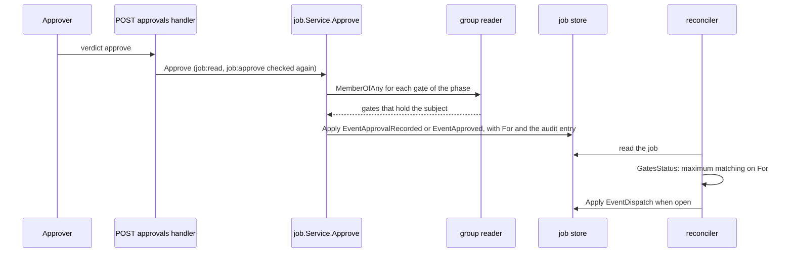

## Context

A job holds one gate for each phase kind, and a gate is one requirement: one count and one list of groups (`pkg/job/gate.go:89`). The decider refuses a unit with more than one requirement (`pkg/gate/jobgate/jobgate.go:168`). This change lets a phase hold up to 3 gates, one for each requirement, and counts approvals with a maximum matching, so that one person fills one slot.

Part A (groups only) is decided by ADR 225 decision 6 and ADR 192 decision 6. Part B (users, unit owners, fresh authentication, unless) waits for the five open questions in the proposal. In Part A the decider keeps its refusal for each Part B shape.

The flow on main, which this change keeps:

1. `POST .../jobs` runs the decider, builds the gates (`PolicyGates`, `pkg/job/service_start.go:439`) and stores the job in `awaiting-approval`.
2. `POST .../jobs/{job_id}/approvals` calls `Approve` (`pkg/job/service_approve.go:38`). It reads the waiting gates, checks the approver and records the verdict.
3. `record` (`:347`) picks the event from `GatesStatus`. The last needed approval gives `EventApproved`.
4. The reconciler calls `dispatchJob` (`pkg/job/reconcile.go:363`). It dispatches when `GatesStatus` is open. The store checks the plan binding, the lock, the busy unit and the destroy proof in the same transaction as the dispatch.

## Decisions

1. **Several gates in one phase, one name each.** `Gate` gets the NEW field `Name string`, the name of its requirement (`default`, `default/<scope key>`). The name is unique in a phase. `Decision.Gates` becomes `map[PhaseKind][]Gate`. `PolicyGates` copies every gate of the kind, sets the type `GateApproval`, and keeps the order that `DefaultRequirements` gives (`pkg/gate/requirements.go:30`). The phase stores `[]Gate` already (`pkg/store/internal/jobstore/body.go:164`).
2. **Eligibility is recorded when the person signs.** The matching needs to know, for each approver, the gates whose groups hold the approver. `GatesStatus` is pure and runs in the reconciler with no group reader. So `Approve` computes the gates that hold the approver and stores their names in `Approval.For`. The matching reads `For` only. This is the same moment as the group check on main, so the behavior for one gate does not change (question 3 asks whether to check again at dispatch).
3. **Maximum matching with augmenting paths.** A new file `pkg/job/match.go` holds `matchGates(gates []Gate, approvals []Approval, startedBy string, policy gate.ApproverPolicy) (filled map[string]int, ok bool)`. Each gate has `Approvals` slots. An approval is a candidate for gate `g` when `g.counts` is true for it (`pkg/job/gate.go:266`) and `g.Name` is in `For`. Two approvals of one subject make one candidate. The search runs from each distinct subject with an augmenting path. The result is independent of the order of the approvals (ADR 225 decision 6). The size is at most 3 gates times 10 slots, so the cost is bounded.
4. **`Gate.Status` stays for one gate.** `GatesStatus` (`:295`) calls `matchGates` for the approval gates, returns `GateRejected` when any verdict rejects (as main does), `GateOpen` when every slot is filled, and `GateWaiting` otherwise. A confirmation gate keeps its own rule and is counted apart from the matching (`pkg/job/gate.go:266`, `WithConfirmations`).
5. **The approver check goes by gate.** `checkApprover` (`:208`) keeps the agent, policy, self-approval and repeat checks. The self-approval check changes from "no gate allows the starter" to "the starter fills only the gates that allow it": the starter's `For` holds only the gates with `AllowSelf`, and an empty `For` is refused. `checkGroups` (`:253`) returns the list of gates that hold the subject, and refuses with `identity.ErrDenied` when the list is empty. The refusal text names the requirements of the phase that the subject cannot fill. A gate with no groups holds every approver who passes the other checks (main: "any holder of the approve action").
6. **Approvals bind to the plan, as on main.** `BindPlan` is set on every gate of a changing phase after a plan phase (`pkg/gate/jobgate/jobgate.go:100-104`). `checkPlan` stays.
7. **Part B shapes stay refused.** `gatesOf` keeps the three `gate.ErrUnavailable` cases of `gateOf` (users or unit owners, `freshAuthSeconds`, groups with no IDs), per requirement, with the same message. `DefaultRequirements` keeps its refusal of an `unless` body (`pkg/gate/requirements.go:44`). So Part A opens no new path for a shape that has no decision.
8. **The count is bound by structure.** `UnitChain` gives at most 3 scopes (`pkg/gate/scope.go:459`) and a scope holds one default (`pkg/gate/rules.go:298`), so `DefaultRequirements` gives at most 3 requirements. The cap of 10 requirements and the 429 refusal of the first draft are dropped: nothing counts requirements today, and a refusal that no input can reach is dead code. A defense-in-depth check stays in the start: a decision with more than `MaxApprovalGates` (3) gates for one phase fails with `ErrInvalid`.
9. **No SQL change.** The job state is the JSON column `jobs.body` (`pkg/store/internal/jobstore/body.go`), shared by `pkg/store/sqlite` and `pkg/store/postgres`. `gateBody` gets `name`, `approvalBody` gets `for`. A job row that holds no `name` is a job of an older shape that no tag shipped, so no conversion code is written. The baselines in `pkg/store/sqlite/migrations/` and `pkg/store/postgres/migrations/` do not change, and no migration is added.
10. **The audit entry names the requirements.** `approvalEntry` (`:391`) adds the change `requirements` with the names in `For`, and `event` as on main. A refusal writes an audit entry through `approvalRefusalReason` (`internal/api/jobs/approve.go:247`), with a new reason for "no requirement of the phase holds the subject".

## Contract

Signatures of the new and changed names. A sentinel that is not listed is the one of main.

```go
// pkg/job/gate.go (NEW fields and constant)
type Gate struct {
    // ... fields of main ...
    // Name is the name of the requirement of the gate: "default" or
    // "default/<scope key>". It is unique in a phase.
    Name string
}

type Approval struct {
    // ... fields of main ...
    // For holds the names of the gates whose groups held the approver when
    // the approver signed. An empty For fills no slot.
    For []string
}

// MaxApprovalGates is the most gates that one phase may hold.
const MaxApprovalGates = 3

// Decision.Gates changes from map[PhaseKind]Gate.
type Decision struct {
    Allow         bool
    Reason        string
    Gates         map[PhaseKind][]Gate
    PolicyVersion string
}

// pkg/job/match.go (NEW, unexported)
func matchGates(gates []Gate, approvals []Approval, startedBy string, policy gate.ApproverPolicy) (filled map[string]int, open bool)

// pkg/job/service_start.go (NEW, unexported). Errors: ErrInvalid.
func checkGates(gates []Gate) error
```

Sentinels: `ErrInvalid` for a bad gate set at the start; `identity.ErrDenied` (as `*DeniedError` on `job:approve`) for an approver that no gate holds; `ErrSelfApproval`, `ErrAlreadyApproved` and `ErrAgentDenied` as on main; `gate.ErrUnavailable` for a requirement with a Part B shape.

Endpoints: no new route. The response of `GET /api/dustpan/v1/namespaces/{namespace}/jobs/{job_id}` gets `gates[].name` (string), `gates[].filled` (integer, the slots that the matching fills) and `approvals[].for` (array of strings). The request of `POST .../approvals` does not change.

Stored shape: `jobs.body` JSON of both dialects gets `gates[].name` and `approvals[].for`. No table, column or migration changes.

Audit entry of an approval: the changes `job`, `verdict`, `phase`, `operation`, `event` and `plan` as on main, plus `requirements` (comma-separated names from `For`).

## Structure

- `Gate.Name` and `Approval.For` are set only in the job package and the jobgate decider. A constructor `NewGate` is not added, because `Gate` is a plain value that tests build (ADR 364: no new tool). The start validates the set of gates of a phase in one function, `checkGates`, which refuses an empty name when the phase has more than one gate, a repeated name, and more than `MaxApprovalGates` gates.
- `matchGates` is unexported. `GatesStatus` is its only caller, so a caller cannot count a gate with another rule.

## Layers (defense in depth)

Authorization per route is unchanged and stays:

| Route | Reads | Actions | Object |
| --- | --- | --- | --- |
| `POST /api/dustpan/v1/namespaces/{namespace}/jobs` | - | writes `unit:run-plan` | the unit (`internal/api/jobs/routes.go:151`) |
| `POST .../jobs/{job_id}/approvals` | `job:read` | `job:approve` | the unit of the job (`:157`) |
| `GET .../jobs/{job_id}` | `job:read` | - | the unit of the job |

The service checks `job:read` and `job:approve` again on the unit (`authorizedJob`). Each layer below stops the attack alone.

| Layer | Guard | Hostile test (fails when the guard is removed) |
| --- | --- | --- |
| Decider (`pkg/gate/jobgate`) | `gatesOf` refuses a requirement with users, unit owners, `freshAuthSeconds`, or groups with no IDs, and names the requirement. `DefaultRequirements` refuses an `unless` body. | A table of defaults with one Part B shape in the second scope. Each row wants `gate.ErrUnavailable`. Remove the guard and the row fails. |
| Gate set (`pkg/job`, `checkGates`) | Refuses a phase with more than 3 gates, a repeated name, or an empty name with several gates. | A decision with 4 gates, 2 gates with one name, 2 gates with an empty name. Each wants `ErrInvalid`. |
| Matcher (`pkg/job/match.go`) | One subject fills one slot. An approval with an empty `For`, an agent, a reject verdict, a subject that the policy does not count, or the starter on a gate with no `AllowSelf` fills no slot. | A table in `pkg/job/match_test.go`: one person who holds both gates fills one slot; two approvals of one subject fill one; a greedy order that fails and a maximum matching that succeeds; the reverse order of the same approvals gives the same result. |
| Service (`pkg/job`, `Approve`) | `checkApprover` and `checkGroups` check each gate by group ID with the reader. A failed read, no reader, a gate with no IDs, or an empty `For` is a `*DeniedError` on `job:approve`. | Extend `pkg/job/service_approve_groups_test.go`: a member of group A only fills gate A; a member of neither group is refused; an inactive member is refused; a read error is refused; the refusal names the gates. |
| Reconciler (`pkg/job/reconcile.go`) | `dispatchJob` dispatches only when `GatesStatus` is open, computed from the stored `For`. | A job with 2 gates, 3 approvals from 2 people: stays queued until the third distinct person. |
| Store (`pkg/store/internal/jobstore`) | The store keeps the codec round trip of `name` and `for`, and `Store.Apply` for `EventDispatch` keeps its checks. | The job store conformance suite (`pkg/job/jobtest`): a job with 2 named gates and approvals with `for` round-trips on both dialects. |
| HTTP (`internal/api/jobs`) | The route keeps `job:read` and `job:approve`. The refusal maps to 403 with the audit reason. | `internal/servertest/jobs_api_test.go`: a caller without `job:approve` gets 403 and no approval is stored; a caller who is in no group gets 403 with the requirement names. |
| Fail closed | An unknown gate type, an unknown status or a missing reader means deny or wait. | `GatesStatus` with an unknown status keeps the job waiting (`pkg/job/service_approve.go:363` keeps `EventApprovalRecorded`). |

Hostile cases for the matcher and the service (each is a row in the table tests):

| Case | Expected |
| --- | --- |
| Ann holds groups A and B; gate A needs 1, gate B needs 1; only Ann approves | waiting: Ann fills one slot |
| Ann holds A and B; Bo holds A only; gate A needs 1, gate B needs 1 | open: Bo fills A, Ann fills B (a greedy order that gives Ann to A fails) |
| Ann approves twice | one slot; the second call is `job.already-approved` |
| The starter holds group A; gate A has `AllowSelf` false | refused with `job.self-approval` |
| An agent records an approval | refused, never a slot |
| `For` is empty on a stored approval | fills no slot |
| A rejection by one holder of `job:approve` | the job is rejected |
| A subject that the approver policy does not count (a dev subject on production) | refused and fills no slot |
| 4 gates in a decision | the start fails with `ErrInvalid` |
| Group read fails | the approval is refused, and an audit entry is written |

## Failure modes

- A person leaves a group after signing: the approval counts (question 3). The audit entry shows `requirements`.
- A group is made again with the same name: the gate holds the old ID, so the new group does not match (`GroupIDs`, ADR 362).
- Two approvals arrive at the same time: the store checks the job version in `Store.Apply`, so the second call gets a conflict (409) and may be sent again.
- A job of a unit with no default: no gate, no matching, no change.
- The reconciler runs on a job with 2 gates and an old approval with no `For`: the approval fills no slot, and the job waits. This is the closed choice.

## Risks

- One approver counted for two requirements lets a change run with too few people. The matcher test and the removal test cover it.
- A first-fit count refuses a valid set. The matching test with a second approver covers it.
- A change of the `Decision` type breaks the callers in `pkg/job/jobtest/rules.go:271` and `pkg/store/storetest/devdata_jobs.go:109`. The tasks list each caller.

## Diagram


