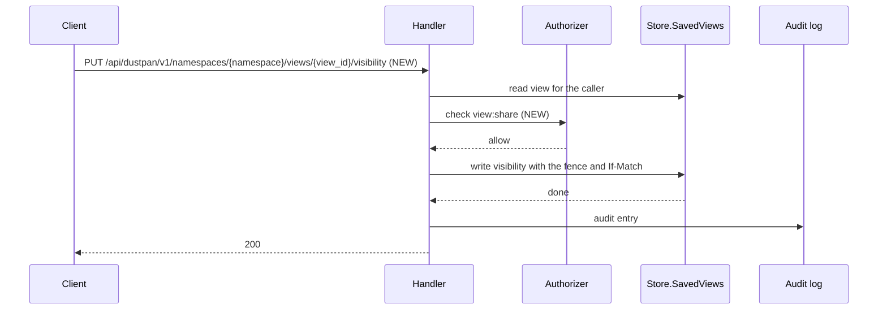
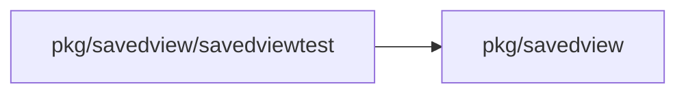
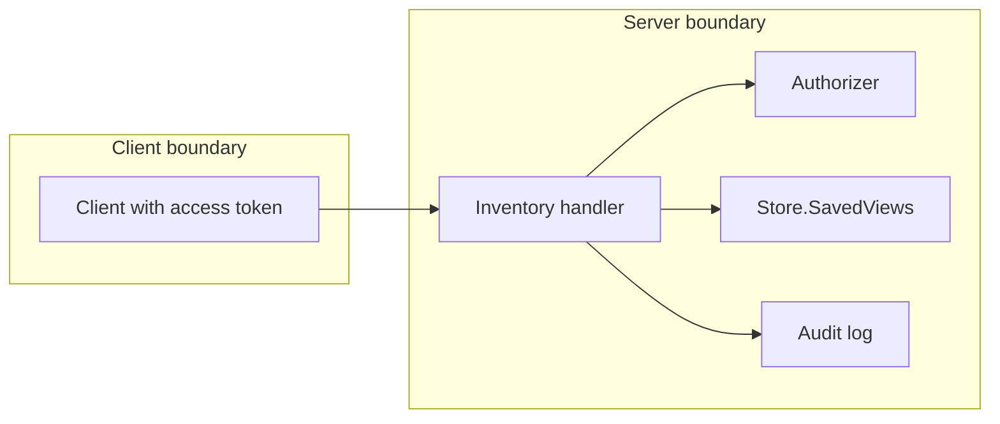

## Context

Saved views exist on main with private views, a query of labels and references, and routes for create, get, list, units and delete. This change adds visibility and replace.

## Decisions

1. **Visibility is a checked value with a stable collection ID.** A stored visibility holds private, namespace or collection, and the collection ID for the last. A name is never stored.
2. **Share is an action.** The NEW action view:share is held through a stored grant. The maker and a holder of view:share set the visibility. Only the maker renames or replaces.
3. **Concurrency.** Share, rename and replace need If-Match. The store checks the version and the fence in one transaction. A concurrent writer gets 412.
4. **Old rows stay valid.** A stored view with no visibility reads as private. A row that fails Validate on read is not served and writes an audit entry.
5. **Collection delete.** The delete of a collection makes its shared views private in the same transaction.

## Structure

An unexported type visibility in pkg/savedview has a constructor NewVisibility. Only the constructor makes a value, and it checks the allowlist and the collection ID. A mutation test removes the check.

## Risks

- A shared view leaks a unit name when the units route skips the per-unit read check.
- A view name leaks to an outsider if the visibility route answers 403 before the read check.

## Layers (defense in depth)

| Layer | Guard | Hostile test |
| --- | --- | --- |
| boundary check | View.Validate and NewVisibility use an allowlist. | TestViewVisibilityUnknownRefused |
| authorize at point of use | The units route checks unit:read for each unit. | TestViewUnitsPerReader |
| fail closed | A row that fails Validate on read is not served. | TestViewRowFailsValidateOnRead |

## Diagrams

After this change:

Modules that the change touches, and their imports on main:

## Quality attributes

| Attribute | Target | Unit | Scope |
| --- | --- | --- | --- |
| none affected | The units route reuses the unit list code path, so its latency budget does not change. |  |  |

## Threat model

Data flow and trust boundaries:

| Boundary | STRIDE | Threat | Layer | Guard | Hostile test |
| --- | --- | --- | --- | --- | --- |
| Client to server | I | An outsider learns that a private or collection view exists. | boundary check | NewVisibility and View.Validate use an allowlist. | TestViewVisibilityUnknownRefused |
| Client to server | I | An outsider learns that a private or collection view exists. | encode or contain | SQL placeholders only. Error text repeats no input. | TestViewErrorRepeatsNoInput |
| Client to server | I | An outsider learns that a private or collection view exists. | limit | Existing body size limit and the view count limits of the owner. | TestViewShareBodyLimit |
| Client to server | I | An outsider learns that a private or collection view exists. | authorize at point of use | The read check runs before the view:share check, and the units route checks unit:read for each unit. | TestViewUnitsPerReader |
| Client to server | I | An outsider learns that a private or collection view exists. | fail closed | An unknown or unreadable view answers the same 404 and writes an audit entry. | TestViewOutsiderSame404 |
| Client to server | E | A caller without view:share widens the visibility of a view, or a namespace administrator edits the content of another person. | boundary check | The route allowlists the visibility values. | TestViewVisibilityUnknownRefused |
| Client to server | E | A caller without view:share widens the visibility of a view, or a namespace administrator edits the content of another person. | encode or contain | The collection scope holds the collection ID checked in the same namespace. | TestViewCollectionOtherNamespace |
| Client to server | E | A caller without view:share widens the visibility of a view, or a namespace administrator edits the content of another person. | limit | The store checks the fence and the If-Match version in one transaction. | TestViewStaleFenceChangesNothing |
| Client to server | E | A caller without view:share widens the visibility of a view, or a namespace administrator edits the content of another person. | authorize at point of use | The handler checks view:share for share, and the maker for replace. | TestViewShareDeniedWithoutAction |
| Client to server | E | A caller without view:share widens the visibility of a view, or a namespace administrator edits the content of another person. | fail closed | An authorizer error denies and writes an audit entry. | TestViewAuthorizerErrorDenies |
| Store to server | T | A restored or old row with a bad visibility is served. | boundary check | The read path runs Validate again. | TestViewRowFailsValidateOnRead |
| Store to server | T | A restored or old row with a bad visibility is served. | encode or contain | The query is decoded through the counterpart of EncodeQuery with strict fields. | TestViewQueryDecodeStrict |
| Store to server | T | A restored or old row with a bad visibility is served. | limit | A row that fails is not served. | TestViewBadRowNotServed |
| Store to server | T | A restored or old row with a bad visibility is served. | authorize at point of use | The units route still checks unit:read for each unit. | TestViewUnitsPerReader |
| Store to server | T | A restored or old row with a bad visibility is served. | fail closed | The server answers 404 and writes an audit entry. | TestViewBadRowAudited |

## Contracts

**Saved view**

- Invariant: The view ID and the namespace never change.
- Invariant: A shared view grants no access.
- Invariant: A collection scope holds the collection ID, never its name.
- `Share`: pre: The caller can read the view.; The caller holds the action view:share.; If-Match holds the current version.; The collection exists in the same namespace.. Post: The view has the new visibility.; One audit entry exists..
- `Replace`: pre: If-Match holds the current version.; The caller is the maker.. Post: The view has the new name and query, with the same ID and owner..
