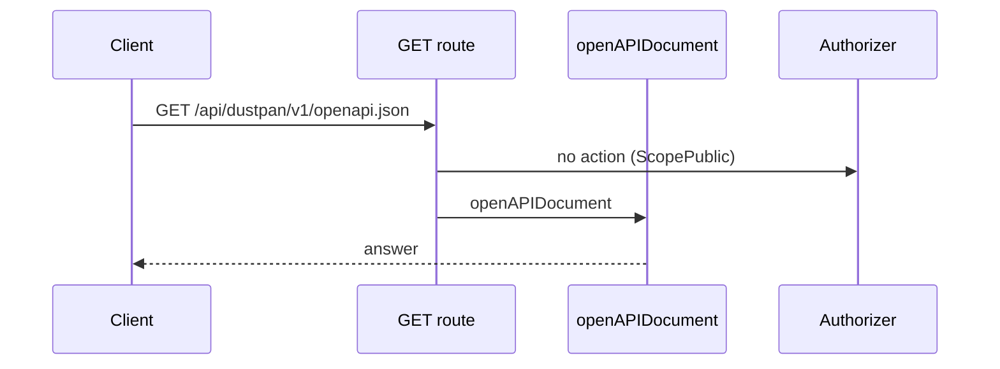

## Context

C# and Java clients wait for a stable REST API. This change records only the start gate. It changes no server behavior and adds no generator target.

## Decisions

1. **Gate record only.** Keep this change as the gate record only. Record the owner stable-API decision in one gate file before any generation work. Plan NEW client-dotnet and NEW client-java as two later changes after the gate passes.

## Structure

No server structure change. No new tool. No NEW generator target in this change.

## Risks

- Starting generation before the API is stable forces repeated breaking changes to the NEW clients.

## Diagrams

Today: `GET /api/dustpan/v1/openapi.json` on main (from the route table and the handler body, route row internal/api/server/openapi.go:22, handler not found).

## Quality attributes

| Attribute | Target | Unit | Scope |
| --- | --- | --- | --- |
| none affected | No server behavior change; no latency, storage or rate change |  |  |
