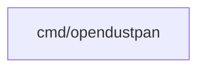

## Context

Release builds tar.gz archives and SHA256SUMS today. Packages come after the first tag, an RFC and the owner decision. The NEW workflow file .github/workflows/packages.yml runs the package build and the install steps.

## Decisions

1. **License first.** Record the tool license and pass make trivy before any package build.
2. **Hash source.** The formula and the PKGBUILD take hashes only from the SHA256SUMS of the release. The packages are Linux only. The formula uses the macOS and Linux tar.gz archives.
3. **Re-made release.** The publish step reads SHA256SUMS of the tag at publish time and refuses a tag whose archive hash differs from the file.

## Structure

One generated file renders the formula and the PKGBUILD from SHA256SUMS, so no hash is typed by hand. A CI step compares each rendered hash with the archive and fails on a mismatch.

## Risks

- A wrong hash in the formula or PKGBUILD breaks the install.
- No signature: integrity relies on hashes only.

## Diagrams

Modules that the change touches, and their imports on main:

## Quality attributes

| Attribute | Target | Unit | Scope |
| --- | --- | --- | --- |
| none affected | Distribution packaging only; no server runtime change. |  |  |
