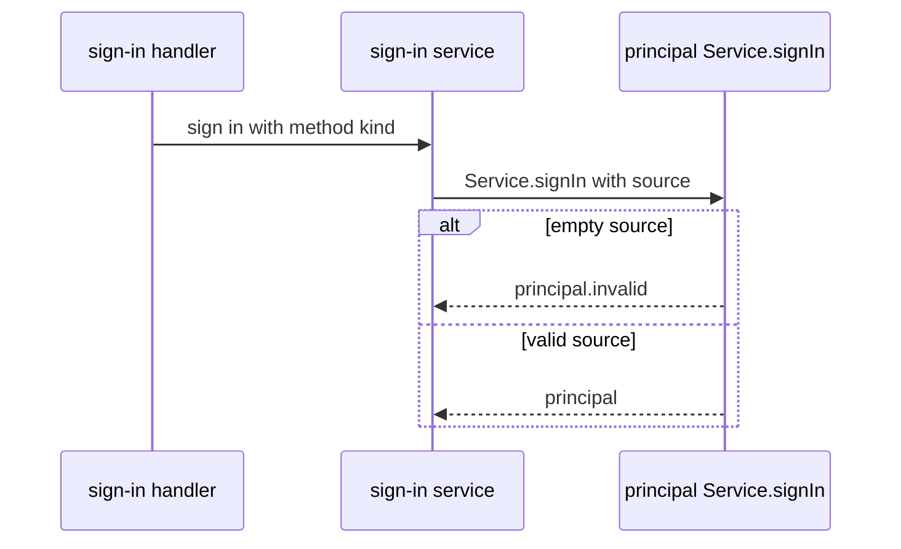
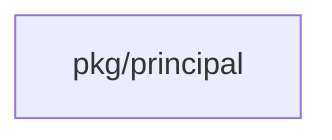
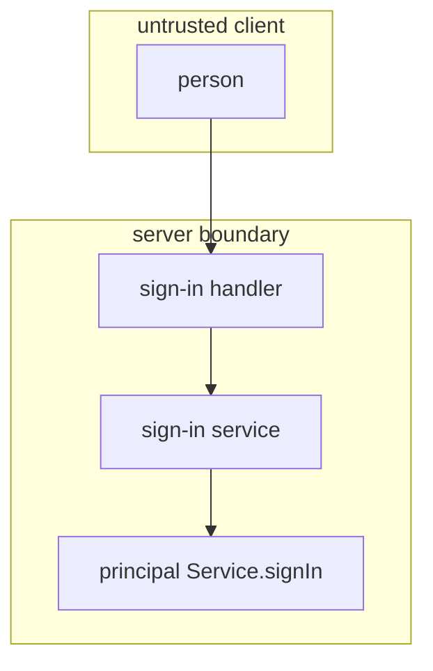

## Context

Sign-in derives the principal source from the method kind. The principal package keeps an older empty-means-oidc fallback. The composition input keeps its store as any.

## Decisions

1. **Fail closed on empty source.** Service.signIn in pkg/principal/service.go returns principal.invalid when the source is empty and keeps no default. A typed source value would change the ports of session, principal and the stores, so the guard at the creation point is the fix boundary.
2. **Narrow store interface.** Declare the methods the sign-in service calls in a small interface in pkg/dustpan/area_signin.go. Use it for signInServiceInputs.store. A compile-time assertion shows that the production store satisfies it.

## Structure

Guard at the start of Service.signIn plus a small unexported store interface in pkg/dustpan/area_signin.go.

## Risks

- A caller that passes an empty source now gets principal.invalid. The new test and the full pkg/principal test run find such a caller before merge.

## Diagrams

After this change:

Modules that the change touches, and their imports on main:

## Quality attributes

| Attribute | Target | Unit | Scope |
| --- | --- | --- | --- |
| none affected | No latency or storage change; a guard and an interface type only. |  |  |

## Threat model

Data flow and trust boundaries:

| Boundary | STRIDE | Threat | Layer | Guard | Hostile test |
| --- | --- | --- | --- | --- | --- |
| server boundary | S | A caller reaches principal creation with an empty source and gets an oidc identity. | boundary check | Service.signIn refuses an empty source with principal.invalid. | TestSignInRefusesEmptySource calls Service.signIn with an empty source. |
| server boundary | S | A caller reaches principal creation with an empty source and gets an oidc identity. | encode or contain | A refused sign-in creates no principal. | TestSignInRefusesEmptySource checks that the principal count does not grow. |
| server boundary | S | A caller reaches principal creation with an empty source and gets an oidc identity. | limit | A refused sign-in writes nothing durable. | TestSignInRefusesEmptySource checks that store counts do not grow. |
| server boundary | S | A caller reaches principal creation with an empty source and gets an oidc identity. | authorize at point of use | The check sits at the point where the principal is made, with no handler help. | A direct call of Service.signIn bypasses the handler and gets a refusal. |
| server boundary | S | A caller reaches principal creation with an empty source and gets an oidc identity. | fail closed | An empty source is denied and no oidc default exists. | The result is principal.invalid, not an oidc principal. |

## Contracts

**principal**

- Invariant: Each sign-in records a non-empty principal source.
- `Service.signIn`: pre: The caller supplies a method kind and a source.. Post: If the source is empty, then it returns principal.invalid and creates no principal..
