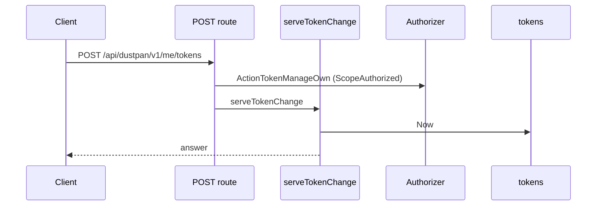
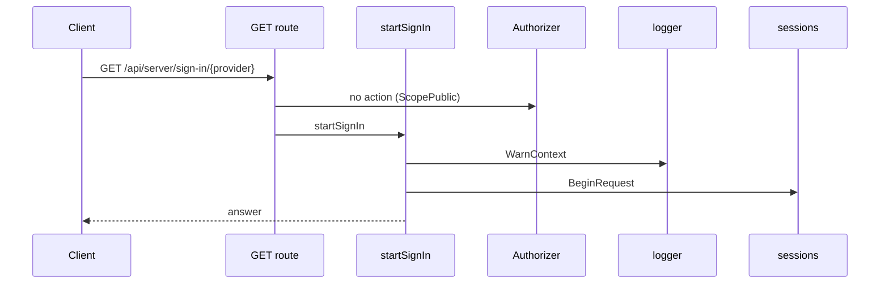
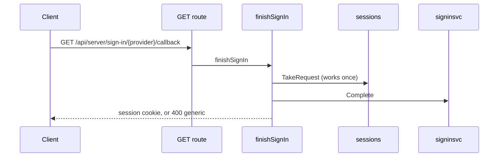
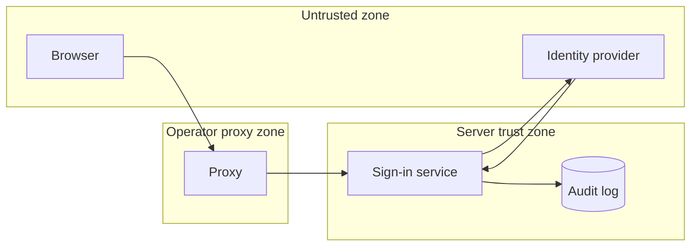

## Context

The sign-in service (internal/signinsvc) already runs one order for OIDC, plain OAuth, LDAP and passkeys. The CAS adapter (internal/casauth) and the trusted-header adapter (internal/headerauth) exist but are not wired: `pkg/session/providerconfig.go:179-183` refuses their modes. This change extends the code that exists. It adds no new adapter package.

## Decisions

1. **Subject sources that cannot change.** Owner decision, 13 Nov 2026 (queue P20). Plain OAuth uses `sub` only, CAS uses a named attribute only, and the header uses the `sub` claim of the signed token only. The display claims (`name`, `preferred_username`, `email`) fill display fields only and never identify a person.
2. **Header token.** The header carries a signed token (`jwt` mode, `internal/headerauth/jwt.go`). The `plain` mode goes away. The comparison of this decision with the code on main gives these facts and differences:
   - The key, the issuer and the audience are provider settings. Main: `configureJWT` (`internal/headerauth/config.go:83`) requires the issuer and the audience, except for the `aws-alb` preset, which checks the signer and the client instead of an audience. No difference.
   - The algorithm allowlist is fixed in code, not a setting: ES256 for the presets, `trustrule.Algorithms()` for a custom issuer (`internal/headerauth/jwt.go:60-66`). ADR 321 decision 36 names the same lists. Difference: the provider answer does not show the effective list. Task 3.6 shows it read-only.
   - Expiry and issued-at are checked with 60 seconds of skew (`pkg/trustrule/jwt.go:35`, `internal/headerauth/jwt.go:104`). No difference.
   - The peer is the TCP peer of the request (`internal/headerauth/headerauth.go:295-298 (PeerOf)`). X-Forwarded-For is never read for the proxy list (`internal/headerauth/headerauth.go:341-342`). No difference in the adapter. Difference: the audit entry of a browser sign-in holds `clientip.String`, not the TCP peer (`internal/api/server/signin.go:574`). Task 3.4 records the TCP peer.
   - The list accepts IPv4, IPv6 and CIDR entries (`internal/headerauth/config.go:16-23 (checkProxies)`, `internal/headerauth/headerauth.go:358 (trusted)`) and is separate from `--trusted-proxies`. Difference: no test checks a peer inside an IPv6 CIDR range; the fixture has a single IPv6 address (`internal/headerauth/fixture_test.go:75`). Task 1.6 adds it.
   - The list is a sensitive setting with an alert (ADR 70 decision 22). Difference: no setting exists. Task 3.5 stores it as a sensitive provider setting.
   - A refused header gets an audit entry (ADR 321 decision 37). Difference: `Strip` (`internal/headerauth/headerauth.go:252`) removes the headers and writes nothing. Task 3.4 writes the entry.
   - A peer outside the list gives `session.ErrUntrustedSource`, which the service maps to a reason without a code (`internal/signinsvc/refuse.go:143-144`). Difference: the code `sign-in.untrusted-proxy` and the peer address. Task 3.3.
3. **CAS subject.** The subject attribute becomes required. Main allows an empty attribute and then uses the CAS user (`internal/casauth/casauth.go:91-94`, `internal/casauth/assertion.go:98-104`). That is the one gap of the CAS adapter. The other gaps are wiring: settings, store, API, the stored-provider build and the ticket in the callback (`internal/api/server/signin.go:544`).
4. **One-time IDs.** No new store. The sign-in request store and the used-ticket store of main cover the state and the CAS ticket, and both fail closed (`internal/api/server/signin.go:531-535`, `pkg/session/usedtickets.go:24-33`).
5. **Codes as audit reasons.** `sign-in.subject-missing` and `sign-in.untrusted-proxy` are catalog codes, and the service writes them as the reason of the audit entry, as `internal/signinsvc/service.go:684` does with a code. The browser answer of the OAuth and CAS callbacks stays the generic `errSignInFailed`.

## Structure

- Provider settings: a `CASSettings` and a `HeaderSettings` next to `OAuthSettings` in `pkg/session`, checked by the provider validate. `OAuthSettings` loses the subject claim.
- Binding of a subject: `pkg/session/provider.go:89` becomes `NormalizeEndpoint(p.UserinfoURL) + "#sub"`; CAS and header providers get their own fixed prefix, as LDAP has `ldap:`.
- Store: the mode CHECK of `sign_in_providers` allows `cas` and `header`; the `subject_claim` column goes away; the new settings get columns. The baselines change in place, because no tag shipped a schema.
- Build: `pkg/dustpan/storedproviders.go` builds a `casauth.Method` and a `headerauth.Method` from a stored provider.
- HTTP: the provider API gets a `cas` and a `header` object. The callback reads `ticket`. A header provider signs in at the start route: the handler reads the request facts and calls the service, with no redirect.

## Risks

- A wrong proxy list grants access. The provider is off by default, an empty list turns it off (`internal/headerauth/headerauth.go:376`), and a change of the list gives an alert.
- The removal of the subject claim changes the binding of each plain OAuth provider. No tag shipped, so no stored binding needs a change.

## Layers (defense in depth)

| Layer | Guard | Hostile test |
| --- | --- | --- |
| Boundary check (adapter) | OAuth: subject from `sub` only. CAS: subject attribute required. Header: `jwt` mode only, peer in the list, IPv6 CIDR, X-Forwarded-For ignored. | TestPlainSubjectIsSubOnly, TestNewRefusesACASConfigWithoutASubjectAttribute, TestNewRefusesThePlainMode, TestAPeerInsideAnIPv6RangeIsTrusted, TestAForwardedForHeaderDoesNotMakeAPeerTrusted |
| Boundary check (domain settings) | Provider validate refuses a CAS provider without a subject attribute and a header provider without a proxy list or with a plain mode. | TestValidateCASAndHeaderProviders |
| Service use check | The service maps the missing subject and the untrusted proxy to a code and writes the peer address. | TestCompleteSubjectMissingReason, TestCompleteUntrustedProxyCodeAndPeer |
| HTTP containment | Declared fields only (`claims.subject` refused), generic browser answer, 401 `sign-in.untrusted-proxy` for the header path, the ticket read from the query. | TestProviderRefusesASubjectClaim, TestCallbackSubjectMissingAnswersGeneric, TestHeaderSignInRefusals, TestCASCallbackRefusals |
| Fail closed | Off by default, empty list off, unknown mode refused, store error refuses. | TestAnEmptyProxyListTurnsTheProviderOff (exists), TestHeaderSignInRefusals |

## Diagrams

Today: `POST /api/dustpan/v1/me/tokens` on main (from the route table and the handler body, route row internal/api/server/tokens.go:578-579, handler createToken at internal/api/server/tokens.go:714).

Today: `GET /api/server/sign-in/{}` on main (from the route table and the handler body, route row internal/api/server/signin.go:287, handler startSignIn at internal/api/server/signin.go:329).

Today: `GET /api/server/sign-in/{}/callback` on main (route row internal/api/server/signin.go:291, handler finishSignIn at internal/api/server/signin.go:408).

## Quality attributes

| Attribute | Target | Unit | Scope |
| --- | --- | --- | --- |
| Time that the header check adds to a request of a header provider, with a cached key | 5 | ms at p95 | each trusted-header sign-in on SQLite and PostgreSQL |

## Threat model

Data flow and trust boundaries:

| Boundary | STRIDE | Threat | Layer | Guard | Hostile test |
| --- | --- | --- | --- | --- | --- |
| Proxy to server | S | A client forges the trusted header. | boundary check | Signed token in `jwt` mode only; the peer must be on the list | TestNewRefusesThePlainMode |
| Proxy to server | S | A client forges the trusted header. | encode or contain | Only the TCP peer is read; X-Forwarded-For is ignored | TestAForwardedForHeaderDoesNotMakeAPeerTrusted |
| Proxy to server | S | A client forges the trusted header. | limit | The list of each provider is separate from `--trusted-proxies`; IPv6 ranges match exactly | TestAPeerInsideAnIPv6RangeIsTrusted |
| Proxy to server | S | A client forges the trusted header. | authorize at point of use | Provider on and person enabled are checked at each sign-in | TestHeaderSignInRefusals |
| Proxy to server | S | A client forges the trusted header. | fail closed | Off by default; an empty list turns the provider off | TestAnEmptyProxyListTurnsTheProviderOff |
| IdP to server | S | A provider answer names a person by a claim that can change. | boundary check | OAuth subject from `sub` only; CAS subject attribute required | TestPlainSubjectIsSubOnly |
| IdP to server | S | A provider answer names a person by a claim that can change. | encode or contain | The API refuses `claims.subject`; display claims fill display fields only | TestProviderRefusesASubjectClaim |
| IdP to server | S | A provider answer names a person by a claim that can change. | limit | A CAS provider without a subject attribute is not valid | TestValidateCASAndHeaderProviders |
| IdP to server | S | A provider answer names a person by a claim that can change. | authorize at point of use | The binding uses the fixed `sub` | TestCompleteSubjectMissingReason |
| IdP to server | S | A provider answer names a person by a claim that can change. | fail closed | No `sub` gives the generic answer and no session | TestCallbackSubjectMissingAnswersGeneric |
| Proxy to server | R | A refused header sign-in leaves no record. | boundary check | Each refusal passes `record`, which writes the entry | TestCompleteUntrustedProxyCodeAndPeer |
| Proxy to server | R | A refused header sign-in leaves no record. | encode or contain | The peer is written as a parsed address, not as header text | TestCompleteUntrustedProxyCodeAndPeer |
| Proxy to server | R | A refused header sign-in leaves no record. | limit | One entry for each refusal | TestHeaderSignInRefusals |
| Proxy to server | R | A refused header sign-in leaves no record. | authorize at point of use | Only the audit read action reads the entries (exists on main) | TestHeaderSignInRefusals |
| Proxy to server | R | A refused header sign-in leaves no record. | fail closed | The refusal stays a refusal when the audit write fails | TestRefusalSurvivesAnAuditFailure (exists) |
