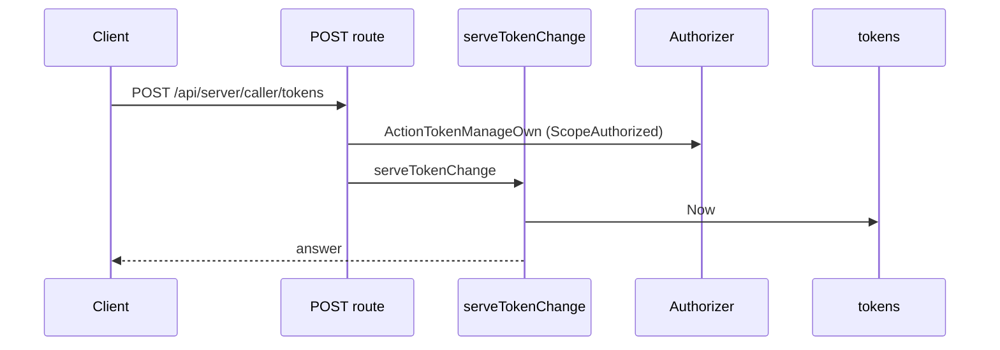
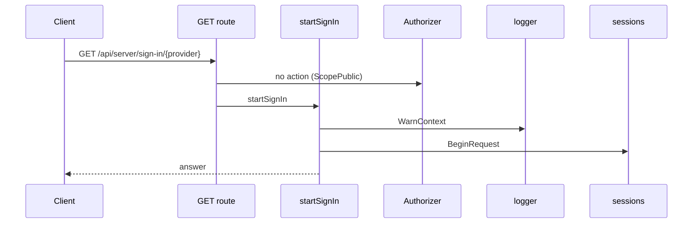
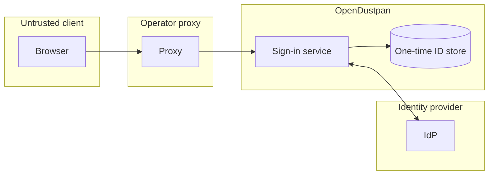

## Context

The sign-in service already runs one order for LDAP, OIDC, CAS and passkeys. This change adds SAML, plain OAuth 2.0 and signed-token trusted header to it.

## Decisions

1. **Adapters behind existing ports.** Owner decision, 13 Nov 2026 (queue P20): OAuth uses `sub`, CAS a named attribute, header a signed claim.
2. **Header token.** The header carries a signed token. The key, issuer, audience and algorithm allowlist are provider settings; expiry is checked. The peer address is the socket address; X-Forwarded-For is never read for the proxy list. The list accepts IPv4, IPv6 and CIDR entries and is separate from the trusted-proxies flag.
3. **One-time IDs in the database.** Request and assertion IDs have a unique key and an expiry; expired rows are deleted; a size bound limits unsolicited floods. The assertion age is 5 minutes with 30 seconds of clock skew.
4. **SAML checks.** The server checks the signature against pinned certificates, issuer, audience, recipient and age. An unpinned or wrapped signature is refused.

## Structure

The sign-in service holds an unexported `methodSet` that only `newMethodSet` can build and that refuses invalid provider settings.

## Risks

- A wrong proxy list grants access; default off guards it.

## Layers (defense in depth)

| Layer | Guard | Hostile test |
| --- | --- | --- |
| Boundary check | Adapters check signature, audience, time, `sub` and peer address. | TestAdapterHostileInputs |
| Service use check | One order; fail closed on store failure. | TestServiceHostile |
| HTTP containment | Declared fields only; CR and LF removed; one audit entry. | TestHandlerHostile |

## Diagrams

Today: `POST /api/server/caller/tokens` on main (from the route table and the handler body, route row internal/api/server/tokens.go:553, handler internal/api/server/tokens.go:246).

Today: `GET /api/server/sign-in/{}` on main (from the route table and the handler body, route row internal/api/server/signin.go:277, handler internal/api/server/signin.go:319).

## Quality attributes

| Attribute | Target | Unit | Scope |
| --- | --- | --- | --- |
| Sign-in latency added by the one-time ID check | 50 | ms at p95 | each browser sign-in on SQLite and PostgreSQL |

## Threat model

Data flow and trust boundaries:

| Boundary | STRIDE | Threat | Layer | Guard | Hostile test |
| --- | --- | --- | --- | --- | --- |
| Proxy to server | S | A client forges the trusted header. | boundary check | Signed token and peer address on the list | TestTrustedHeaderProxyGate |
| Proxy to server | S | A client forges the trusted header. | fail closed | Off by default; deny on unknown | TestTrustedHeaderDefaultOff |
| IdP to server | T | A changed or wrapped SAML assertion. | boundary check | Pinned certificate signature check | TestSamlRefusals |
| IdP to server | T | A changed or wrapped SAML assertion. | fail closed | Refuse on store failure | TestBrowserStoreOutageFailsClosed |
| IdP to server | R | A refused sign-in leaves no record. | authorize at point of use | One audit entry for each refusal | TestAuditEntryPerRefusal |
| Browser to server | D | A flood of unsolicited requests fills the ID store. | limit | Size bound and expiry delete | TestOneTimeIdStoreBound |
