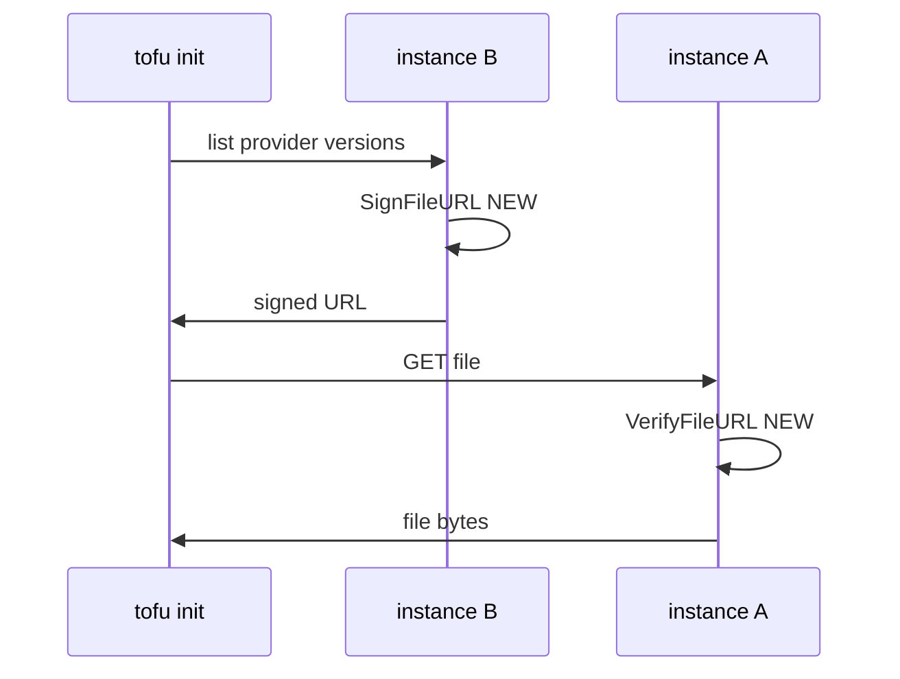
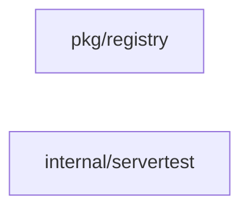
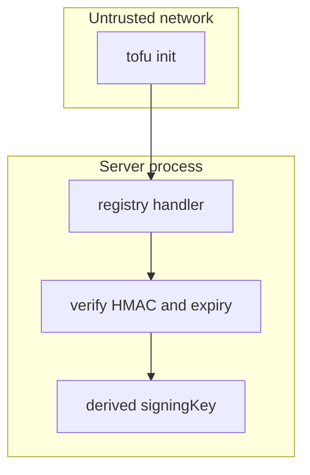

## Context

All instances of one installation share one database, one object store and one key-encryption key. Only the registry URL signing key is per-instance today.

## Decisions

1. **One derived key for all instances.** Derive a 32 byte HMAC key with HKDF-SHA256 from the stored key-encryption key held in the server store, with info registry-file-url-v1 plus the stable installation database ID. Keep it in the NEW unexported type signingKey in pkg/registry, made only by the NEW constructor newSigningKey, which refuses an empty source key. The only source is the stored key-encryption key. The path adds no flag.
2. **Sign and verify shape.** The NEW methods SignFileURL and VerifyFileURL live in pkg/registry. The HMAC covers version, namespace ID, file path and expiry in fixed order with length prefixes. Expiry is 300 seconds; verify allows 60 seconds skew against the verifying instance wall clock for 360 seconds maximum validity. Verify reads no database. Version field v=1; unknown version denies.

## Structure

The NEW unexported type signingKey with constructor newSigningKey: no code path can make a per-instance random key.

## Risks

- A key-encryption key change ends in-flight URLs within 360 seconds.
- Clock skew above 60 seconds refuses fresh URLs.

## Layers (defense in depth)

| Layer | Guard | Hostile test |
| --- | --- | --- |
| boundary check | Allowlist of base64url characters, length cap 2048 bytes. | Send overlong values to the handler; expect registry.signature-invalid. |
| encode or contain | Length-prefixed HMAC with constant-time compare. | Flip one byte; expect refusal. |
| limit | 360 second maximum validity. | Replay after 360 seconds; expect refusal. |
| authorize at point of use | Registry read grant at sign time. | Sign without grant; expect refusal. |
| fail closed | Unknown version or empty key denies. | Send v=2; expect denial. |

## Diagrams

After this change:

Modules that the change touches, and their imports on main:

## Quality attributes

| Attribute | Target | Unit | Scope |
| --- | --- | --- | --- |
| latency | 5 | ms p99 | signed URL verify on the registry file path |
| availability | 360 | s maximum validity of old URLs | after a key-encryption key change |

## Threat model

Data flow and trust boundaries:

| Boundary | STRIDE | Threat | Layer | Guard | Hostile test |
| --- | --- | --- | --- | --- | --- |
| network to registry handler | S | Forged file URL reads provider files without a grant. | boundary check | Allowlist decode with length cap. | Overlong values; expect refusal. |
| network to registry handler | S | Forged file URL reads provider files without a grant. | encode or contain | Fixed-order HMAC, constant-time compare. | Flip bytes; expect refusal. |
| network to registry handler | S | Forged file URL reads provider files without a grant. | limit | 360 second maximum validity. | Replay late; expect refusal. |
| network to registry handler | S | Forged file URL reads provider files without a grant. | authorize at point of use | Grant check at sign time. | Sign without grant; expect refusal. |
| network to registry handler | S | Forged file URL reads provider files without a grant. | fail closed | Unknown version denies. | Omit version; expect denial. |

## Contracts

**registry**

- Invariant: One installation has one derived URL signing key at one time.
- Invariant: An expired or altered URL never grants a file read.
- `SignFileURL`: pre: The caller passed the registry read grant check.. Post: The URL carries v=1, expiry and HMAC..
- `VerifyFileURL`: pre: The URL text is untrusted.. Post: A valid URL returns the file identity, else registry.signature-invalid..
