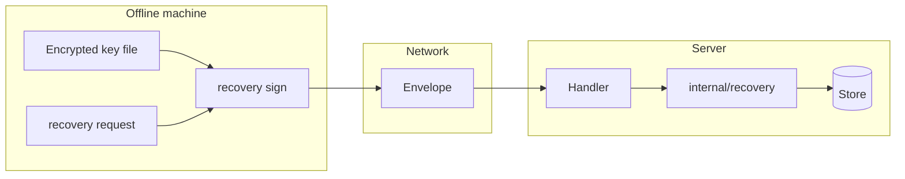

## Context

Signed-request recovery (ADR 57, ADR 295, ADR 372) makes one temporary
administrator from a request that the offline operator key signs. The route is
public: it acts as no principal before its checks pass. Its result is the same
bounded temporary administrator as the host command (ADR 245): one named
person, one site-administrator grant, at most 24 hours, the end of all access
at the expiry, and a review after use.

## Decisions

1. **The stored recovery settings.** The baseline of each dialect gets four
   tables, in their places in the name order:
   - `recovery_settings`: one row, with the mode (`bootstrap`,
     `signed-request` or `none`) and the time of the first boot. The
     installation name is the setting `--installation` (ADR 248). The server
     never makes a name at random, so a restore keeps it.
   - `recovery_keys`: the trust bundle. The key ID (a server-made stable ID),
     the public key in the wire form of `ssh-ed25519`, its SHA-256
     fingerprint (unique), the time of the add, the principal ID of the person
     who added it (empty for the first-boot key) and the reason.
   - `recovery_nonces`: the nonce (primary key), the `notAfter` time and the
     time to delete (`notAfter` plus 1 hour).
   - `recovery_attempts`: the source group (an IPv4 address, or the /64 group
     of an IPv6 address, or `*` for the installation), the start of the window
     and the count.
2. **The first boot writes the settings once.** `serve` writes the row of
   `recovery_settings` and the first key in one transaction when the row does
   not exist. It reads the public key file under the rules of decision 13.
   With `--recovery-mode signed-request` and no key file, `serve`
   refuses to start and names `--recovery-public-key-file`. The content of
   the file must parse as exactly one `ssh-ed25519` public key: the same
   parse and the same key type rule as the add route (decision 12). `serve`
   refuses a key of another type, more than one key, text that does not parse
   and an empty file. On a malformed or wrong-type key file, `serve` fails
   closed: it refuses to start, stores nothing and writes no recovery
   settings. It logs one error that names the file and the reason, and no key
   material. When the row
   exists, the stored mode wins over `--recovery-mode` (ADR 245 decision 6).
   A different setting writes one warning to the log at each start (ADR 347).
3. **The canonical request.** `request.json` is one JSON object, UTF-8, with
   no white space, the members in this order, and no other member:
   `version` (exactly 1), `audience` (the external URL of the server),
   `installation` (the installation name),
   `person` (the name of the new temporary administrator: 1 to 64 characters
   of `[a-z0-9._-]`, no other value, and no normalization; a `person` that
   names a reserved subject, such as `admin` or `admin-2`, or that names an
   existing principal, refuses with the reason `person`, in the transaction,
   which rolls back and creates nothing),
   `reason` (1 to 500
   characters, no Unicode Cc or Cf, ADR 245 decision 17), `nonce` (32 random
   bytes, base64url, no padding), `notBefore` and `notAfter` (Unix
   milliseconds), `answerKey` (the HPKE public key: an X25519 public key of
   exactly 32 bytes after base64url decoding) and
   `keyId` (the SHA-256 fingerprint of the signing key). The server decodes
   with a strict decoder, encodes the result again, and refuses the body when
   the two byte strings differ. So one request has exactly one byte form, and
   the signature covers exactly the bytes that the server reads. The server
   refuses a `version` other than 1. The request binds to the installation
   name and to the audience, the external URL of the server. Both must match.
   Two installations with the same name and the same trust key are told apart
   by the audience and by the nonce store of each installation.
4. **The signature.** A detached SSH signature of the format of
   `ssh-keygen -Y sign`, hash `sha512`, namespace
   `opendustpan-recovery@<installation name>`. Only `ssh-ed25519` keys pass.
   The service verifies with the key of the bundle that `keyId` names, never
   with the key in the signature.
5. **The envelope.** `POST /api/dustpan/v1/recovery/signed-requests` takes
   `{"request": "<base64url of request.json>", "signature": "<armored
   signature>"}`, at most 8 KiB.
6. **One structure for the use.** An unexported type `signedRequest` in
   `internal/recovery` has only one constructor, `parseSignedRequest`. It runs
   the checks of the handler again (size, canonical form, members, times),
   counts the attempt in the shared counter and refuses when a limit applies,
   and then runs the signature check. The count comes first, so the rate limit
   bounds the number of signature checks. The method that makes the temporary
   administrator takes a `signedRequest`, never raw bytes, so no caller can
   skip a check.
7. **One transaction.** `internal/recovery` calls the host issuer with one
   store call. In one transaction it:
   - checks the stored mode is `signed-request` (a second layer; the handler
     checks the stored mode before any other work),
   - counts the attempt in `recovery_attempts` and checks both limits (a
     second layer; the service counts the attempt before the signature check,
     and each of the two checks carries a comment that names the other layer),
   - refuses when a temporary administrator record of a recovery is live,
   - inserts the nonce (a unique key, ADR 295 decision 3),
   - makes the person, the grant, the record and the token, with their four
     audit entries (ADR 245 decision 7),
   - seals the answer to the `answerKey` of the request (decision 9),
   - writes one audit entry for the use that holds the mode, the time and the
     client address, and the action `recovery:use-signed-request`,
   - writes the notification `break-glass.used` with the use (kind
     `temp-admin`, mode `signed-request`, the client address, `Until` the end
     of the record).

   A failure of any step fails the transaction, so a failed seal of the
   answer creates nothing. On PostgreSQL the transaction pins READ COMMITTED
   and takes the advisory lock of the server audit scope first, as ADR 245
   decision 8 does. A refusal in the transaction rolls back and then writes
   the refusal audit entry and the attempt count in a second transaction, so
   a refusal leaves a record and makes no temporary administrator.

   The client address is the address that the trusted-proxy setting of the
   server gives: the resolver of `internal/clientip` reads a forwarding header
   only from a trusted proxy, and otherwise the client address is the address
   of the TCP peer. The server parses the address with `net/netip` and refuses
   a malformed one. A hostile forwarding header from a peer that is not
   trusted has no effect on the client address.
8. **One answer.** Every refusal, at each layer, answers `403` with the code
   `recovery.refused` and one fixed text. The audit entry
   `recovery.refused` holds the reason code (`shape`, `canonical`, `time`,
   `mode`, `installation`, `unknown-key`, `signature`, `nonce-used`,
   `rate-limit`, `recovery-active`, `maintenance`, `answer`, `store`,
   `address`, `person`). A malformed `answerKey` and a failed seal of the
   answer both refuse with the reason `answer`. A malformed client address
   refuses with the reason `address`. A request during maintenance mode
   refuses with the reason `maintenance`, and the refusal fails closed. A
   `person` that names a reserved subject or an existing principal refuses
   with the reason `person`, in the transaction, which rolls back and creates
   nothing. The server log line holds the same reason code and no request
   text.
9. **The answer.** On success the server encrypts `{"person", "token",
   "expires"}` with HPKE (RFC 9180, base mode, DHKEM(X25519, HKDF-SHA256),
   HKDF-SHA256, AES-256-GCM, `crypto/hpke` of the standard library) to
   `answerKey`. The info string is `opendustpan-recovery v1` and the
   installation name. The additional data is the SHA-256 of the request bytes.
   The server seals the answer in the transaction of decision 7. When the seal
   fails, the server fails closed: it refuses the request with the reason
   `answer`, writes the denial to the audit log and creates nothing. The plain
   token never appears in the answer, a log or an audit entry.
10. **The review.** The consumer of `break-glass.used` opens the review with
    `Store.Open` whatever `breakGlassReview.enabled` says. With the setting
    off, the review has no deadline and no notice steps. With it on, it has
    both. The consumer also sends one notice to each site administrator at
    the use (ADR 372 decision 3). `breakglass.Use` gets two fields, `Mode` and
    `Source`. `Use.Validate` refuses a `temp-admin` use with an unknown mode,
    and a `temp-admin` use of mode `signed-request` with no source.
11. **The two recovery steps.** The admin reset of the factors of a person and
    the issue of an enrollment code read one predicate,
    `tempadmin.IsRecoveryAdmin(principal)`, from the stored record of the
    caller, never from the request. When it is true, the fresh-step check of
    these two routes passes with an audit entry that names the temporary
    administrator and the exception. The reason and the reach checks stay.
    Every other route keeps its fresh-step check, with no branch on the
    predicate.
12. **The trust bundle routes.**

    | Route | Action | Object | Fresh step |
    | --- | --- | --- | --- |
    | `GET /api/dustpan/v1/recovery` (mode, keys) | `server:read-settings` | server | no |
    | `POST /api/dustpan/v1/recovery/keys` | `server:manage-settings` | server | yes |
    | `DELETE /api/dustpan/v1/recovery/keys/{id}` | `server:manage-settings` | server | yes |
    | `POST /api/dustpan/v1/recovery/signed-requests` | `recovery:use-signed-request` | - | no |

    The add refuses a fifth key, a key type other than `ssh-ed25519` and a
    known fingerprint. The removal refuses the last key with
    `recovery.last-key`. Each add and removal needs a reason, writes an audit
    entry and sends a notice to each site administrator.

    The route `POST /api/dustpan/v1/recovery/signed-requests` is public. It
    stays on the public list of the route test, because the caller has no
    identity yet and the signed request is the credential. It still names the
    action `recovery:use-signed-request` (ADR 57 decision 6). The refusal audit
    entry and the break-glass use record that action.
13. **The CLI.** `opendustpan recovery request|sign|verify|submit` and
    `opendustpan recovery keys list|add|remove`. `request`, `sign` and
    `verify` work offline. `sign` reads an OpenSSH private key file and
    refuses a file that no passphrase encrypts. It reads the passphrase from
    the terminal only. `submit` and `keys` are REST clients (ADR 39). The
    flag `--installation` of `request` names the installation name (ADR 248).

    The containment rule and the 16 KiB size limit apply to every file that
    the CLI reads or writes in this flow: `request.json`, `request.json.sig`,
    `request.key`, the private key file of `sign`, the public key file of
    `verify` and the public key file of the first boot (decision 2). Each file
    opens through `os.Root` or a clean-path containment check, with a size
    limit of 16 KiB. The reader refuses a path that leaves the root and a
    file larger than 16 KiB. The private key files are refused when group or
    others can read them: the private key file of `sign`, and `request.key`,
    which the CLI writes with mode 0600.

## Structure

The bug class "a recovery with no review" is impossible by structure: the
notification row is in the transaction that makes the temporary administrator
(decision 7). The bug class "a skipped check" is impossible by structure: the
issuer takes only a `signedRequest`, and only `parseSignedRequest` makes one
(decision 6). The bug class "an oracle in the refusal" is impossible by
structure: the handler has one refusal writer, with no reason argument for the
answer (decision 8). The rest are guards with a mutation test each: the times,
the rate limit and the second live recovery.

The depguard rules: only `cmd/opendustpan` and `internal/recovery` name the
host issuer (ADR 295 decision 1). Only `cmd/opendustpan` and the package of the
handler import `internal/recovery`.

## Risks

- A theft of the private key alone gives a bounded remote temporary
  administrator (ADR 295 decision 2). The notice to each site administrator
  and the review make the use visible.
- A loss of every key of the bundle leaves signed-request recovery unusable.
  The operator uses a restore (no break-glass).
- A clock skew of more than 2 minutes refuses a fresh request.
  `recovery verify` prints the times of the request.
- `recovery sign` uses `golang.org/x/crypto/ssh` to read an encrypted OpenSSH
  key file. The module is already in `go.mod`. The package is new in the
  binary of the CLI.

## Layers (defense in depth)

| Layer | Guard | Hostile test |
| --- | --- | --- |
| HTTP handler | 8 KiB limit, content type, envelope shape, base64url, canonical form, members and the `person` allowlist, the `answerKey` shape (an X25519 public key of exactly 32 bytes), the `version` member, times, the stored mode check before any other work, the maintenance-mode check and the client-address parse. One answer. | Send an oversize body, a body with a duplicate member, a `person` outside the allowlist, an `answerKey` of 31 bytes and of 33 bytes and one that is not base64, a `version` other than 1, a non-canonical body, a wrong content type, a time past the skew, and a request in maintenance mode straight to the handler. Expect `recovery.refused` and no service call; a malformed client address gives a refusal with the reason `address`. |
| Service (`internal/recovery`) | `parseSignedRequest` checks the shape, the times, the installation name, the audience and the signature against the bundle key again, and it counts the attempt and refuses before the signature check. | Call the service with a request for another installation, a request with a wrong audience, a key in the signature that is not in the bundle, a key type other than `ssh-ed25519`, and a canonical body with a bad signature. Expect a refusal and no store write. |
| Store | The stored mode check (a second layer), the attempt counter (a second layer), the live-recovery check, the `person` check (a reserved subject or an existing principal refuses with the reason `person`) and the unique nonce insert, in the transaction of the temporary administrator. | Insert the same nonce twice, run two recoveries at once, run a recovery with the stored mode `bootstrap`, and run recoveries whose `person` names `admin`, `admin-2` and an existing principal (an expired temporary administrator), straight against the store. Expect one success at most, and a `person` refusal with the reason `person` and no new row. |
| Key file | Every file that the server or the CLI reads or writes in the flow (`request.json`, `request.json.sig`, `request.key`, the private key file of `sign`, the public key file of `verify` and the public key file of the first boot) opens through `os.Root` or a clean-path containment check, with a 16 KiB size limit; the private key files are refused when group or others can read it. | Give a path that leaves the root, a file larger than 16 KiB and a `request.key` with mode 0644, straight to each reader. Expect a refusal. |
| First boot (`serve`) | The content of `--recovery-public-key-file` must parse as exactly one `ssh-ed25519` public key, with the same parse and key type rule as the add route. On a malformed or wrong-type file, `serve` fails closed: it refuses to start, stores nothing and writes no recovery settings, and logs one error that names the file and the reason. | Start `serve` with a key file that holds an `ssh-rsa` key, two `ssh-ed25519` keys, text that does not parse and no content. Expect no start, no stored mode and no stored key. |
| Answer | HPKE to the key of the request, sealed in the transaction. A failed seal fails closed. | Decrypt with another key, and force a seal failure. Expect a failure, a refusal with reason `answer`, and no temporary administrator. |
| Authorizer | Each later request checks the stored grant of the temporary administrator. The two recovery steps read the stored record. | Call a third fresh-step route as a temporary administrator. Expect `mfa.fresh-step-required`. |
| Audit | Each refusal and each use writes an entry; the use entry holds the mode, the time, the client address and the action `recovery:use-signed-request`. | Break the store after the checks. Expect `recovery.refused` with reason `store` and one audit entry. |

## Quality attributes

| Attribute | Target | Unit | Scope |
| --- | --- | --- | --- |
| security | 1 temporary administrator for each valid nonce. 0 for a replay | temporary administrators | the route, 2 instances on one database |
| security | 1 answer for 15 refusal reasons: same status, body and length | answers | the route |
| reliability | 0 temporary administrators and 0 nonces after a crash before the commit | rows | the route, one restart |

## Threat model

| Boundary | STRIDE | Threat | Layer | Guard | Hostile test |
| --- | --- | --- | --- | --- | --- |
| Network | S | A caller forges a request. | boundary check | The handler refuses a non-canonical or malformed body, a wrong content type, a `person` outside the allowlist, an `answerKey` that is not an X25519 public key of exactly 32 bytes, and a `version` other than 1. | A body with an extra member, a wrong content type or a `person` outside the allowlist gives `recovery.refused` with reason `shape`; an `answerKey` of 31 or 33 bytes or one that is not base64 gives `answer`; a `version` other than 1 gives `shape`. |
| Network | S | A caller picks a `person` that names a reserved subject or an existing principal. | authorize at point of use | The issuer refuses a reserved subject and the store refuses an existing principal, in the transaction, so the refusal creates nothing. | A `person` of `admin`, `admin-2` and an existing principal (an expired temporary administrator), sent straight to the store, gives a refusal with reason `person` and no new row. |
| Network | S | A caller forges a request. | encode or contain | The service verifies with the bundle key that `keyId` names, never with the key in the signature, and accepts only `ssh-ed25519`. | A signature with a key that is not in the bundle, or with a key type other than `ssh-ed25519`, gives a refusal. |
| Network | S | A caller forges a request. | limit | 8 KiB, 5 attempts in 15 minutes for each source, 30 for the installation, in the database. The server counts the attempt and refuses before the signature check. | The sixth attempt from one /64 group is refused on a second instance, and a refused request runs no signature check. |
| Network | S | A caller forges a request. | authorize at point of use | The handler checks the stored mode before any other work, and the store checks it again in the transaction. | A valid request with the stored mode `bootstrap` gives a refusal. |
| Network | S | A caller forges a request. | boundary check | The server takes the client address from the trusted proxy when one is trusted, and otherwise the address of the TCP peer, and parses it with `net/netip`; a malformed address refuses. | A hostile forwarding header from a peer that is not trusted gives the client address of the peer, and a malformed address gives `recovery.refused` with reason `address`. |
| Network | S | A caller forges a request. | fail closed | An unknown member, value or store error refuses, with an audit entry. | A store fault gives `recovery.refused` with reason `store`. |
| Network | T | A caller replays a used request. | boundary check | The handler refuses a time outside the window, including `notAfter` more than 10 minutes after `notBefore`. | A request 3 minutes past `notAfter`, or with `notAfter` more than 10 minutes after `notBefore`, gives a refusal. |
| Network | T | A caller replays a used request. | encode or contain | Placeholders only. The nonce is a unique key and its shape is checked. | A nonce with quote characters, a malformed nonce or a short nonce gives one row or a refusal. |
| Network | T | A caller replays a used request. | limit | The nonce stays until `notAfter` plus 1 hour. | The purge keeps a row inside the window. |
| Network | T | A caller replays a used request. | authorize at point of use | The nonce insert is in the transaction of the temporary administrator. | Two submits at once give one temporary administrator. |
| Network | T | A caller replays a used request. | fail closed | A failed insert fails the transaction. | No record exists after a duplicate nonce. |
| Network | I | A caller learns why a request failed. | boundary check | One refusal writer with no reason in the answer. | 15 refusal reasons give the same status, body and length. |
| Network | I | A copy of a signed request gives the token. | encode or contain | HPKE to `answerKey`. | Decrypt with another key: failure. |
| Network | I | A copy of a signed request gives the token. | fail closed | The seal of the answer is in the transaction of decision 7; a failed seal rolls back. | A forced seal failure gives `recovery.refused` with reason `answer` and no temporary administrator. |
| Server | E | The temporary administrator does more than recovery steps with no fresh step. | authorize at point of use | Only the two routes read the predicate. | A token creation as a temporary administrator gives `mfa.fresh-step-required`. |
| Server | E | A second recovery runs while one is live. | authorize at point of use | The live-recovery check in the transaction. | A second valid request gives a refusal with reason `recovery-active`. |
| Server | T | A recovery request during maintenance mode changes the installation. | fail closed | The handler refuses while the installation is in maintenance mode. | A request in maintenance mode gives `recovery.refused` with reason `maintenance`. |
| Server | T | The first boot stores a key of the wrong type or a key that does not parse. | boundary check | The content of `--recovery-public-key-file` must parse as exactly one `ssh-ed25519` public key, with the same parse and key type rule as the add route. | An `ssh-rsa` key, two `ssh-ed25519` keys, text that does not parse and an empty file each refuse the start. |
| Server | T | The first boot stores a key of the wrong type or a key that does not parse. | fail closed | On a malformed or wrong-type key file, `serve` refuses to start, stores nothing and writes no recovery settings, and logs one error that names the file and the reason. | After each hostile key file the store holds no mode and no key. |
| Server | R | A use leaves no record. | fail closed | The notification, the audit entries and the record commit together. | A fault in the notification write leaves no temporary administrator. |

## Failure modes

| Step | Failure | Retry | State after |
| --- | --- | --- | --- |
| Submit | Crash before the commit | The same request again, before `notAfter` plus 2 minutes. | No temporary administrator, no nonce. |
| Submit | Crash after the commit, before the answer | A new request. The first temporary administrator is live, so the new request is refused until it ends or a site administrator ends it. | One temporary administrator, whose token nobody holds. Its review opens. The docs page names this case. |
| Submit | Two submits at once with one nonce | None. | One temporary administrator. |
| Submit | Clock skew over 2 minutes | Fix the clock and make a new request. | No change. |
| Key add | A stolen session of a site administrator adds a key | A site administrator removes the key. | The notice to each site administrator and the audit entry show the add. |
