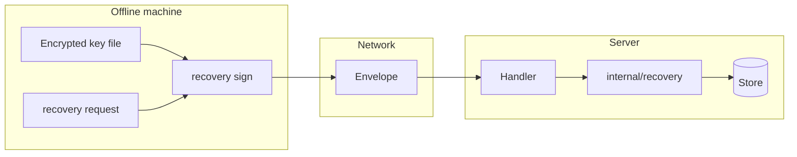

## Context

Signed-request recovery (ADR 57, ADR 295, ADR 372) makes one temporary
administrator from a request that the offline operator key signs. The route is
public: it acts as no principal before its checks pass. Its result is the same
bounded temporary administrator as the host command (ADR 245): one named
person, one site-administrator grant, at most 24 hours, the end of all access
at the expiry, and a review after use.

## Decisions

1. **The stored recovery settings.** The baseline of each dialect gets four
   tables, in their places in the name order:
   - `recovery_settings`: one row, with the mode (`bootstrap`,
     `signed-request` or `none`), the installation ID (16 random bytes,
     base32, no padding) and the time of the first boot.
   - `recovery_keys`: the trust bundle. The key ID (a server-made stable ID),
     the public key in the wire form of `ssh-ed25519`, its SHA-256
     fingerprint (unique), the time of the add, the principal ID of the person
     who added it (empty for the first-boot key) and the reason.
   - `recovery_nonces`: the nonce (primary key), the `notAfter` time and the
     time to delete (`notAfter` plus 1 hour).
   - `recovery_attempts`: the source group (an IPv4 address, or the /64 group
     of an IPv6 address, or `*` for the installation), the start of the window
     and the count.
2. **The first boot writes the settings once.** `serve` writes the row of
   `recovery_settings` and the first key in one transaction when the row does
   not exist. With `--recovery-mode signed-request` and no key file, `serve`
   refuses to start and names `--recovery-public-key-file`. When the row
   exists, the stored mode wins over `--recovery-mode` (ADR 245 decision 6).
   A different setting writes one warning to the log at each start (ADR 347).
3. **The canonical request.** `request.json` is one JSON object, UTF-8, with
   no white space, the members in this order, and no other member:
   `version` (1), `audience` (`"opendustpan-recovery"`), `installation`,
   `person` (the name of the new temporary administrator), `reason` (1 to 500
   characters, no Unicode Cc or Cf, ADR 245 decision 17), `nonce` (32 random
   bytes, base64url, no padding), `notBefore` and `notAfter` (Unix
   milliseconds), `answerKey` (the HPKE public key, X25519, base64url) and
   `keyId` (the SHA-256 fingerprint of the signing key). The server decodes
   with a strict decoder, encodes the result again, and refuses the body when
   the two byte strings differ. So one request has exactly one byte form, and
   the signature covers exactly the bytes that the server reads.
4. **The signature.** A detached SSH signature of the format of
   `ssh-keygen -Y sign`, hash `sha512`, namespace
   `opendustpan-recovery@<installation ID>`. Only `ssh-ed25519` keys pass. The
   service verifies with the key of the bundle that `keyId` names, never with
   the key in the signature.
5. **The envelope.** `POST /api/dustpan/v1/recovery/signed-requests` takes
   `{"request": "<base64url of request.json>", "signature": "<armored
   signature>"}`, at most 8 KiB.
6. **One structure for the use.** An unexported type `signedRequest` in
   `internal/recovery` has only one constructor, `parseSignedRequest`. It runs
   the checks of the handler again (size, canonical form, members, times) and
   the signature check. The method that makes the temporary administrator
   takes a `signedRequest`, never raw bytes, so no caller can skip a check.
7. **One transaction.** `internal/recovery` calls the host issuer with one
   store call. In one transaction it:
   - checks the stored mode is `signed-request`,
   - counts the attempt in `recovery_attempts` and checks both limits,
   - refuses when a temporary administrator record of a recovery is live,
   - inserts the nonce (a unique key, ADR 295 decision 3),
   - makes the person, the grant, the record and the token, with their four
     audit entries (ADR 245 decision 7),
   - writes the notification `break-glass.used` with the use (kind
     `temp-admin`, mode `signed-request`, the source address, `Until` the end
     of the record).

   A failure of any step fails the transaction. On PostgreSQL the transaction
   pins READ COMMITTED and takes the advisory lock of the server audit scope
   first, as ADR 245 decision 8 does. A refusal in the transaction rolls back
   and then writes the refusal audit entry and the attempt count in a second
   transaction, so a refusal leaves a record and makes no temporary
   administrator.
8. **One answer.** Every refusal, at each layer, answers `403` with the code
   `recovery.refused` and one fixed text. The audit entry
   `recovery.refused` holds the reason code (`shape`, `canonical`, `time`,
   `mode`, `installation`, `unknown-key`, `signature`, `nonce-used`,
   `rate-limit`, `recovery-active`, `store`). The server log line holds the
   same reason code and no request text.
9. **The answer.** On success the server encrypts `{"person", "token",
   "expires"}` with HPKE (RFC 9180, base mode, DHKEM(X25519, HKDF-SHA256),
   HKDF-SHA256, AES-256-GCM, `crypto/hpke` of the standard library) to
   `answerKey`. The info string is `opendustpan-recovery v1` and the
   installation ID. The additional data is the SHA-256 of the request bytes.
   The plain token never appears in the answer, a log or an audit entry.
10. **The review.** The consumer of `break-glass.used` opens the review with
    `Store.Open` whatever `breakGlassReview.enabled` says. With the setting
    off, the review has no deadline and no notice steps. With it on, it has
    both. The consumer also sends one notice to each site administrator at
    the use (ADR 372 decision 3). `breakglass.Use` gets two fields, `Mode` and
    `Source`. `Use.Validate` refuses a `temp-admin` use with an unknown mode,
    and a `temp-admin` use of mode `signed-request` with no source.
11. **The two recovery steps.** The admin reset of the factors of a person and
    the issue of an enrollment code read one predicate,
    `tempadmin.IsRecoveryAdmin(principal)`, from the stored record of the
    caller, never from the request. When it is true, the fresh-step check of
    these two routes passes with an audit entry that names the temporary
    administrator and the exception. The reason and the reach checks stay.
    Every other route keeps its fresh-step check, with no branch on the
    predicate.
12. **The trust bundle routes.**

    | Route | Action | Object | Fresh step |
    | --- | --- | --- | --- |
    | `GET /api/dustpan/v1/recovery` (mode, installation ID, keys) | `server:read-settings` | server | no |
    | `POST /api/dustpan/v1/recovery/keys` | `server:manage-settings` | server | yes |
    | `DELETE /api/dustpan/v1/recovery/keys/{id}` | `server:manage-settings` | server | yes |
    | `POST /api/dustpan/v1/recovery/signed-requests` | none (public list of the route test) | - | no |

    The add refuses a fifth key, a key type other than `ssh-ed25519` and a
    known fingerprint. The removal refuses the last key with
    `recovery.last-key`. Each add and removal needs a reason, writes an audit
    entry and sends a notice to each site administrator.
13. **The CLI.** `opendustpan recovery request|sign|verify|submit` and
    `opendustpan recovery keys list|add|remove`. `request`, `sign` and
    `verify` work offline. `sign` reads an OpenSSH private key file and
    refuses a file that no passphrase encrypts. It reads the passphrase from
    the terminal only. `submit` and `keys` are REST clients (ADR 39).

## Structure

The bug class "a recovery with no review" is impossible by structure: the
notification row is in the transaction that makes the temporary administrator
(decision 7). The bug class "a skipped check" is impossible by structure: the
issuer takes only a `signedRequest`, and only `parseSignedRequest` makes one
(decision 6). The bug class "an oracle in the refusal" is impossible by
structure: the handler has one refusal writer, with no reason argument for the
answer (decision 8). The rest are guards with a mutation test each: the times,
the rate limit and the second live recovery.

The depguard rules: only `cmd/opendustpan` and `internal/recovery` name the
host issuer (ADR 295 decision 1). Only `cmd/opendustpan` and the package of the
handler import `internal/recovery`.

## Risks

- A theft of the private key and its passphrase gives "a bounded remote
  temporary administrator" (ADR 295 decision 2). The notice to each site
  administrator and the review make the use visible.
- A loss of every key of the bundle leaves signed-request recovery unusable.
  The operator uses a restore (mode 3 path).
- A clock skew of more than 2 minutes refuses a fresh request.
  `recovery verify` prints the times of the request.
- `recovery sign` uses `golang.org/x/crypto/ssh` to read an encrypted OpenSSH
  key file. The module is already in `go.mod`. The package is new in the
  binary of the CLI.

## Layers (defense in depth)

| Layer | Guard | Hostile test |
| --- | --- | --- |
| HTTP handler | 8 KiB limit, content type, envelope shape, base64url, canonical form, members, times. One answer. | Send an oversize body, a body with a duplicate member, a non-canonical body and a time past the skew straight to the handler. Expect `recovery.refused` and no service call. |
| Service (`internal/recovery`) | `parseSignedRequest` checks the shape, the times, the installation, the audience and the signature against the bundle key again. | Call the service with a request for another installation, a key in the signature that is not in the bundle, and a canonical body with a bad signature. Expect a refusal and no store write. |
| Store | Stored mode check, the attempt counter, the live-recovery check and the unique nonce insert, in the transaction of the temporary administrator. | Insert the same nonce twice, run two recoveries at once, and run a recovery with the stored mode `bootstrap`, straight against the store. Expect one success at most. |
| Answer | HPKE to the key of the request. | Decrypt with another key. Expect a failure. |
| Authorizer | Each later request checks the stored grant of the temporary administrator. The two recovery steps read the stored record. | Call a third fresh-step route as a temporary administrator. Expect `mfa.fresh-step-required`. |
| Audit | Each refusal and each use writes an entry. | Break the store after the checks. Expect `recovery.refused` with reason `store` and one audit entry. |

## Quality attributes

| Attribute | Target | Unit | Scope |
| --- | --- | --- | --- |
| security | 1 temporary administrator for each valid nonce. 0 for a replay | temporary administrators | the route, 2 instances on one database |
| security | 1 answer for 11 refusal reasons: same status, body and length | answers | the route |
| reliability | 0 temporary administrators and 0 nonces after a crash before the commit | rows | the route, one restart |

## Threat model

| Boundary | STRIDE | Threat | Layer | Guard | Hostile test |
| --- | --- | --- | --- | --- | --- |
| Network | S | A caller forges a request. | boundary check | The handler refuses a non-canonical or malformed body. | A body with an extra member gives `recovery.refused`. |
| Network | S | A caller forges a request. | encode or contain | The service verifies with the bundle key that `keyId` names, never with the key in the signature. | A signature with a key that is not in the bundle gives a refusal. |
| Network | S | A caller forges a request. | limit | 8 KiB, 5 attempts in 15 minutes for each source, 30 for the installation, in the database. | The sixth attempt from one /64 group is refused on a second instance. |
| Network | S | A caller forges a request. | authorize at point of use | The store checks the stored mode in the transaction. | A valid request with the stored mode `bootstrap` gives a refusal. |
| Network | S | A caller forges a request. | fail closed | An unknown member, value or store error refuses, with an audit entry. | A store fault gives `recovery.refused` with reason `store`. |
| Network | T | A caller replays a used request. | boundary check | The handler refuses a time outside the window. | A request 3 minutes past `notAfter` gives a refusal. |
| Network | T | A caller replays a used request. | encode or contain | Placeholders only. The nonce is a unique key. | A nonce with quote characters gives one row or a refusal. |
| Network | T | A caller replays a used request. | limit | The nonce stays until `notAfter` plus 1 hour. | The purge keeps a row inside the window. |
| Network | T | A caller replays a used request. | authorize at point of use | The nonce insert is in the transaction of the temporary administrator. | Two submits at once give one temporary administrator. |
| Network | T | A caller replays a used request. | fail closed | A failed insert fails the transaction. | No record exists after a duplicate nonce. |
| Network | I | A caller learns why a request failed. | boundary check | One refusal writer with no reason in the answer. | 11 refusal reasons give the same status, body and length. |
| Network | I | A copy of a signed request gives the token. | encode or contain | HPKE to `answerKey`. | Decrypt with another key: failure. |
| Server | E | The temporary administrator does more than recovery steps with no fresh step. | authorize at point of use | Only the two routes read the predicate. | A token creation as a temporary administrator gives `mfa.fresh-step-required`. |
| Server | E | A second recovery runs while one is live. | authorize at point of use | The live-recovery check in the transaction. | A second valid request gives a refusal with reason `recovery-active`. |
| Server | R | A use leaves no record. | fail closed | The notification, the audit entries and the record commit together. | A fault in the notification write leaves no temporary administrator. |

## Failure modes

| Step | Failure | Retry | State after |
| --- | --- | --- | --- |
| Submit | Crash before the commit | The same request again, before `notAfter` plus 2 minutes. | No temporary administrator, no nonce. |
| Submit | Crash after the commit, before the answer | A new request. The first temporary administrator is live, so the new request is refused until it ends or a site administrator ends it. | One temporary administrator, whose token nobody holds. Its review opens. The docs page names this case. |
| Submit | Two submits at once with one nonce | None. | One temporary administrator. |
| Submit | Clock skew over 2 minutes | Fix the clock and make a new request. | No change. |
| Key add | A stolen session of a site administrator adds a key | A site administrator removes the key. | The notice to each site administrator and the audit entry show the add. |
