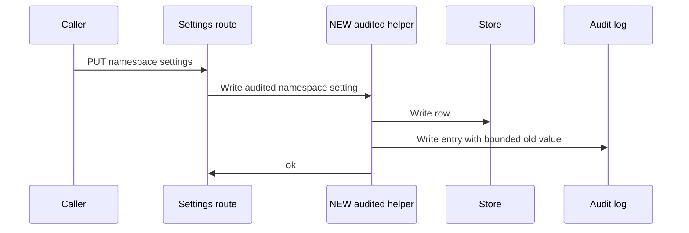

## Context

Invalid old filter values can carry large text into Change.Old. Sourcefilter and outputshare lack one audited write helper per dialect. Final purge must free blobs that the stack sweep skipped for a soft-deleted stack.

## Decisions

1. **Bounded old value.** Bound Change.Old through Record filter change: always store SHA-256 hex and byte length; store the kept prefix of the first 256 bytes only when old value length is 256 bytes or less; store no value bytes above that length; store no value bytes when the old value is not valid UTF-8; encode kept bytes as base64 in JSON.
2. **Audited helpers.** Add one audited namespace-setting write helper per dialect for sourcefilter and one for outputshare through Write audited namespace setting; both helpers write the setting row and the audit entry in the same transaction; shared bound logic lives in one unexported constructor; dialect helpers only bind SQL.
3. **Structure over check.** Make unaudited writes impossible by structure: the setting row write method stays unexported inside the store package and only Write audited namespace setting calls it; direct row writes from outside the package do not compile.

## Structure

Unexported boundedOld type with constructor newBoundedOld that takes raw bytes and returns SHA-256 hex, length, and kept prefix; only the constructor builds Change.Old for invalid filter values; unexported setting row writer called only by Write audited namespace setting.

## Risks

- Helper writes setting without audit entry.
- Purge leaves skipped blobs.

## Diagrams

After this change:

## Quality attributes

| Attribute | Target | Unit | Scope |
| --- | --- | --- | --- |
| storage growth | 256 | bytes max kept prefix | per audit Change.Old of invalid filter value |

## Contracts

**Audit Change**

- Invariant: Change.Old never holds more than 256 kept bytes of an invalid old filter value.
- Invariant: Change.Old always holds SHA-256 hex and byte length of an invalid old filter value.
- `Record filter change`: pre: Old filter value failed validation.. Post: Change.Old holds SHA-256 hex and byte length, plus kept prefix only when input length is 256 bytes or less..

**Namespace setting write**

- Invariant: Each sourcefilter and outputshare write goes through one audited helper per dialect.
- Invariant: A failed audit insert rolls back the setting row in the same transaction.
- `Write audited namespace setting`: pre: Caller holds namespace write grant.. Post: Setting row is stored.; One audit entry is stored with bounded old value..
