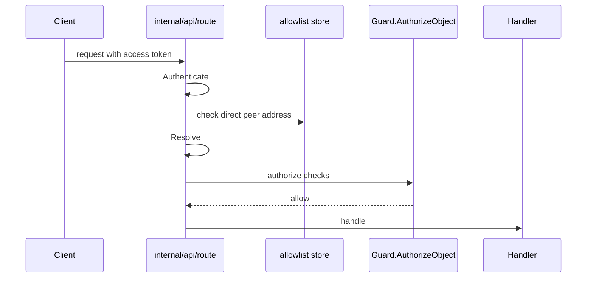
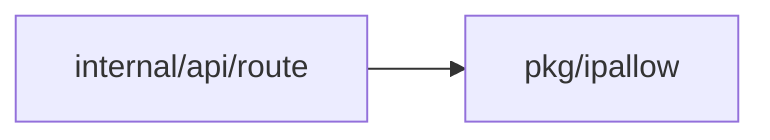
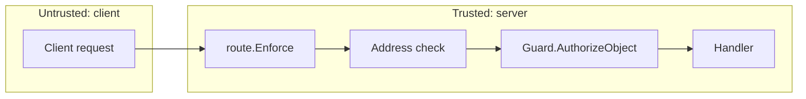

## Context

Three authorize paths exist: Guard.AuthorizeAll used by route.Enforce, Guard.AuthorizeObject, and own wrappers in runner, jobs and drift. Address checks repeat in callers. Main already refuses a duplicate variant name in checkedErrorVariants.

## Decisions

1. **Single guard path in route.Enforce.** Move the IP allowlist check into route.Enforce between Authenticate and Resolve on namespaced tool-neutral routes. Move runner, jobs and drift onto route.Enforce and delete their three address-check copies. Fold Guard.AuthorizeAll into the Guard.AuthorizeObject path so one entry point authorizes each route. Routes with no namespace skip the address check.

## Structure

Unexported enforce chain in internal/api/route with constructor route.Enforce that builds Authenticate, address check, Resolve, Guard.AuthorizeObject and handler in that fixed order; callers pass checks, and no new tool is added.

## Risks

- Runner, jobs or drift keeps a direct authorize call outside route.Enforce.
- Address check runs after Resolve and leaks existence of objects to denied addresses.

## Layers (defense in depth)

| Layer | Guard | Hostile test |
| --- | --- | --- |
| boundary check | Enforce checks the direct peer address against the namespace allowlist before Resolve and denies with the NEW error code route.address-forbidden. | Send a request from a denied address with a valid credential and confirm denial before handler work. |
| authorize at point of use | AuthorizeObject evaluates every check of the route and denies on unknown or missing verdict. | Call AuthorizeObject with an unknown check and confirm denial with an audit record. |
| fail closed | Any error in authenticate, address check, resolve or authorize denies the request and writes the denial to the audit log. | Inject a store error in the address lookup and confirm a closed denial, not a pass. |

## Diagrams

After this change:

Modules that the change touches, and their imports on main:

## Quality attributes

| Attribute | Target | Unit | Scope |
| --- | --- | --- | --- |
| latency | 2 | ms added budget for address check and single authorize path | namespaced tool-neutral route through route.Enforce |
| storage growth | 0 | new tables | installation |

## Threat model

Data flow and trust boundaries:

| Boundary | STRIDE | Threat | Layer | Guard | Hostile test |
| --- | --- | --- | --- | --- | --- |
| Client to route.Enforce | S | Spoofed principal or forged namespace reaches a runner, jobs or drift route. | boundary check | Enforce allows declared routes and methods and rejects malformed identity and address input. | Send a forged namespace field and a malformed address and confirm rejection. |
| Client to route.Enforce | S | Spoofed principal or forged namespace reaches a runner, jobs or drift route. | encode or contain | No caller input is interpolated into queries or paths; store placeholders and fixed route values. | Send address and namespace values with SQL and path characters and confirm containment. |
| Client to route.Enforce | S | Spoofed principal or forged namespace reaches a runner, jobs or drift route. | limit | Address lookup carries a timeout and a size limit on identity input. | Stall the allowlist read and confirm the request times out closed. |
| Client to route.Enforce | S | Spoofed principal or forged namespace reaches a runner, jobs or drift route. | authorize at point of use | Guard.AuthorizeObject checks the grant for the object at the point of use. | Send a valid token without the grant and confirm denial. |
| Client to route.Enforce | S | Spoofed principal or forged namespace reaches a runner, jobs or drift route. | fail closed | Any authenticate, address or authorize error denies and writes the denial to the audit log. | Force an address-store error and confirm a closed denial with an audit record. |
| Client to route.Enforce | E | Caller bypasses the address or authorize layer through a second guard path. | boundary check | One Enforce chain fixes the order Authenticate, address check, Resolve, Guard.AuthorizeObject. | Bypass a caller wrapper and confirm the same denial through Enforce. |
| Client to route.Enforce | E | Caller bypasses the address or authorize layer through a second guard path. | encode or contain | Denied address never reaches Resolve, so no object existence leaks. | Request a missing object from a denied address and confirm the identical address-forbidden answer. |
| Client to route.Enforce | E | Caller bypasses the address or authorize layer through a second guard path. | limit | Per-route checks carry no extra authority beyond the declared actions. | Request an action outside the route checks and confirm denial. |
| Client to route.Enforce | E | Caller bypasses the address or authorize layer through a second guard path. | authorize at point of use | Each moved route declares its authorization actions and object. | Call each moved route without the grant and confirm denial. |
| Client to route.Enforce | E | Caller bypasses the address or authorize layer through a second guard path. | fail closed | Unknown check or unknown verdict denies. | Pass an unknown check name and confirm denial with an audit record. |

## Contracts

**Guard**

- Invariant: One enforce path authorizes each moved route.
- `Guard.AuthorizeObject`: pre: Caller passes the authenticated principal and the checks of the route.. Post: One fail-closed verdict for the checks of the route..

**Enforce**

- Invariant: Address check runs between Authenticate and Resolve on namespaced tool-neutral routes.
- `route.Enforce`: pre: Route carries namespace identity for the address check.. Post: Denied address returns the NEW error code route.address-forbidden without Resolve or handler work..
