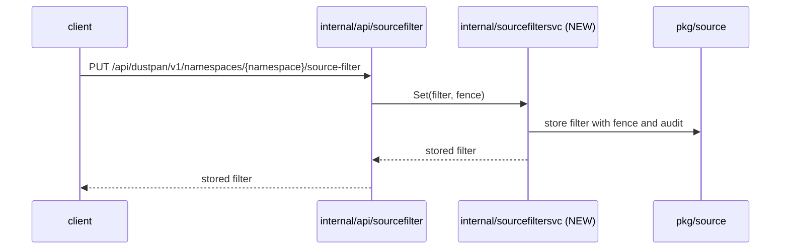

## Context

The source filter routes store a namespace filter, but no fetch path enforces it yet. The handler holds encode, audit and fence steps that belong in a service.

## Decisions

1. **Stored-only filter with service-owned writes.** Add NEW unexported type `service` in NEW package `internal/sourcefiltersvc` with NEW constructor `New`; only the NEW constructor `New` builds a valid value. The handler decodes the request and calls the NEW method `service.Set` and the NEW method `service.Get`, and holds no store port after the move. The reference page states stored-only until the fetch path lands. This change lands first; the audit action name is set by source-filter-routes-use-runner.

## Structure

NEW unexported type `service` in NEW package `internal/sourcefiltersvc` with NEW constructor `New`; the handler keeps only decode and the service call after the store port leaves the handler constructor.

## Risks

- An operator reads the old promise and expects fetches to obey the filter.

## Diagrams

After this change:

Modules that the change touches, and their imports on main:

New imports of this change (each one allowed by the module rules):

- `internal/api/sourcefilter` imports `internal/sourcefiltersvc (NEW)`

## Quality attributes

| Attribute | Target | Unit | Scope |
| --- | --- | --- | --- |
| none affected | Docs correction plus a handler-to-service move with no behavior or limit change |  |  |

## Change impact (computed from main)

Tests:

- `pkg/manuallock/manuallock_test.go` names `service.Get`
- `pkg/backup/run_before_restore_test.go` names `service.Get`
- `pkg/backup/restore_live_blob_internal_test.go` names `service.Get`

Docs pages:

- `docs/guides/s3-blobs.md:126` names `service.Get`
- `docs/guides/workload-identity.md:125` names `service.Get`
- `docs/reference/registry-api.md:203` names `service.Get`

ADRs:

- `docs/adr/0243-the-source-port-its-adapters-and-conformance.md` names `service.Get`
- `docs/adr/0030-backups-and-restore.md` names `service.Get`
- `docs/adr/0134-the-launcher-contract.md` names `service.Get`
