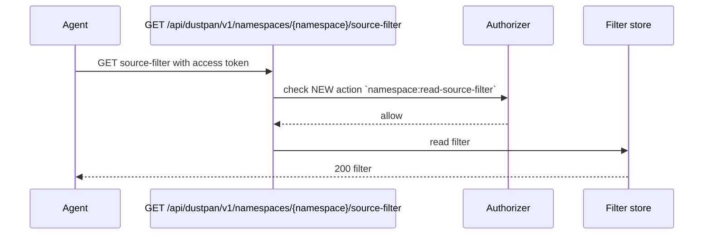

## Context

The source-filter routes authorize with runner actions while the filter holds ProtectedBranches, a future gate fact input. The handler logic moves to a service in source-filter-no-fetch-reads, so this action change lands there.

## Decisions

1. **Separate source-filter actions.** Add two namespace actions for the source filter and require them on GET and PUT. Write the audit entry with the manage action. Keep runner actions for runner pools and runners only. Each built-in role that carries a runner action for the same namespace scope also carries the matching new source-filter action, so current administrators keep access. Stored grants do not change and there is no alias: a custom grant that holds only runner actions loses source-filter access until a namespace administrator grants the new role.
2. **Migration and audit history.** Implement the action and audit change in the NEW internal source-filter service made by source-filter-no-fetch-reads, not in the handler it removes. Roles are code-defined, so installations get the new actions on built-in roles by upgrade with no numbered migration and no data rewrite. Old audit entries stay as written; readers query both action names over the cutover. The store write and the audit write keep the atomicity of the current source-filter path; the change does not add a new transaction shape.

## Structure

No new unexported type. The fix changes the declared authorization action strings in the NEW internal source-filter service made by source-filter-no-fetch-reads.

## Risks

- Grants that hold only runner actions lose read and write access to the source filter and must ask for the new grant.

## Layers (defense in depth)

| Layer | Guard | Hostile test |
| --- | --- | --- |
| authorize at point of use | Route requires the NEW action `namespace:read-source-filter` for GET and the NEW action `namespace:manage-source-filter` for PUT on the namespace object from the path. | PUT with only `namespace:manage-runners` gets 403 and changes nothing. |
| fail closed | Denial leaves stored state unchanged and the audit chain keeps old entries as written. | Refused PUT stores nothing; old entries that name `namespace:manage-runners` stay unchanged. |

## Diagrams

After this change:



## Quality attributes

| Attribute | Target | Unit | Scope |
| --- | --- | --- | --- |
| none affected | Authorization string change only; no latency or storage target changes. |  |  |

## Threat model

Data flow and trust boundaries:

```mermaid
flowchart LR
subgraph Internet[untrusted client]
C[Agent with access token]
end
subgraph Server[server trust boundary]
R[source-filter handler]
A[authorizer]
S[filter store]
end
C-->|GET PUT /namespaces/{namespace}/source-filter|R
R-->A
A-->S
```

| Boundary | STRIDE | Threat | Layer | Guard | Hostile test |
| --- | --- | --- | --- | --- | --- |
| Server trust boundary | E | A runner admin marks any branch protected and so satisfies a future approval rule. | boundary check | Handler binds the check to the namespace object from the path and requires the matching new source-filter action. | Send GET and PUT with runner-only grants and with a cross-namespace grant; expect 403 with no state change. |
| Server trust boundary | E | A runner admin marks any branch protected and so satisfies a future approval rule. | encode or contain | Branch names pass as JSON data only and the handler returns them without running markup. | Store a branch name with markup through setSourceFilter and read it back through getSourceFilter; expect the same text with no markup run. |
| Server trust boundary | E | A runner admin marks any branch protected and so satisfies a future approval rule. | limit | The handler applies the current server body limit to the PUT document. | Send an oversize PUT document; expect refusal with no state change. |
| Server trust boundary | E | A runner admin marks any branch protected and so satisfies a future approval rule. | authorize at point of use | Handler checks the NEW action `namespace:read-source-filter` or `namespace:manage-source-filter` on the namespace object at the point of use. | Send PUT with only `namespace:manage-runners`; expect 403 with no state change. |
| Server trust boundary | E | A runner admin marks any branch protected and so satisfies a future approval rule. | fail closed | Denial leaves the stored filter unchanged and old audit entries stay as written. | Send refused PUT then read the filter; expect the old filter and no success entry. |

## Contracts

**source.Filter**

- Invariant: Filter belongs to one namespace.
- Invariant: ProtectedBranches holds branch names only.
- `getSourceFilter`: pre: Caller holds the NEW action `namespace:read-source-filter` on the namespace.. Post: Returned filter equals the stored filter..
- `setSourceFilter`: pre: Caller holds the NEW action `namespace:manage-source-filter` on the namespace.. Post: Stored filter equals the accepted input..
