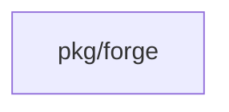
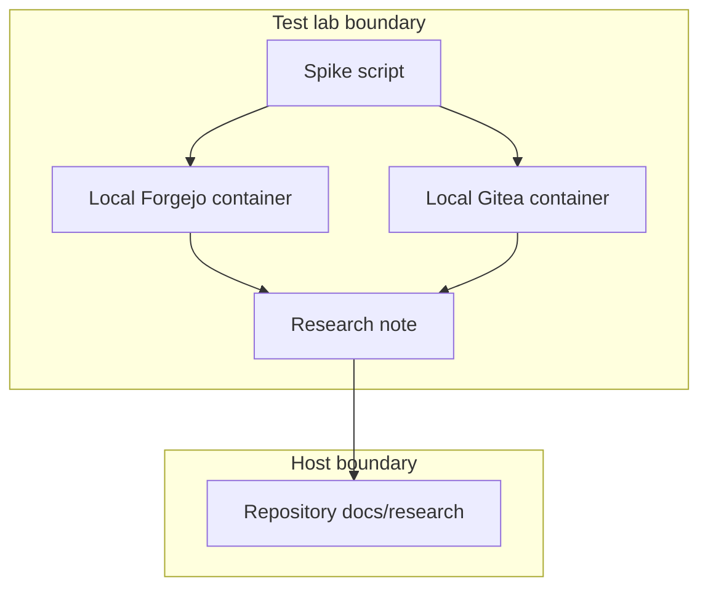

## Context

The Forge port in pkg/forge with its forgetest conformance suite needs validation against Forgejo, Gitea, and a bridge shape before more adapters depend on it.

## Decisions

1. **Throwaway spike with a single research note.** Probe a local Forgejo container and Gitea with throwaway code kept outside pkg/forge and deleted after the note, then record per-method support with the API call for each, the five named gaps, the bridge sketch and verdict, and the post to #886 in one NEW research note at docs/research/forge-small-forges-spike.md.

## Structure

No new unexported type; the spike keeps throwaway code outside pkg/forge and writes the NEW docs/research/forge-small-forges-spike.md note only.

## Risks

- Prototype code leaks into production paths; mitigation: it lives in NEW /var/tmp/forge-spike/ only and is deleted before close.
- Findings go stale when forge APIs change; mitigation: the NEW note records the container pin, API versions and fake credential kind.

## Diagrams

Modules that the change touches, and their imports on main:

## Quality attributes

| Attribute | Target | Unit | Scope |
| --- | --- | --- | --- |
| none affected | Research note only; no runtime path changes |  |  |

## Threat model

Data flow and trust boundaries:

| Boundary | STRIDE | Threat | Layer | Guard | Hostile test |
| --- | --- | --- | --- | --- | --- |
| Test lab boundary | S | A spoofed forge container tricks the spike into sending credentials to an attacker host. | boundary check | Allow only loopback container addresses with pinned images recorded in the note. | Point the spike at a non-loopback host and show it refuses before any credential is sent. |
| Test lab boundary | S | A spoofed forge container tricks the spike into sending credentials to an attacker host. | encode or contain | Use fake credentials only and never log token text; redact secrets in output. | Inject a fake token with header characters and show it is never written to logs or the note. |
| Test lab boundary | S | A spoofed forge container tricks the spike into sending credentials to an attacker host. | limit | Run with a short probe timeout and a small request cap per method. | Point the spike at a hanging endpoint and show it stops within the timeout. |
| Test lab boundary | S | A spoofed forge container tricks the spike into sending credentials to an attacker host. | authorize at point of use | Use a throwaway local account with reader scope only for the probe. | Attempt a write with the probe credential and show the forge refuses it. |
| Test lab boundary | S | A spoofed forge container tricks the spike into sending credentials to an attacker host. | fail closed | Abort the probe on any unexpected response shape and record unsupported. | Return a malformed webhook payload and show the spike records unsupported and stops that case. |
| Test lab boundary | T | A tampered webhook payload corrupts the per-method support finding. | boundary check | Check webhook URL, event type, and signature against an allowlist before accepting. | Send a webhook with a wrong signature and show the receiver rejects it. |
| Test lab boundary | T | A tampered webhook payload corrupts the per-method support finding. | encode or contain | Parse webhook JSON with strict decode and store raw bytes for review. | Send a webhook with an unknown field and oversized body and show it is rejected. |
| Test lab boundary | T | A tampered webhook payload corrupts the per-method support finding. | limit | Limit webhook receiver lifetime to the probe run and cap body size. | Send a slow oversized webhook and show the receiver times out and refuses it. |
| Test lab boundary | T | A tampered webhook payload corrupts the per-method support finding. | authorize at point of use | Accept webhooks only for the probe repository owned by the throwaway account. | Send a webhook for another repository and show it is refused. |
| Test lab boundary | T | A tampered webhook payload corrupts the per-method support finding. | fail closed | Deny on signature or shape error and mark the method unsupported. | Send a tampered payload with a valid shape and show it is denied and logged. |
| Host boundary | I | A real credential leaks into the research note or the shell history. | boundary check | Allow only NEW docs/research/forge-small-forges-spike.md path with no secret text. | Attempt to write a token into the note and show the check refuses it. |
| Host boundary | I | A real credential leaks into the research note or the shell history. | encode or contain | Write the note as plain text with API calls and versions, never credential values. | Scan the written note for the fake credential value and show no match. |
| Host boundary | I | A real credential leaks into the research note or the shell history. | limit | Keep the note to the per-method table, gaps, sketch, and verdict with no dumps. | Add a full response dump to the draft and show review removes it. |
| Host boundary | I | A real credential leaks into the research note or the shell history. | authorize at point of use | Publish the note only after showing prototype deletion and container removal. | Skip the deletion step and show the close check fails. |
| Host boundary | I | A real credential leaks into the research note or the shell history. | fail closed | Refuse to close the spike while throwaway code or containers remain. | Leave NEW /var/tmp/forge-spike/ in place and show the check fails. |
