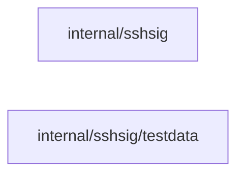
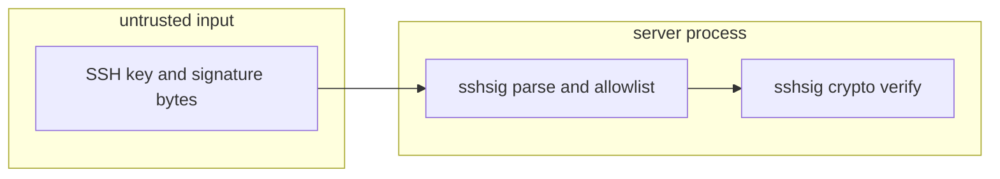

## Context

internal/sshsig verifies step-up SSH signatures. It accepts only ed25519 today and refuses each other type fail closed.

## Decisions

1. **ECDSA verify structure.** Add ECDSA P-256 Verify with SSH mpint r and s, strict range check 1 <= r,s < N, strict mpint padding check, P-256 point check including point on curve and not at infinity, SHA-256 digest. Point and wire checks run before the ECDSA verify call.
2. **sk-ECDSA authenticator rule.** Add sk-ECDSA Verify with the same authenticator-data rule as sk-ed25519: user presence required, only UP and UV flags allowed, message sha256(app) || flags || counter || sha256(data) hashed with SHA-256. The expected application string is the step-up namespace value passed to Verify; a mismatch fails with ErrInvalid. Verify holds no counter state and makes no replay claim.
3. **RSA verify limits.** Add RSA Verify for ssh-rsa keys of 3072 to 8192 bits only, exponent odd with 3 <= e <= 4294967295, signature types rsa-sha2-256 and rsa-sha2-512 only. Check wire length limits, then modulus size and exponent, then signature length and value below modulus, then key and signature label match, before any RSA verify call. Refuse ssh-rsa SHA-1 signatures, short keys, oversize keys, and out-of-range exponents with ErrInvalid.

## Structure

Keep unexported verifier dispatch by key type with constructors that check invariants: parsed ecdsaKey holds a validated P-256 point, parsed rsaKey holds modulus bit length and exponent within bounds. Only the constructor makes each value.

## Risks

- Wrong authenticator-data construction accepts forged sk-ECDSA signatures.
- Loose mpint or range check accepts malleable ECDSA signatures.
- Missing RSA size bound allows weak keys.

## Layers (defense in depth)

| Layer | Guard | Hostile test |
| --- | --- | --- |
| refuse unknown key and signature types | Allowlist check on SSH key type and RSA signature type at parse. | Send dsa, ssh-rsa SHA-1, and unknown key types; each answers ErrInvalid. |
| refuse malformed values | Strict point, mpint, r and s range, modulus size, and exponent size checks before crypto verify. | Send bad point, zero r or s, r equal to order, bad mpint padding, short modulus; each answers ErrInvalid. |
| limit crypto cost | Upper bound 8192 bits on RSA modulus and 32-bit bound on exponent, fixed SHA-256 or SHA-512 digest, no SHA-1 path. | Send 16384-bit modulus, exponent above 4294967295, and rsa-sha2-256 label mismatch; each answers ErrInvalid. |

## Diagrams

Modules that the change touches, and their imports on main:

## Quality attributes

| Attribute | Target | Unit | Scope |
| --- | --- | --- | --- |
| verification latency | 500 | ms max | one sshsig Verify call at 8192-bit RSA |

## Threat model

Data flow and trust boundaries:

| Boundary | STRIDE | Threat | Layer | Guard | Hostile test |
| --- | --- | --- | --- | --- | --- |
| untrusted input to sshsig parse | S | Spoofed key type or signature label bypasses verification. | boundary check | Allowlist of five key types and two RSA signature types; each other value returns ErrInvalid. | Send dsa and ssh-rsa SHA-1 labels; each returns ErrInvalid. |
| untrusted input to sshsig parse | S | Spoofed key type or signature label bypasses verification. | encode or contain | Strict SSH wire decode with length limits; malformed wire returns ErrInvalid. | Send truncated key blob and oversize string length; each returns ErrInvalid. |
| untrusted input to sshsig parse | S | Spoofed key type or signature label bypasses verification. | limit | Upper bound 8192 bits on RSA modulus and 32-bit bound on exponent; oversize input returns ErrInvalid. | Send oversize modulus and huge exponent; each returns ErrInvalid. |
| untrusted input to sshsig parse | S | Spoofed key type or signature label bypasses verification. | authorize at point of use | No grant follows from parse alone; verify must still succeed. | Send well-formed but unsigned key; verify returns ErrInvalid. |
| untrusted input to sshsig parse | S | Spoofed key type or signature label bypasses verification. | fail closed | Unknown type fails closed with ErrInvalid and no fallback. | Remove the allowlist branch; hostile-type test fails. |
| server process crypto verify | T | Tampered signature, flags, or key values forge a step-up. | boundary check | P-256 point validation, mpint padding check, and 1 <= r,s < N range check before verify. | Send bad point, zero r, r equal to order, bad padding; each returns ErrInvalid. |
| server process crypto verify | T | Tampered signature, flags, or key values forge a step-up. | encode or contain | Fixed digest construction for sk-ECDSA and fixed hash for RSA; no caller-supplied hash. | Send mismatched digest input; verify returns ErrInvalid. |
| server process crypto verify | T | Tampered signature, flags, or key values forge a step-up. | limit | RSA modulus 3072 to 8192 bits plus exponent bound; ECDSA fixed P-256 curve. | Send 2048-bit SmallRSA vector and 16384-bit modulus; each returns ErrInvalid. |
| server process crypto verify | T | Tampered signature, flags, or key values forge a step-up. | authorize at point of use | UP required and only UP and UV flags allowed for sk keys. | Send flags without UP and flags with extra bits; each returns ErrInvalid. |
| server process crypto verify | T | Tampered signature, flags, or key values forge a step-up. | fail closed | Crypto failure returns ErrInvalid; no acceptance on error. | Remove the verify-error branch; tampered-signature test fails. |

## Contracts

**sshsig verifier**

- Invariant: Only the five listed key types verify.
- Invariant: Each other type fails closed with stepup.ErrInvalid.
- Invariant: RSA moduli below 3072 bits or above 8192 bits fail closed.
- `Verify`: pre: Key type is one of the allowlist.; Signature bytes are present.. Post: Valid ECDSA, sk-ECDSA, or RSA Verify returns a public key.; Invalid input returns stepup.ErrInvalid..
