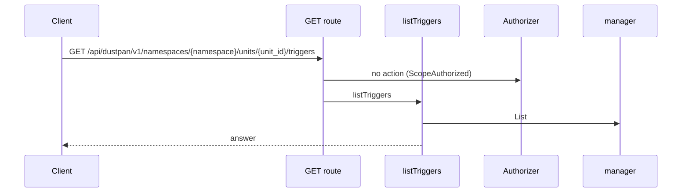
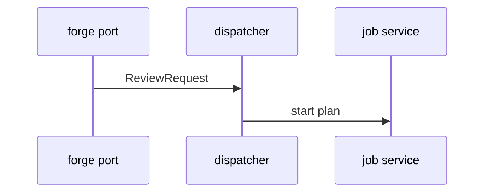
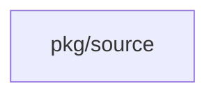
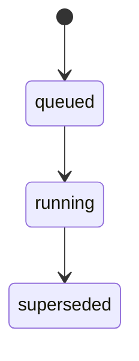
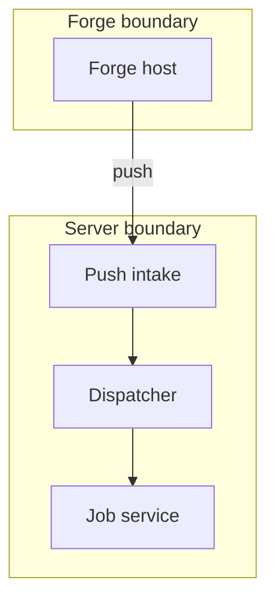

## Context

The Forge port calls a new method Dispatcher.ReviewRequest on the existing trigger.Dispatcher port. The dispatcher starts plans only through the job service.

## Decisions

1. **Paths filter and push dispatcher.** Trigger gains an unexported paths field that only NewTrigger sets. Empty input defaults to the cleaned working directory. An empty, absolute or escaping pattern fails the constructor. The dispatcher keeps triggers of the same repository and branch whose paths touch the changed files, refuses a fork push with an audit entry, and starts the newer plan before it cancels the older one.

## Structure

Trigger holds an unexported paths field that only NewTrigger sets, so no stored trigger has an open filter.

## Risks

- A fork push must never run author code.
- A truncated changed-file list must never skip a plan silently.

## Layers (defense in depth)

| Layer | Guard | Hostile test |
| --- | --- | --- |
| boundary check | NewTrigger rejects an invalid paths pattern. | Save a trigger with dot-dot, absolute and empty patterns and show the refusal. |
| fail closed | The dispatcher refuses a fork push or a missing fork flag with an audit entry. | Send a fork push and show that no plan starts. |

## Diagrams

Today: `GET /api/dustpan/v1/namespaces/{namespace}/units/{unit_id}/triggers` on main (from the route table and the handler body, route row internal/api/triggers/routes.go:93, handler internal/api/triggers/serve.go:123).

After this change:

Modules that the change touches, and their imports on main:

New imports of this change (each one allowed by the module rules):

- `pkg/forge` imports `pkg/trigger`
- `pkg/trigger` imports `pkg/job`

States and transitions after this change:

## Quality attributes

| Attribute | Target | Unit | Scope |
| --- | --- | --- | --- |
| Push to plan start latency | 5 | seconds at p95 | one push that matches up to 20 units |

## Threat model

Data flow and trust boundaries:

| Boundary | STRIDE | Threat | Layer | Guard | Hostile test |
| --- | --- | --- | --- | --- | --- |
| Forge boundary | E | A fork push runs author code. | boundary check | NewTrigger and the intake accept only an allowlisted paths pattern and a known fork flag. | Save a trigger with a dot-dot pattern and send an event with no fork flag; both are refused. |
| Forge boundary | E | A fork push runs author code. | encode or contain | Changed file paths are cleaned and matched with a containment check against the working directory. | Send a changed file named with dot-dot segments and show that it matches no trigger. |
| Forge boundary | E | A fork push runs author code. | limit | The open-job limit and a cap per push bound the plans of one push. | Send a push that touches 500 units and show that the plans stay within the cap. |
| Forge boundary | E | A fork push runs author code. | authorize at point of use | The job service checks the run-as principal at each start. | Start a plan for a principal with no start grant and show the refusal. |
| Forge boundary | E | A fork push runs author code. | fail closed | Refuse a fork push or a missing fork flag with an audit entry. | Send a fork push and show that no plan starts. |

## Contracts

**trigger.Trigger**

- Invariant: Stored paths are normalized and never empty.
- `NewTrigger`: pre: Paths patterns do not escape the repository root.. Post: Stored paths equal the normalized input or the default..

## Failure modes

| Step | Failure | Retry | State after |
| --- | --- | --- | --- |
| Replace the older plan | The cancel of the older plan fails. | No retry; the newer plan proceeds. | The newer plan is queued. |
