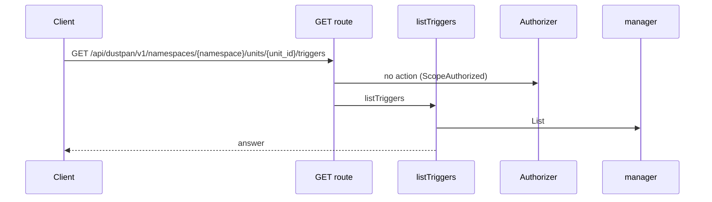
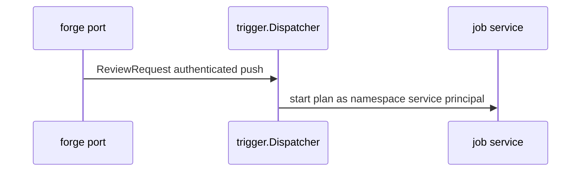
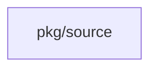
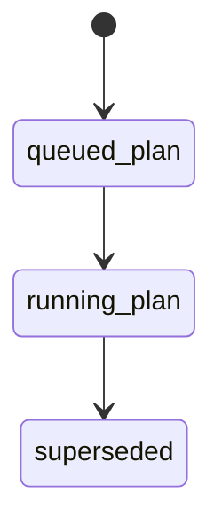
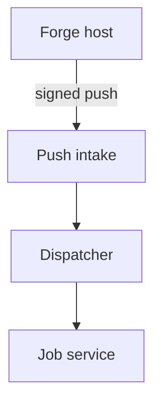

## Context

Push intake stays in the trigger domain and starts plans only through the job service. The intake is a new method Dispatcher.ReviewRequest on the existing trigger.Dispatcher port; the Forge port calls it. The dispatcher matches units in the same namespace under the namespace fence.

## Decisions

1. **Paths filter and push dispatcher.** Add Dispatcher.ReviewRequest to the trigger.Dispatcher port. Extend Trigger with an unexported paths field set only by NewTrigger; empty input defaults to the cleaned working directory of the code location, and an empty or escaping pattern fails the constructor. The dispatcher accepts only authenticated events, matches repository and branch, matches the union of changed files, refuses a fork push or a missing fork flag with an audit entry, starts each plan as the namespace service principal with source kind forge, starts the newer plan before it cancels the older one, and serializes supersede steps per namespace.
2. **Credential path for author code.** Unit profile credentials come through the profile attachment authority and not through the starter token. The namespace service principal holds only the stored start-of-plan grant. Output reads use the last saver of the trigger. A stale attachment fails the job with a named error and no secret in the log.

## Structure

Trigger holds an unexported paths field set only by NewTrigger; empty input defaults to the normalized working directory and any invalid pattern fails the constructor so no stored trigger holds an open filter.

## Risks

- A fork push must never run author code with unit profile credentials.
- A spoofed push event must never start a plan.
- A truncated changed-file list must never silently skip or misroute a plan.

## Layers (defense in depth)

| Layer | Guard | Hostile test |
| --- | --- | --- |
| boundary check | Intake accepts only authenticated events with delivery-ID deduplication. | Send a forged push and a replayed push to the intake and show no plan starts. |
| fail closed | Dispatcher refuses a fork push and a missing fork flag with an audit entry. | Send a fork push and an empty-flag push with other checks bypassed and show no plan starts. |
| fail closed | Job start checks the fork flag again before any profile open. | Call job start with a missing fork flag directly and show denial with no profile open. |
| authorize at point of use | Job service checks the namespace fence, plan-only port, open-job limit and start grant. | Call start with a cross-namespace unit and with an apply operation and show a denial. |

## Diagrams

Today: `GET /api/dustpan/v1/namespaces/{namespace}/units/{unit_id}/triggers` on main (from the route table and the handler body, route row internal/api/triggers/routes.go:93, handler internal/api/triggers/serve.go:123).

After this change:

Modules that the change touches, and their imports on main:

New imports of this change (each one allowed by the module rules):

- `pkg/forge` imports `pkg/trigger`
- `pkg/trigger` imports `pkg/job`

States and transitions after this change:

## Quality attributes

| Attribute | Target | Unit | Scope |
| --- | --- | --- | --- |
| push-to-plan dispatch latency | 30 | s | one review-request push to matching units |

## Threat model

Data flow and trust boundaries:

| Boundary | STRIDE | Threat | Layer | Guard | Hostile test |
| --- | --- | --- | --- | --- | --- |
| Forge boundary | S | A spoofed push starts author code with unit profile credentials. | boundary check | Accept only authenticated events with delivery-ID deduplication. | Send a forged and a replayed push and show no start. |
| Forge boundary | S | A spoofed push starts author code with unit profile credentials. | fail closed | Refuse fork pushes and missing flags with an audit entry. | Send a fork push with other checks bypassed and show no start. |

## Contracts

**trigger.Trigger**

- Invariant: One unit owns the trigger.
- Invariant: Stored paths filter is normalized and never empty.
- `NewTrigger`: pre: Paths patterns do not escape the repository root.. Post: Stored paths equal normalized input or the cleaned working directory default..

## Failure modes

| Step | Failure | Retry | State after |
| --- | --- | --- | --- |
| Replace older plan on newer push | Cancel of the older plan fails. | No retry; fail the older plan and proceed with the newer plan. | Older plan failed, newer plan queued. |
