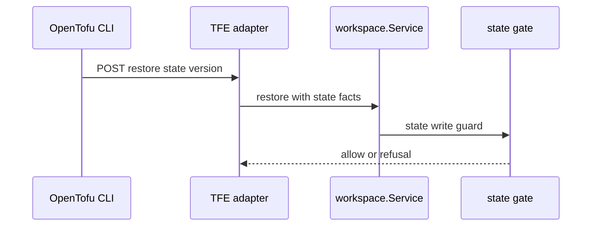
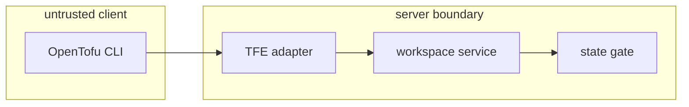

## Context

The TFE restore refuses state that is not the exact envelope. Several callers use the loose IsClientEncrypted, so an upload accepts look-alikes.

## Decisions

1. **One strict check.** IsClientEncrypted in pkg/workspace/tofu_state.go allows exactly serial, lineage, meta, encrypted_data and encryption_version with their kinds. A separate unexported loose reader serves stored documents.
2. **Delete limit branch.** Delete the ErrLimit branch in stateUnreadable in internal/api/stategate/stategate.go because gate.Code ranks gate.limit first.
3. **Duplicate restore waits.** Code of Service.answerDuplicateRestore does not change until the PM decides the open question.

## Structure

One exported strict check in pkg/workspace/tofu_state.go plus one unexported loose reader. Only the reader sees stored documents.

## Risks

- New uploads of look-alikes are refused.
- Test fixtures with bare encrypted_data need an update.

## Layers (defense in depth)

| Layer | Guard | Hostile test |
| --- | --- | --- |
| boundary check | Strict five-member allowlist in IsClientEncrypted. | TestClientEncryptionPathsAgree posts bare encrypted_data and expects refusal. |
| fail closed | An unreadable state refuses the write and writes no version. | A corrupt envelope at restore gives invalid state and no new version. |

## Diagrams

After this change:

## Quality attributes

| Attribute | Target | Unit | Scope |
| --- | --- | --- | --- |
| none affected | Small hardening with no latency or storage target change. |  |  |

## Threat model

Data flow and trust boundaries:

| Boundary | STRIDE | Threat | Layer | Guard | Hostile test |
| --- | --- | --- | --- | --- | --- |
| server boundary | T | A look-alike encrypted document passes upload and reaches restore. | boundary check | Strict five-member allowlist. | TestClientEncryptionPathsAgree posts look-alikes. |
| server boundary | T | A look-alike encrypted document passes upload and reaches restore. | encode or contain | Fixed JSON decode of the envelope. | An extra-member document is refused. |
| server boundary | T | A look-alike encrypted document passes upload and reaches restore. | limit | State size limit before fact fill. | An over-limit state gives gate.limit. |
| server boundary | T | A look-alike encrypted document passes upload and reaches restore. | authorize at point of use | State write guard on the restore route. | A restore without the grant is denied. |
| server boundary | T | A look-alike encrypted document passes upload and reaches restore. | fail closed | An unreadable state writes no version. | A corrupt envelope gives no new version. |

## Contracts

**workspace.StateVersion**

- Invariant: Each state version keeps one lineage and one serial.
- `IsClientEncrypted`: pre: Input is the raw bytes of a new state document.. Post: Returns true only for the exact five-member envelope..
