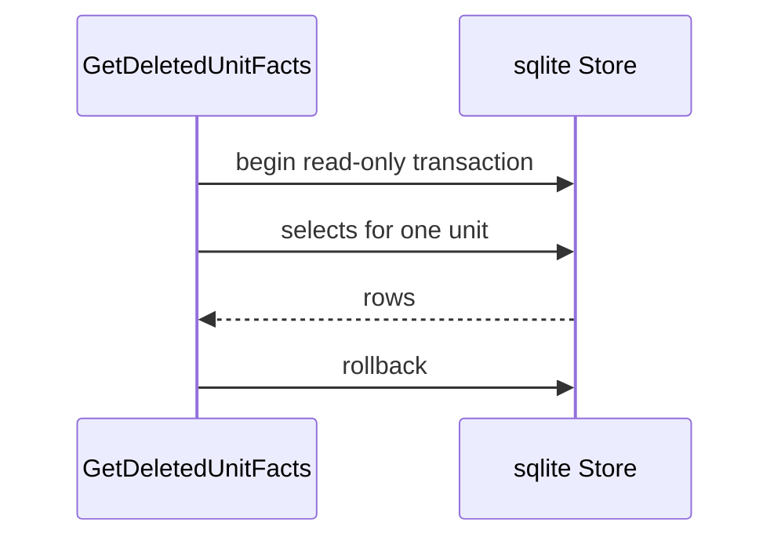
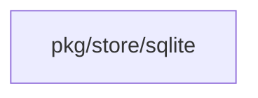
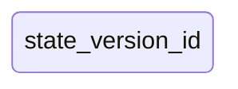
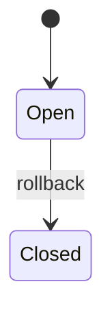

## Context

The state.write gate reads deleted-unit facts from SQLite. Separate reads under a shared lock do not give a snapshot. Two small cleanups ride along: one start-up log and one rollback pattern.

## Decisions

1. **One snapshot read per call.** GetDeletedUnitFacts opens one read-only SQLite transaction at entry, runs every select on it, then rolls back before return. The transaction never leaves the method.
2. **No atomic check-and-write.** The fact read and the gated write stay separate steps. The snapshot removes mixed rows inside the read only.
3. **Fail closed on read failure.** A failed read returns the store error and no partial facts. When a select and the rollback both fail, the method returns the select error.
4. **Existing settings with deferred close.** The read uses the existing connection settings. A deferred close runs on success, on error and on panic.
5. **One fixed start-up log line.** Log one INFO line per start when the gate service is absent, then keep the current no-gate path. A log failure never blocks start.
6. **Explicit rollback branch.** Replace the blank-assign rollback pattern with an explicit branch on the touched fact-read path only.

## Structure

An unexported helper on the SQLite store takes the open read-only transaction. Only the GetDeletedUnitFacts entry path opens it, and its deferred close releases it, so separate reads cannot bypass the snapshot.

## Risks

- A held read transaction can delay a writer for the short fact read; no transaction is held across calls.

## Diagrams

After this change:

Modules that the change touches, and their imports on main:

States on main in the touched packages:

States and transitions after this change:

## Quality attributes

| Attribute | Target | Unit | Scope |
| --- | --- | --- | --- |
| snapshot isolation | 1 | read-only transaction per call | SQLite GetDeletedUnitFacts call |
| start-up log volume | 1 | log line per start | server start with no gate service |

## Failure modes

| Step | Failure | Retry | State after |
| --- | --- | --- | --- |
| Read deleted-unit facts inside one read-only transaction. | Begin, select, or rollback fails, or the context is canceled. | Return the store error with no partial facts; the caller retries the write as a new call. | Transaction closed; no facts returned. |
| Log one INFO line at start when the gate service is absent. | Log write fails. | No retry; continue start on the no-gate path. | Server started with no gate service. |
| Branch on the rollback error. | Rollback reports an error. | Return the select error if a select failed, else the rollback error. | Transaction closed; first error returned. |

## Change impact (computed from main)

Tests:

- `pkg/dustpan/stateguard_internal_test.go` names `GetDeletedUnitFacts`
