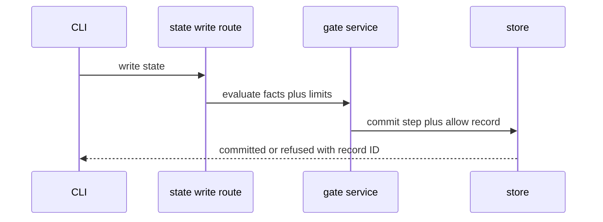
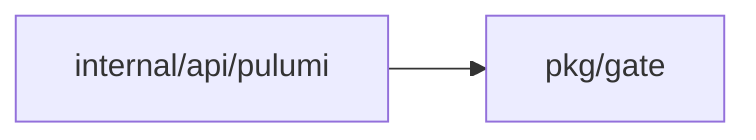
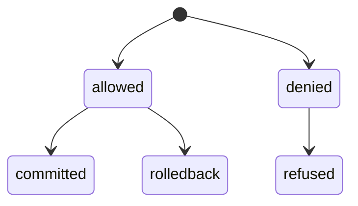
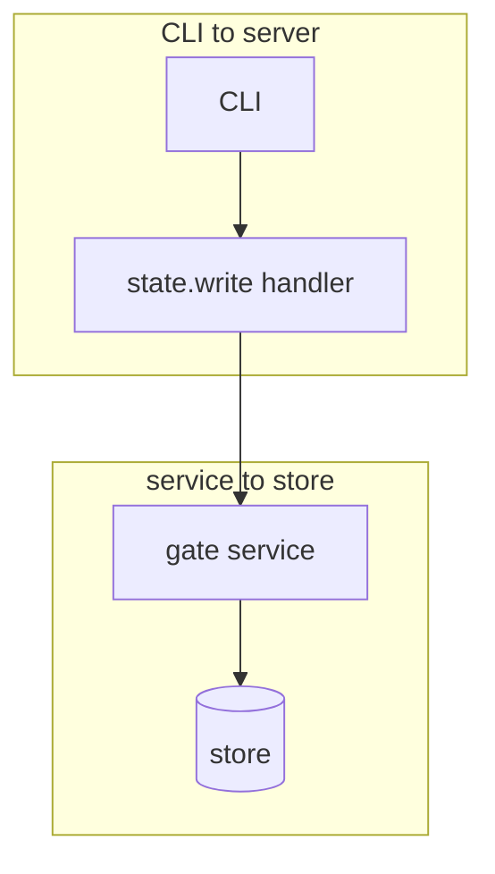

## Context

The state.write guard, record writer and access check live in pkg/gate.

## Decisions

1. **Facts from the states.** Build facts from the old and new state of the operation. An unreadable or client-encrypted body gives available false with a reason.
2. **Records.** Write the allow record with the step. Write a refusal record in its own transaction. If it cannot commit, fail closed with gate.unavailable.
3. **Limits.** Wire the limited authorizer on every route for all object kinds. Cap counted resources at 10000 and fail threshold comparisons closed above it.

## Structure

The unexported guard type of pkg/gate is built only by its constructor, which checks that the fact schema, the record store and the authorizer are set.

## Risks

- Large states raise fact build time; the cap is 10000 resources.
- A concurrent write changes the stored state; the fence rolls back the step and its record.

## Layers (defense in depth)

| Layer | Guard | Hostile test |
| --- | --- | --- |
| port adapter | The fact builder maps encrypted bodies to available false and caps counts. | Send a client-encrypted state and a 20000-resource state. |
| service | The service writes step and allow record in one transaction. | Lose the fence before commit; nothing commits. |
| HTTP handler | The handler runs the limited authorizer. | Call a route with a forbid limit; it returns 403 gate.limited. |

## Diagrams

After this change:

Modules that the change touches, and their imports on main:

New imports of this change (each one allowed by the module rules):

- `internal/api/tfe` imports `pkg/gate`

States on main in the touched packages:

States and transitions after this change:

## Quality attributes

| Attribute | Target | Unit | Scope |
| --- | --- | --- | --- |
| counted resources per evaluation | 10000 | entries | state.write fact document |

## Threat model

Data flow and trust boundaries:

| Boundary | STRIDE | Threat | Layer | Guard | Hostile test |
| --- | --- | --- | --- | --- | --- |
| CLI to server | E | A caller with grants but a forbid access limit writes state. | boundary check | The handler allowlists the operation kind. | Send an unknown kind; it is rejected. |
| CLI to server | E | A caller with grants but a forbid access limit writes state. | encode or contain | The record holds facts and a SHA-256, no raw state. | Inspect the record for raw bytes. |
| CLI to server | E | A caller with grants but a forbid access limit writes state. | limit | Counted resources cap at 10000. | Send 20000 resources; no panic. |
| CLI to server | E | A caller with grants but a forbid access limit writes state. | authorize at point of use | The limited authorizer runs before the call. | Call with a forbid limit; 403 gate.limited. |
| CLI to server | E | A caller with grants but a forbid access limit writes state. | fail closed | A record store failure gives gate.unavailable. | Break the record store; 503 and no state change. |

## Contracts

**gate decision record**

- Invariant: An allow record commits only with its step.
- `State facts from both states`: pre: The caller holds the old and new states.. Post: The facts hold state.available and a reason when the body is missing..

## Failure modes

| Step | Failure | Retry | State after |
| --- | --- | --- | --- |
| Commit step with allow record | Fence lost | No retry; roll back. | No step and no record committed. |
| Write refusal record | Store write fails | No retry; gate.unavailable. | No state changed. |

## Change impact (computed from main)

Tests:

- `pkg/gate/gate_test.go` names `gate.ErrRuleFailed`
- `pkg/gate/statewrite_test.go` names `gate.ErrRuleFailed`
- `internal/policy/policytest/mem_test.go` names `gate.ErrRuleFailed`

ADRs:

- `docs/adr/0114-the-policy-port-and-its-default-adapters.md` names `gate.ErrRuleFailed`
- `docs/adr/0112-blueprints-the-document-versions-and-expr.md` names `gate.ErrRuleFailed`
- `docs/adr/0230-gate-configuration-actions-routes-errors-and-audit.md` names `gate.ErrRuleFailed`
